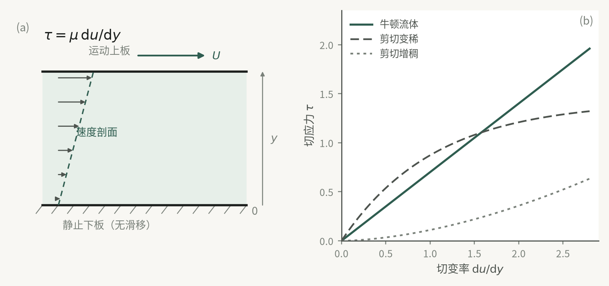
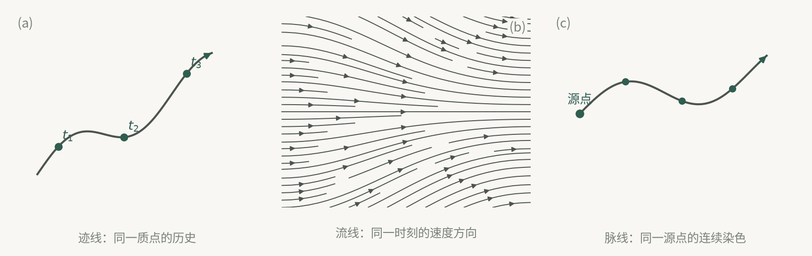

## 本章的两条线索

本章没有一上来就给出基本方程，而是先回答两个更前置的问题：**研究对象在什么意义上可以当作连续体来处理**，以及**用什么语言把它的运动记录下来**。

前半部分（1.1–1.3）从“流体在静止时不能承受剪切力”这一力学判据出发，依次建立连续介质模型、密度与压缩性、粘性与导热性。这些量（$\rho$、$\mu$、$k$、$K$、$\beta$）刻画的是**流体作为物质的身份**，与流动状态无关，只随物质种类和当地 $p$、$T$ 变化。

后半部分（1.4–1.8）则从连续介质假设的一个直接推论出发——“任一瞬时、任一空间点上恰有一个流体质点”——建立欧拉场描述、随体导数、几何图像、微团运动分解和应力状态。这一半准备的是**描述运动的语言**，其中的量（$u,v,w$、$\partial u/\partial y$、$\nabla\cdot\boldsymbol V$、$\sigma_{ij}$）都是时空的函数。

把这两条线分清，就不会把“粘性”与“粘性切应力”、“不可压缩流体”与“不可压缩流动”混为一谈。

## 1. 流体的力学身份：静止时不能承受剪切力

**这一节要解决的问题**：凭什么把液体和气体归为一类，又凭什么把它们与固体区分开？

宏观表象上的差别是直观的：一定量的固体有确定的几何外形和体积，不易变形；一定量的液体没有确定形状，易变形。但这只是现象描述。物理上的解释在分子层面：同体积下流体所含分子数远少于固体，分子间隙大、分子间作用力小、无规则热运动强烈，因而易流动。

真正可以拿来做判据的是力学层面的差异：

- **固体**在静止时也能承受剪切力，它通过微小变形产生抗力，达到平衡后只要剪切力不变就不再继续变形——固体抵抗的是“变形量”。
- **流体**在静止时不能承受剪切力，任何微小剪切力只要持续作用，它就连续不断地变形——流体抵抗的是“变形速率”。

由此得到本章的第一个定义：**在任何微小剪切力的持续作用下能够连续不断变形的物质称为流体**。注意这个定义里的“持续”和“连续不断”两个词，它们预示了后面粘性定律中出现的是速度梯度 $\mathrm du/\mathrm dy$ 而不是位移梯度。

液体与气体虽同属流体，仍有区别需要记住：液体一般占有固定体积，容器大于液体体积时存在**自由液面**；气体则完全没有这一特性。

## 2. 连续介质假设：让流体变成“场”的前提

**这一节要解决的问题**：流体由大量离散分子组成，宏观方程凭什么对“点”写导数？

教材用密度的极限过程来建立模型。在 $t$ 时刻取包含 $P(x,y,z)$ 点的微小体积 $\Delta\tau$，其中质量 $\Delta m$，平均密度 $\bar\rho=\Delta m/\Delta\tau$。不断改变 $\Delta\tau$ 会发现：

- 当 $\Delta\tau$ 缩小到某个极限体积 $\Delta\tau_0$ 时，$\bar\rho$ 趋于确定值 $\rho$，且不再随 $\Delta\tau$ 增大而变化——此时分子个性不再起作用；
- 当 $\Delta\tau<\Delta\tau_0$ 时，$\bar\rho$ 随机波动、无确定极限——体积内分子数太少，分子随机进出对 $\Delta m$ 影响显著。

$\Delta\tau_0$ 因此具有双重性格：**宏观上足够小**，可视为没有空间尺寸的几何点；**微观上足够大**，包含足够多分子，使分子个别行为对宏观特性影响可忽略，空间与时间上的统计平均有确定意义和数值。

定义：把极限体积 $\Delta\tau_0$ 内所有流体分子的总体称为**流体质点**；认为流体是由无限多连续分布的流体质点组成的物质——这就是**连续介质假设**。由它，密度可写成

$$\rho=\lim_{\Delta\tau\to\Delta\tau_0}\frac{\Delta m}{\Delta\tau}=\frac{\mathrm dm}{\mathrm d\tau},$$

且是位置与时间的连续函数，直角坐标下 $\rho=\rho(x,y,z,t)$。进一步，全部宏观物理量（速度、压强、密度、温度）都是时空连续函数，可以对其使用连续函数与场论的解析方法。

**适用范围有明确判据**。教材给出 $d\gg l$ 与 $L\gg d$：$d$ 是极限体积的特征尺度（如取 $d=10^{-3}\,\mathrm{cm}$，则 $\Delta\tau_0\approx10^{-9}\,\mathrm{cm^3}$，标准状态下该体积气体中仍含 $2.7\times10^{10}$ 个分子，同体积液体中有 $3\times10^{13}$ 个）；$l$ 是分子平均自由程（标准状态下气体约 $10^{-7}\,\mathrm{cm}$，液体约 $10^{-8}\,\mathrm{cm}$）；$L$ 是所研究流动中宏观物理量发生显著变化的特征长度（管流取管径或管长，绕流取物体特征尺寸）。

结论：只要宏观量显著变化的空间尺度不小于 $10^{-3}\,\mathrm{cm}$、时间尺度不小于 $10^{-6}\,\mathrm{s}$（保证分子间有足够碰撞次数），按连续介质处理就没有问题。**反例必须记住**：高空稀薄气体中的物体运动、直径 $<10^{-3}\,\mathrm{cm}$ 的微细血管中的血液流动、厚度 $<10^{-4}\,\mathrm{cm}$ 的激波内气体运动、微机电系统与纳米器件中的流动——这些必须考虑分子运动特性，采用微观或宏微观结合的途径。本书只讨论连续介质假设下的理论。

推论还有一条常被忽略但很有用：既然流体是连续体，它所占据的空间（**流场**）中任何瞬时、任何空间点上都有一个且只有一个流体质点存在。这正是下一节两种描述法都成立的根据。

## 3. 密度、比体积与状态方程

**这一节要解决的问题**：如何用一个标量把“物质的多少”装进连续体框架。

单位体积流体所具有的质量称为密度 $\rho$，单位 $\mathrm{kg/m^3}$。已知有限体积 $\tau$ 内密度分布时，$\mathrm dm=\rho\,\mathrm d\tau$，$m=\int_\tau\rho\,\mathrm d\tau$；若同一时刻 $\tau$ 内密度处处相同，则 $m=\rho\tau$。

密度的倒数称**比体积** $v=1/\rho$，即单位质量流体所占体积，单位 $\mathrm{m^3/kg}$，满足 $\rho v=1$。

工程中还常用两个量：**重度** $\gamma=\rho g$（单位 $\mathrm{N/m^3}$，仅在有重力场的意义上成立）；**相对体积质量（相对密度）**，为该流体重量与 $4^\circ\mathrm C$ 同体积纯水重量之比，在重力场中也就是密度之比，是**量纲为 1** 的量。

关键的一句话是：不管流体运动与否，同一时刻同一点上的 $\rho$ 与 $p$、$T$ 都满足热力学平衡态的状态方程，即 $\rho=\rho(p,T)$（状态方程在 3.5 节给出）。这意味着：**密度是热力学量，压缩性问题的落脚点是状态方程，而不是力学方程**。此外，对多组分混合物（海水、锅炉烟气），密度还是各组分浓度的函数；本书只讨论单一组分流体，通常把混合物折算成单一组分。

## 4. 可压缩性与热膨胀性：两个系数、一个模量

**这一节要解决的问题**：$\rho=\rho(p,T)$ 是二元函数，如何用两个可测的物性系数把它的两个偏导数量化？

由全微分

$$\mathrm d\rho=\frac{\partial\rho}{\partial p}\mathrm dp+\frac{\partial\rho}{\partial T}\mathrm dT=\rho B\,\mathrm dp-\rho\beta\,\mathrm dT,$$

其中

$$\beta=-\frac{1}{\rho}\frac{\partial\rho}{\partial T}=\frac{1}{v}\frac{\partial v}{\partial T},\qquad B=\frac{1}{\rho}\frac{\partial\rho}{\partial p}=-\frac{1}{v}\frac{\partial v}{\partial p}.$$

$\beta$ 称**热体胀系数**（单位 $\mathrm{K^{-1}}$），表示定压下温度升高 $1^\circ\mathrm C$ 时密度的相对减小率或体积的相对膨胀率；$B$ 称**等温压缩系数**（单位 $\mathrm{Pa^{-1}}$），表示定温下压强增加一个单位时密度的相对增加率或体积的相对缩小率。流体在外力（主要是压力）作用下体积或密度改变的性质称为**可压缩性**（亦称体积弹性）；体积或密度随温度改变的性质称为**热膨胀性**。

$B$ 的倒数是最便于表征可压缩性的量——**弹性体积模量**

$$K=\frac{1}{B}=\rho\frac{\partial p}{\partial\rho}=-v\frac{\partial p}{\partial v},$$

单位与 $p$ 相同，为 $\mathrm{N/m^2(Pa)}$。$K$ 表示产生单位相对体积（密度）变化所需的压强增量；**$K$ 越大，可压缩性越小**。

三个必须区分的适用情形：

| 对象 | $K$ 的行为 | 数量级示例 |
|---|---|---|
| 液体 | 实验测定，数值很大，随 $p$、$T$ 变化很小，近乎常数 | 水 $K\approx2.04\times10^{9}\,\mathrm{Pa}$ |
| 完全气体（等温） | 由 $p=\rho RT$ 得 $K=p$，不是常数，与压强成正比 | 标准大气压时 $K\approx1.013\times10^{5}\,\mathrm{Pa}$ |
| 气体（任意过程） | 按 $K=\rho\,\partial p/\partial\rho$ 计算，随过程不同 | 取决于压缩过程 |

数值感受：水压增加一个大气压（$1.013\times10^5\,\mathrm{Pa}$），体积仅缩小 $1.013\times10^5/K$，约万分之零点五；而气体在标准大气压下再等温增加 $0.1$ 个大气压，体积就缩小十分之一。**气体的可压缩性比液体大得多**，这是本章反复用到的基本事实。

关于 $\beta$：不同流体 $\beta$ 值不同，$\beta$ 越大热体胀性越大；一般而言气体的热体胀率比液体大。

## 5. 不可压缩假设：是流动的判据，而非流体的属性

**这一节要解决的问题**：$\rho$ 是变量会让所有方程复杂化，什么条件下可以把它当常数？

严格说任何流体都可压缩，只是程度不同。工程处理中常用**不可压缩流体假设**：把可压缩性很小的流体近似视为 $\rho=$ 常数。

但判断标准不能只看 $K$ 的大小。把定义式近似写成

$$\frac{\Delta\rho}{\rho}\approx\frac{\Delta p}{K},$$

要让密度视为常数，要求 $\Delta\rho/\rho\ll1$，通常要求 $\Delta\rho/\rho<0.05$。有两条路可以满足：

1. **$K$ 很大**，即使 $\Delta p$ 不小，$\Delta\rho/\rho$ 仍很小——大多数液体的流动属于此类。例外是 $\Delta p$ 特别大的情形，如水下爆炸、封闭管道中的水击现象。
2. **$\Delta p$ 很小**，即使 $K$ 不太大，$\Delta\rho/\rho$ 仍很小——气体的多数低速流动属于此类。对于压强变化由流速变化引起的气体流动（静止大气中的低速飞行物绕流、风绕建筑物、变截面管道中的低速气流），理论和实验都表明流速**小于 $100\,\mathrm{m/s}$** 时 $\Delta\rho/\rho$ 很小，可按不可压缩处理。

两个概念的辨析务必写清：**不可压缩流体**与**不可压缩流动**严格说不同。但对均质不可压缩流体，两种提法都意味着 $\rho$ 时时、处处为同一常数，记作 $\rho=$ 常数。

还有一条连带约定：所有流体都有热体胀性，但通常忽略可压缩性时也同时忽略热体胀性；除非流动主要由温度分布不均匀造成（如自然对流）。

## 6. 粘性：从附着条件与速度梯度到内摩擦

**这一节要解决的问题**：相邻流层有相对运动时，为什么会有平行于接触面的剪切力？它的大小由什么决定？

教材的演示是两平行平板：间距 $h$，下板固定，上板以等速 $U$ 沿 $x$ 方向平移。由于流体与平板间存在附着力，紧贴上板的流体随板同速移动，紧贴下板的流体静止；只要 $h$ 与 $U$ 都足够小，两板间各流体薄层就一层带一层地平行流动，速度由上至下线性递减 $u=u(y)$。

实验结果是外力与 $U$、$A$ 成正比、与 $h$ 成反比（$F\propto AU/h$），牛顿把它总结为

$$\tau=\mu\frac{\mathrm du}{\mathrm dy}.$$

这就是**牛顿粘性定律**（牛顿内摩擦定律）。其中 $\tau$ 是单位接触面积上的内摩擦力，称**粘性切应力**（$\mathrm{Pa}$）；$\mathrm du/\mathrm dy$ 称速度梯度或剪切应变率（$\mathrm{s^{-1}}$）；$\mu$ 称**动力粘度**（动力粘性系数）。速度剖面可近似为线性时，$\tau=F/A$、$\mathrm du/\mathrm dy=U/h$。

**适用前提必须写明**：式 $\tau=\mu\,\mathrm du/\mathrm dy$ 适用于**有粘性流体的一维平行层状流动**，它是特例而非普适形式；任意流动状态下的推广在 3.4 节给出。

物理解释：运动快的流层对慢的流层施拖曳力，慢的对快的施阻滞力，二者大小相等方向相反，是一对**内摩擦力**。流体抵抗两层流体相对滑动或剪切变形的性质称为**粘性**（粘滞性）；其作用表现为阻滞流体内部的相对滑动。

关于 $\mu$ 的性质与变化：

- $\mu$ 由流体本身固有物性决定，是粘性大小的直接度量，也是抵抗剪切变形能力的度量，单位 $\mathrm{Pa\cdot s}=\mathrm{N\cdot s/m^2}$。
- **压力影响小**：低于 10 个大气压范围内可忽略。
- **温度影响大，且液气相反**：液体 $\mu$ 随温度升高而**减小**，气体 $\mu$ 随温度升高而**增大**。原因教材未展开，但趋势必须记住，不能一律套用。
- 经验关系：纯水 $\mu=\dfrac{\mu_0}{1+0.0337t+0.000221t^2}$（$t$ 为摄氏温度，$\mu_0=1.792\times10^{-3}\,\mathrm{Pa\cdot s}$）；低压气体 $\mu=\mu_0\dfrac{273+C}{T+C}\left(\dfrac{T}{273}\right)^{3/2}$（$T$ 为热力学温度，$C$ 按气体种类给定；空气 $C=111$，$\mu_0=1.71\times10^{-5}\,\mathrm{Pa\cdot s}$）。

**运动粘度** $\nu=\mu/\rho$，单位 $\mathrm{m^2/s}$。教材特别强调：$\nu$ 没有明确的物理意义，不是粘性大小的直接度量，引入它只是为了公式书写简便。（一条工程关联：我国现行机械油牌号与运动粘度有关，粗略地说，××号机械油表示该油在 $50^\circ\mathrm C$ 时的运动粘度约为纯水在 $20.2^\circ\mathrm C$ 时运动粘度的××倍。）

数量级感受（表 1-2）：300 K 空气 $\mu=1.846\times10^{-5}\,\mathrm{Pa\cdot s}$、$\nu=1.590\times10^{-5}\,\mathrm{m^2/s}$；293 K 水 $\mu=1.005\times10^{-3}\,\mathrm{Pa\cdot s}$、$\nu=1.007\times10^{-6}\,\mathrm{m^2/s}$；300 K 润滑油 $\mu=0.486\,\mathrm{Pa\cdot s}$、$\nu=0.550\times10^{-3}\,\mathrm{m^2/s}$。液体的动力粘度普遍大于气体，但水与空气的 $\mu$ 都不大。

**牛顿流体与非牛顿流体**：服从 $\tau=\mu\,\mathrm du/\mathrm dy$ 的称牛顿流体；有粘性但不服从的称非牛顿流体。水、空气、水蒸气、各种气体、润滑油属牛顿流体；牛奶、蜂蜜、油脂、油漆、高分子聚合物溶液、水泥浆、动物血液属非牛顿流体。本书只涉及牛顿流体。

**无粘性流体假设**：一切真实流体都有粘性，但由 $\tau=\mu\,\mathrm du/\mathrm dy$ 可见，当 $\mu$ 很小而速度梯度不大，或速度梯度很小而 $\mu$ 不大时，粘性切应力很小，或与其他作用力相比很小，此时可忽略其粘性效应。流动中忽略粘性效应的流体称**无粘性流体**（理想流体），即令 $\mu=0$。

**这个假设的能力边界必须说清**：它对液体表面波、不脱体绕流的压力分布及由此产生的升力等问题精度足够；但它**不能解释流动阻力与能量损失的实质**——这正是它在后续章节需要被修正的原因。对粘性效应不可忽略的问题，实用做法是先按无粘求基本规律，再用近似理论或实验对粘性效应作补偿与修正。

图 1-1　速度梯度与切应力；右图为牛顿流体、剪切变稀与剪切增稠的流变曲线。

## 7. 导热性与绝热假设

**这一节要解决的问题**：流体内部温度不均匀时，热量如何输运？它与流动是什么关系？

流体中的传热有三种方式：**热辐射**（通过电磁波产生热量，绝大多数流动问题可不考虑，少数确实存在时作为已知热源项处理）、**热对流**（因流体宏观运动产生的热量迁移，分自然对流与强迫对流）、**热传导**。三者之中，**只有热传导是流体固有的物理性质**，它源于分子热运动。因此本节的物性量只针对热传导。

温度分布不均匀时，热能由高温层向低温层输运，这种性质称**导热性**，其定量规律为**傅里叶热传导定律**

$$\boldsymbol q=-k\nabla T,$$

$\boldsymbol q$ 是单位时间内通过单位面积的热量（热流密度矢量，$\mathrm{W/m^2}$）；$\nabla T$ 是温度梯度矢量；$k$ 是**导热系数**（热导率）。**负号表示热量流向与温度梯度方向相反**。一般流体导热性各向同性，$k$ 为标量，单位 $\mathrm{W/(m\cdot K)}$。温度分布为一维（如 $T=T(y)$）时简化为 $q_y=-k\,\mathrm dT/\mathrm dy$。

$k$ 因流体而异，同种流体随 $p$、$T$ 变化，由实验测定。通常液体导热性优于气体。

**绝热假设**：大多数流动问题中，因温度梯度较小、或流速较快以至于流体来不及进行热传导，常可忽略导热性，即令 $k=0$；忽略导热性的流体（流动）称**绝热流体（流动）**。教材给出的重要推论链是：**假定为无粘性、不可压缩的流体，也必定可假定为绝热流体；无粘性绝热流体的流动必定是等熵流动**。这条链是后续推导等熵关系的前提，不能反过来用。

## 8. 描述流体运动的两种语言

**这一节要解决的问题**：连续介质假设说“一个空间点对应一个流体质点”，那么观察的着眼点放在质点上还是放在空间点上？这就是拉格朗日法与欧拉法的分野。

**拉格朗日描述法**着眼于流体质点，通过追踪各质点的位置随时间的变化来确定整个流场。困难在于流场由无数质点组成，必须先编号。办法是取 $t=t_0$ 时刻质点所在的空间坐标 $(a,b,c)$ 作为标号——同一质点的 $(a,b,c)$ 固定不变。于是

$$\boldsymbol r=\boldsymbol r(a,b,c,t),\qquad B=B(a,b,c,t),$$

$(a,b,c)$ 称**拉格朗日变数**（随体坐标）。直角坐标下有 $x=x(a,b,c,t)$、$y=y(a,b,c,t)$、$z=z(a,b,c,t)$。给出或求得这种表达式是拉格朗日法的关键。

**欧拉描述法**着眼于流场空间点，在各固定空间点上观察流体质点经过时物理量的变化。同一空间点在不同时刻被不同质点占据，但观察到的量总与该空间点相联系。于是

$$B=B(\boldsymbol r,t)=B(q_1,q_2,q_3,t)=B(x,y,z,t),$$

$(q_1,q_2,q_3)$ 称**欧拉变数**。这些分布函数构成**场**：速度场、加速度场、压强场、密度场。最关键的是速度场

$$\boldsymbol V=\boldsymbol V(x,y,z,t)=u\boldsymbol i+v\boldsymbol j+w\boldsymbol k .$$

**两者的联系**：只是着眼点不同，实质等价。若标号 $(a,b,c)$ 的质点在 $t$ 时刻恰好到达 $(x,y,z)$，则

$$B(x,y,z,t)=B\big[x(a,b,c,t),\,y(a,b,c,t),\,z(a,b,c,t),\,t\big]=B(a,b,c,t),$$

即两者描述的是同一种流动，可以互相转换。

**欧拉法更优越的三条理由**（教材明确列出，值得记住）：① 表示的是物理量的场，便于用场论工具研究；② 加速度在欧拉法下是一阶导数，拉格朗日法下是二阶导数，即欧拉描述的控制方程组低一阶，边界条件与数学处理更容易；③ 多数工程流动并不关心每个质点的来龙去脉；若确实需要，先求速度分布再转换为拉格朗日描述即可。本书此后若无特别说明，均采用欧拉法。

## 9. 随体导数：把“跟随质点”写进场论语言

**这一节要解决的问题**：欧拉法给出的是场 $B(x,y,z,t)$，随体导数要回答“跟随一个质点看，这个场量怎样变化”。

在拉格朗日描述中，$B=B(a,b,c,t)$，$(a,b,c)$ 与 $t$ 无关，所以随体导数就是 $\partial B/\partial t=\mathrm dB/\mathrm dt$，非常直观：速度是位置矢径对时间的偏导 $\boldsymbol V=\partial\boldsymbol r/\partial t$，加速度是速度对时间的偏导 $\boldsymbol a=\partial\boldsymbol V/\partial t=\partial^2\boldsymbol r/\partial t^2$。

困难在欧拉描述中：$B=B(x,y,z,t)$ 里的 $(x,y,z)$ 有双重身份——既是流场空间坐标，又是 $t$ 时刻某质点的位置。跟随时必须把 $x,y,z$ 视为 $t$ 的函数，用链式法则：

$$\frac{\mathrm DB}{\mathrm Dt}=\frac{\partial B}{\partial t}+u\frac{\partial B}{\partial x}+v\frac{\partial B}{\partial y}+w\frac{\partial B}{\partial z},$$

矢量形式为

$$\frac{\mathrm DB}{\mathrm Dt}=\frac{\partial B}{\partial t}+(\boldsymbol V\cdot\nabla)B,\qquad \frac{\mathrm D}{\mathrm Dt}=\frac{\partial}{\partial t}+(\boldsymbol V\cdot\nabla).$$

两个组成项的物理意义必须分清：

- $\dfrac{\partial}{\partial t}$ 是**局部导数**（当地导数），表示**流场的非定常性**；定常流动时 $\partial/\partial t=0$。
- $(\boldsymbol V\cdot\nabla)$ 是**迁移导数**（位变导数），表示**流场的非均匀性**；若 $\nabla B=\boldsymbol 0$，则 $B$ 场均匀，迁移项为零。

注意这两个“为零”的条件是独立的：定常不等于均匀，均匀也不等于定常。这一点在第 15 节再辨析。

$\nabla=\dfrac{\partial}{\partial x}\boldsymbol i+\dfrac{\partial}{\partial y}\boldsymbol j+\dfrac{\partial}{\partial z}\boldsymbol k$ 是哈密顿算子，兼有矢量与微分双重性质。

把它用到速度场上就得到欧拉描述下的加速度：

$$\boldsymbol a=\frac{\mathrm D\boldsymbol V}{\mathrm Dt}=\frac{\partial\boldsymbol V}{\partial t}+(\boldsymbol V\cdot\nabla)\boldsymbol V,$$

分量形式为

$$a_x=\frac{\partial u}{\partial t}+u\frac{\partial u}{\partial x}+v\frac{\partial u}{\partial y}+w\frac{\partial u}{\partial z},\quad(\text{y、z 方向同理轮换}).$$

$\partial\boldsymbol V/\partial t$ 称**当地加速度**（同一空间点上速度随时间的变化率，定常速度场中为零）；$(\boldsymbol V\cdot\nabla)\boldsymbol V$ 称**迁移加速度**（同一时刻因不同空间点速度差异产生的变化率，均匀速度场中为零）。

一个实用提醒：**迁移加速度不为零不要求流动非定常**。定常管流在变截面处速度大小改变，迁移加速度就存在。这是初学者最容易漏项的地方，因为 $\partial\boldsymbol V/\partial t=0$ 常被误认为 $\boldsymbol a=\boldsymbol 0$。

## 10. 两种描述的互相转换

**这一节要解决的问题**：两种语言既然等价，具体怎么换？转换的数学障碍在哪里？

**拉格朗日 → 欧拉**。已知质点运动规律 $x=x(a,b,c,t)$ 等与 $B=B(a,b,c,t)$，求 $B=B(x,y,z,t)$。关键前提是能从运动规律中反解出 $(a,b,c)$，而这要求函数行列式

$$\frac{\partial(x,y,z)}{\partial(a,b,c)}\neq0,\ \infty .$$

满足即可反解出 $a=a(x,y,z)$、$b=b(x,y,z)$、$c=c(x,y,z)$，代入 $B(a,b,c,t)$ 即完成转换。运动规律形式简单时（如例 1.1 的 $x=a\mathrm e^t$、$y=b\mathrm e^{-t}$），反解可直接看出。

**欧拉 → 拉格朗日**。已知速度场 $u,v,w$ 与 $B(x,y,z,t)$，求质点运动规律与 $B(a,b,c,t)$。依据是 $\boldsymbol V=\mathrm d\boldsymbol r/\mathrm dt$，即

$$\frac{\mathrm dx}{\mathrm dt}=u(x,y,z,t),\quad \frac{\mathrm dy}{\mathrm dt}=v(x,y,z,t),\quad \frac{\mathrm dz}{\mathrm dt}=w(x,y,z,t).$$

在 $u,v,w$ 已知时这构成**一阶常微分方程组**，求解得含积分常数 $c_1,c_2,c_3$ 的通解；再由初始条件（设 $t=t_0$ 时 $(x,y,z)=(a,b,c)$）定出常数，代回即得 $x=x(a,b,c,t)$ 等。**关键步骤是获得这个一阶方程组的解析解**。

两个例题的结果值得作为模板记住：

- 例 1.1：$x=a\mathrm e^{t}$、$y=b\mathrm e^{-t}$ $\Rightarrow$ $u=x$、$v=-y$；$a_x=x$、$a_y=y$。雅可比行列式为 $1$，反解 $a=x\mathrm e^{-t}$、$b=y\mathrm e^{t}$。注意加速度也可从速度场出发直接用随体导数算，两条路应一致。
- 例 1.2：$u=x+t$、$v=-y-t$ $\Rightarrow$ 解出 $x=(a+1)\mathrm e^{t}-t-1$、$y=(b-1)\mathrm e^{-t}-t+1$；再对 $t$ 求偏导得 $u=(a+1)\mathrm e^{t}-1$、$v=-(b-1)\mathrm e^{-t}-1$，$a_x=(a+1)\mathrm e^{t}$、$a_y=(b-1)\mathrm e^{-t}$。

例 1.2 与例 1.3 的对比很有教学价值：例 1.2 的两个方程各自独立可分离求解；例 1.3（$u=-y+t$、$v=x$）的两个方程**互相耦合**，必须先对一个方程再求导、代入另一方程，得到二阶线性非齐次方程 $\dfrac{\mathrm d^2y}{\mathrm dt^2}+y=t$ 才能解。这说明“迹线方程是一阶方程组”不等于“可分离求解”。

## 11. 流场的几何图像：迹线、流线、脉线、流面、流管

**这一节要解决的问题**：数值场不直观，如何用曲线把流场画出来，并进一步做定量计算？

### 11.1 迹线：单个质点的历史轨迹

迹线是流体质点在流场中运动的轨迹。它着眼于质点，因此拉格朗日描述的位置表达式 $x=x(a,b,c,t)$、$y=y(a,b,c,t)$、$z=z(a,b,c,t)$ 就是迹线的参数方程。例 1.1 中消去 $t$ 得 $xy=ab$——该流动中质点的迹线是平面双曲线，$t=0$ 时位于 $(a,b)$ 的质点都沿这条双曲线运动。

在欧拉描述下求迹线，本质就是欧拉→拉格朗日的转换，微分方程为

$$\mathrm d\boldsymbol r=\boldsymbol V\mathrm dt,\qquad \frac{\mathrm dx}{u}=\frac{\mathrm dy}{v}=\frac{\mathrm dz}{w}=\mathrm dt,$$

求解时须把 $x,y,z$ 都看作 $t$ 的函数，$t$ 是自变量而非参数。

### 11.2 流线：同一时刻的速度方向场

流线是这样一条曲线：**某一时刻**，位于该曲线上的所有流体质点的运动方向都与该曲线相切。它着眼于同一时刻的不同质点，是速度分布的几何表示。由 $\mathrm d\boldsymbol r\parallel\boldsymbol V$ 得

$$\mathrm d\boldsymbol r\times\boldsymbol V=\boldsymbol 0,\qquad \frac{\mathrm dx}{u}=\frac{\mathrm dy}{v}=\frac{\mathrm dz}{w}.$$

**积分时须把 $t$ 视为常参数**——这是流线与迹线在数学处理上最实质的区别。

流线有三条特性：

1. **唯一性**：某一时刻过某一空间点只能有一条流线，一般情况下流线不能相交或分支。理由是速度场单值——某时刻某点只能有一个速度大小与方向。连续介质假设允许物理量在孤立的点、线、面上不连续，因此出现三类例外点：**驻点**（速度为零）、**奇点**（速度趋于无穷）、**速度间断点**（该点有两个方向相同而大小不同的速度，流线在此相切）。
2. **瞬时性**：非定常流动中，过一点的流线形状随时间改变。
3. 一般情况下流线与迹线**不重合**：迹线是同一质点的不同时刻，流线是同一时刻的不同质点，两者微分方程形式与积分方式都不同。**但当流动定常时，两者在几何上重合。**

同一时刻整个流场的流线簇构成**流谱**。画流线必须同时画出流动方向；若用带箭头的间断短线表示，短线的长度与密集程度可表示各点速度的大小与变化。

例 1.3 把这三条特性一次演示清楚：$u=-y+t$、$v=x$ 时，$t=0$ 过 $(1,1)$ 的迹线参数方程为 $x=1-\sin t$、$y=\cos t+t$（即 $(1-x)^2+(y-t)^2=1$）；而流线在把 $t$ 当常数积分后得 $x^2+(y-t)^2=c$，整个流谱是同心圆簇，$t=0$ 过 $(1,1)$ 的那条是 $x^2+y^2=2$。两者明显不同——因为流动非定常。例 1.4 中 $u=-x$、$v=y+1$ 且 $\partial u/\partial t=\partial v/\partial t=0$，迹线与流线都化为 $x(y+1)=c$，形式相同——因为流动定常。

### 11.3 脉线：固定点上的“来客名单”

一段时间内，不同流体质点相继经过同一空间固定点，在某一瞬时把这些质点所处位置光滑连接而成的曲线称**脉线**（染色线）。若该固定点是施放染色的源点，瞬时看到的就是一条有色线。实验技术中用随流染色液、烟丝、氢气泡等使脉线可视化，配合数字摄像与图像处理可使流场几何描述更形象。

脉线方程可仿迹线方法导出（教材未展开）。关键结论：**定常流动时脉线、迹线、流线三者在几何上重合**，此时实验可视化得到的就是流线与迹线。

### 11.4 流面、流管、流束

流线只是几何概念，用长短疏密只能定性显示流速。定量说明流过多少流体，需要引入流面、流管、流束。

**流面**：过一条非流线且不自相交的空间曲线 $L$，在其上每一点作流线，这些密集流线构成的曲面。它与流线有相仿性质：某一时刻过一条非流线曲线只有一个流面；非定常时形状随时间变。最重要的性质是**流体不能穿越流面**，流面如同不可渗透固壁面，即流体在垂直流面方向的速度为零。

**流管**：若上述曲线 $L$ 自行封闭，流面成为管状曲面，把该管状曲面连同管内流体合称流管，最外层管状流面称流管侧表面。流管内的流动与不可渗透固壁管道中的流动等价。性质：一般情况下流管不能相交；定常时流管一经构成其位置形状不变；**流管不能在流场内部中断**——因为流管内充满运动流体，中断意味着通流截面趋于零，而侧表面又不许流体通过，只能要求流速趋于无穷，不合实际。但流管可以自行封闭成环形、伸向无穷远，或终止于流场边界（固壁面、自由液面）。

**有效截面（过流断面）**：以 $L$ 为周界可作许多截面，形状可为曲面或平面，截面上各点速度大小方向一般不同；若截面上流速方向处处与该面垂直，则称有效截面。截面面积很小的流管称**微元流管（流束）**，其极限就是一条流线；对流束可认为截面上速度处处相同，且截面为平面。

### 11.5 流量与平均流速

单位时间内通过某空间曲面的流体体积称**体积流量**，质量称**质量流量**。在有限截面 $A$ 上取微元面积 $\mathrm dA$（视为平面，法向单位矢量 $\boldsymbol n$，其上 $\boldsymbol V$、$\rho$ 视为均匀）：

$$\mathrm dQ=\boldsymbol V\cdot\boldsymbol n\,\mathrm dA,\qquad \mathrm dQ_m=\rho\boldsymbol V\cdot\boldsymbol n\,\mathrm dA,$$

$$Q=\int_A\boldsymbol V\cdot\boldsymbol n\,\mathrm dA\ (\mathrm{m^3/s}),\qquad Q_m=\int_A\rho\boldsymbol V\cdot\boldsymbol n\,\mathrm dA\ (\mathrm{kg/s}).$$

**点积的符号要留意**：$\boldsymbol V\cdot\boldsymbol n$ 的正负取决于速度与外法线夹角——出口截面上外法线与速度同向则通量为正，入口截面上二者反向则为负。这在后面控制体分析中直接决定各项的正负号，不能随手取绝对值。

$\rho=$ 常数时 $Q_m=\rho Q$，不可压缩流动中通常使用体积流量（江河、水管、风机、泵等均以 $\mathrm{m^3/s}$ 计）。再引入**截面平均流速**

$$\bar V=\frac{Q}{A}=\frac{1}{A}\int_A\boldsymbol V\cdot\boldsymbol n\,\mathrm dA .$$

因为流量比速度分布容易测量，工程计算中平均流速非常实用。

图 1-2　迹线跟随单个质点，流线是同一时刻的速度方向场，脉线是同一源点的连续染色。

## 12. 流体微团的运动分解：亥姆霍兹速度分解定理

**这一节要解决的问题**：1.3 节的 $\mathrm du/\mathrm dy$ 只是一维平行剪切流动中的单个剪切应变率分量。任意三维运动的流体微团，到底在做哪些运动？能否像刚体那样分解？

刚体运动可分解为平移与转动。流体有易流动性、可压缩性和粘性，运动过程中不仅没有固定形状，体积还可能变化，所以除平移和转动外一般还有**变形运动**。分析方法是微元体法：取**流体微团**——由足够多连续分布的流体质点组成、具有线形尺度效应的流体团，初始时刻质量与体积一定，形状可按需要取规则六面体或任意形状。

设 $M_0$ 处速度为 $\boldsymbol V_0$，邻近 $M$ 点矢径为 $\boldsymbol r+\delta\boldsymbol r$。由于 $|\delta\boldsymbol r|$ 很小且 $\boldsymbol V$ 连续可微，把 $\boldsymbol V(M)$ 在 $M_0$ 展开为泰勒级数并略去二阶以上小量：

$$\boldsymbol V(M)=\boldsymbol V_0+\frac{\partial\boldsymbol V}{\partial x}\delta x+\frac{\partial\boldsymbol V}{\partial y}\delta y+\frac{\partial\boldsymbol V}{\partial z}\delta z=\boldsymbol V_0+\delta\boldsymbol V .$$

$\delta\boldsymbol V$ 是 $M$ 相对 $M_0$ 的相对运动速度，九个偏导数都在 $t$ 时刻、$M_0$ 点上取值。把九分量方阵（**速度梯度张量**）分解为对称方阵与反对称方阵，并定义

$$\varepsilon_{xx}=\frac{\partial u}{\partial x},\ \varepsilon_{yy}=\frac{\partial v}{\partial y},\ \varepsilon_{zz}=\frac{\partial w}{\partial z},$$

$$\varepsilon_{xy}=\varepsilon_{yx}=\frac12\left(\frac{\partial u}{\partial y}+\frac{\partial v}{\partial x}\right),\ \text{（}xz\text{、}yz\text{ 同理）},$$

$$\Omega_x=\frac12\left(\frac{\partial w}{\partial y}-\frac{\partial v}{\partial z}\right),\ \Omega_y=\frac12\left(\frac{\partial u}{\partial z}-\frac{\partial w}{\partial x}\right),\ \Omega_z=\frac12\left(\frac{\partial v}{\partial x}-\frac{\partial u}{\partial y}\right),$$

即得

$$\delta\boldsymbol V=\boldsymbol E\cdot\delta\boldsymbol r+\boldsymbol\Omega\times\delta\boldsymbol r,\qquad \boldsymbol V(M)=\boldsymbol V_0(M_0)+\boldsymbol E\cdot\delta\boldsymbol r+\boldsymbol\Omega\times\delta\boldsymbol r .$$

这就是**亥姆霍兹速度分解定理**。$\boldsymbol\Omega$ 是转动角速度矢量，$\boldsymbol E$ 是**应变率张量**（变形速率张量），与 $\boldsymbol V_0$ 一样都是 $t$ 时刻 $M_0$ 点上的场量；$\boldsymbol E$ 是由九个分量构成的对称二阶张量。

### 12.1 三个分量的物理意义（正六面体微团分析）

**线变形**：若只有 $u$ 与 $\partial u/\partial x$ 不为零，$\Delta t$ 后 $ab$ 边在 $x$ 方向相对伸长，线应变率为

$$\frac{a_1b_1-ab}{ab\cdot\Delta t}=\frac{\partial u}{\partial x}=\varepsilon_{xx},$$

即 $\varepsilon_{xx}$、$\varepsilon_{yy}$、$\varepsilon_{zz}$ 分别是沿 $x$、$y$、$z$ 方向的**线（正）应变率**。

三边同时伸长引起体积相对膨胀，相对体积膨胀率为

$$\lim_{\Delta t\to0}\frac{\delta x_1\delta y_1\delta z_1-\delta x\delta y\delta z}{\delta x\delta y\delta z\,\Delta t}=\frac{\partial u}{\partial x}+\frac{\partial v}{\partial y}+\frac{\partial w}{\partial z}=\varepsilon_{xx}+\varepsilon_{yy}+\varepsilon_{zz}=\nabla\cdot\boldsymbol V .$$

这条等式极为重要：**速度散度就是该点运动流体的相对体积膨胀率**。于是得到不可压缩的判据：$\nabla\cdot\boldsymbol V=0$ 表示相对体积膨胀率为零，即不可压缩流动；反之，若流动不可压缩则必有 $\nabla\cdot\boldsymbol V=0$；若流体又是均质的，则等价于 $\rho=$ 常数。注意“均质”这一附加前提——非均质流体的不可压缩条件还要加 $\mathrm D\rho/\mathrm Dt=0$ 的讨论，教材未展开，此处不引入。

**角变形**：若只有 $u,v$ 且 $\partial u/\partial y$、$\partial v/\partial x$ 不为零，$t$ 时刻 $a$ 点直角在 $t+\Delta t$ 变锐，减小量为 $\delta\alpha+\delta\beta$，其中 $\delta\alpha\approx\dfrac{\partial v}{\partial x}\Delta t$、$\delta\beta\approx\dfrac{\partial u}{\partial y}\Delta t$。定义单位时间内角度的平均减小量为**剪切应变率**：

$$\lim_{\Delta t\to0}\frac12(\delta\alpha+\delta\beta)/\Delta t=\frac12\left(\frac{\partial u}{\partial y}+\frac{\partial v}{\partial x}\right)=\varepsilon_{xy}=\varepsilon_{yx}.$$

$\varepsilon_{xz}$、$\varepsilon_{yz}$ 分别是 $xoz$、$yoz$ 平面上的剪切应变率。**注意那个 $\frac12$**：它是“平均”二字的数学体现，不是笔误；正因为取了平均，$\varepsilon_{xy}$ 才与旋转角速度分开。

**旋转**：同一情形下微团还发生旋转，对角线 $ac$ 转到 $a_1c_1$。以逆时针为正，$\delta\theta=\gamma+\delta\alpha-45^\circ$，由菱形几何 $2\gamma+\delta\alpha+\delta\beta=90^\circ$ 得 $\delta\theta\approx\left(\dfrac{\partial v}{\partial x}-\dfrac{\partial u}{\partial y}\right)\Delta t/2$，于是

$$\Omega_z=\lim_{\Delta t\to0}\delta\theta/\Delta t=\frac12\left(\frac{\partial v}{\partial x}-\frac{\partial u}{\partial y}\right),$$

表示微团以 $(x,y,z)$ 为瞬心绕平行于 $z$ 轴的平均角速度。

与场论旋度公式比对可得

$$\boldsymbol\Omega=\frac12(\nabla\times\boldsymbol V),\qquad \boldsymbol\omega=\nabla\times\boldsymbol V=2\boldsymbol\Omega,$$

$\boldsymbol\omega$ 称**涡量**，是表征流体运动有旋的重要物理量。

### 12.2 与刚体速度分解的两点差别

1. 流体中的速度分解定理**只在一点邻近的流体微团中**成立，不是整体性质；
2. 流体微团除平动与转动外，还有复杂的线变形与剪切变形运动。

此外教材提醒：**流体中运动的分解并不唯一**，只是亥姆霍兹分解具有较清晰的物理意义——这句话防止把该分解当作某种唯一的自然律。

（附带的数学工具：附录Ⅰ给出二阶笛卡儿张量的分解定理、主值主轴、三个不变量等内容。对本章而言只需记住两点支撑：速度梯度张量按 $\partial u_i/\partial x_j=\varepsilon_{ij}+A_{ij}$ 唯一分解为应变率张量加旋转张量；$\boldsymbol E$ 与应力张量同为二阶实对称张量，其第一不变量分别为 $\nabla\cdot\boldsymbol V$ 与 $p_{11}+p_{22}+p_{33}$。）

## 13. 运动的分类：为问题选择模型

**这一节要解决的问题**：前面得到的判据（$\rho$ 是否常数、$\mu$ 是否为零、$\partial/\partial t$ 是否为零、$\nabla\times\boldsymbol V$ 是否为零）如何组合成可用的理论模型？

教材在此把分类集中交代，因为它们分别是后续各章模型的前提。

**（1）不可压缩流动与可压缩流动**。从微团运动分析结合物理性质看：若运动过程中质量不变而体积相对膨胀率很小近于零，密度基本不变，则为不可压缩流动。令体积相对膨胀率为零得 $\nabla\cdot\boldsymbol V=0$，密度不变记作 $\rho=$ 常数（时时处处）。注意这是**从运动学角度**给出的判据，与 1.2.3 节从 $K$、$\Delta p$ 给出的**物性角度**判据互相印证而非重复。

**（2）粘性流体流动与无粘性流体流动**。基于牛顿粘性定律与剪切变形分析。实际判断常靠**粘性切应力与其他力（主要是惯性力）的量级比较**（详见第 6、7 章）。令 $\mu=0$ 即无粘性流动，它在流体力学理论中占有重要地位。

**（3）定常流动与非定常流动**。在欧拉描述下按对 $t$ 的依赖关系分类：速度等物理量不随时间变化即定常，数学上 $\partial/\partial t=0$。教材的辩证表述值得记住：**非定常是绝对的，定常是相对的**。变化十分缓慢的流动可视为定常，例如大容器中的小孔出流、流量基本不变时管道或槽道中的液体流动、物体在流体中匀速直线运动引起的流动。定常问题的研究处理比非定常简单得多。

**（4）一维、二维与三维流动**。按对空间变量的依赖关系分类：所有物理量只与一个空间变量有关即一维。工程中几乎找不到真正的一维流动，**微元流管（流束）中的流动最接近一维**；有限截面管道中若只考虑按截面平均后的量，也可算一维，或称**准一维流动**。

二维流动有**平面二维**与**轴对称二维**两种，因此把二维流动统称“平面流动”并不确切，更何况平面流动并不一定都是二维流动。三维流动肯定是空间流动，但空间流动不一定是三维的——轴对称物体（子弹、鱼雷）运动方向始终与对称轴平行时，该流动是轴对称二维流动。严格说实际流动绝大多数是三维的，一维、二维都是为了简化求解所作的假设。

**（5）有旋流动与无旋流动**。从微团运动分析角度分类：全流场微团旋转角速度为零即无旋流动，又称**有势流动**。速度分布已知时用 $\nabla\times\boldsymbol V$ 是否为零判断；**速度分布未知时事先判别有难度**，这是该判据的实用局限。一般规律：**粘性流体的流动总是有旋的；无粘性流体的流动可能有旋也可能无旋**。既忽略粘性又忽略重力时，从静止起动的流动、来自无穷远均匀流的流动、变截面管道中的一维流动，都是无粘流体中典型的无旋流。无旋流动在数学上有较成熟的处理方法，因而应用广泛。有旋运动也可称涡运动，粘性流体中涡运动的研究仍是重要课题；除粘性外，流场非正压性与质量力无势（如科氏力）也将引起有旋运动，例如大气气旋与海洋环流。

其他分类（层流与湍流、亚声速与超声速）在后续章节遇到时再介绍。

## 14. 作用力与应力张量

**这一节要解决的问题**：力是力学三要素之一，作用在流体上的力如何分类、如何定量表示？

按作用方式分为**体积力**与**表面力**两大类。

### 14.1 体积力（质量力）

体积力作用在每一个流体质点上（重力、惯性力、电磁力等），大小与流体体积或质量成正比，与该体积或质量之外的流体是否存在无关，因此是**非接触力**，具有外力性质。

取流体团体积 $\tau$、表面 $A$，微元体积 $\Delta\tau$ 内质量 $\Delta m=\rho\Delta\tau$，其上体积力 $\Delta\boldsymbol F$，定义

$$\boldsymbol f=\lim_{\Delta m\to0}\frac{\Delta\boldsymbol F}{\Delta m}=\frac{1}{\rho}\lim_{\Delta\tau\to0}\frac{\Delta\boldsymbol F}{\Delta\tau}=\frac{1}{\rho}\frac{\mathrm d\boldsymbol F}{\mathrm d\tau},$$

$\boldsymbol f$ 称**体积力分布密度**（简称体积力、单位质量力），单位 $\mathrm{m/s^2}$，与加速度单位相同。则有限体积内的总体积力为

$$\boldsymbol F_b=\int_\tau\rho\boldsymbol f\,\mathrm d\tau .$$

多数问题中体积力已知：重力场中只有重力时 $\boldsymbol f=\boldsymbol g$；忽略体积力（如重力场中管道内气体流动）时 $\boldsymbol f=\boldsymbol 0$。

### 14.2 表面力与应力

表面力是外界作用在所考察流体接触界面上的力，界面可以是流-流或流-固接触面。它因面接触才产生相互作用，大小与接触面积成正比、与流体质量无关，例如压强、粘性剪切力。**表面力是接触力，本质上具有内力性质；但在流体与固体界面上，它对流体而言是外力。**

在 $A$ 面上取点，微元面积 $\Delta A$ 上表面力 $\Delta\boldsymbol P$，定义

$$\boldsymbol p_n=\lim_{\Delta A\to0}\frac{\Delta\boldsymbol P}{\Delta A}=\frac{\mathrm d\boldsymbol P}{\mathrm d A},$$

$\boldsymbol p_n$ 称**表面应力矢量**（简称应力），单位 $\mathrm{N/m^2=Pa}$，表示 $t$ 时刻在点上作用在以 $\boldsymbol n$ 为法线的单位面积流体上的表面力。

两点须强调：

- $\boldsymbol p_n$ 的下标 $\boldsymbol n$ 是**所考察流体面的外法线方向**，与之接触的另一侧面上应力为 $\boldsymbol p_{-n}$，由牛顿第三定律 $\boldsymbol p_n=-\boldsymbol p_{-n}$——这正体现了应力的内力本质。**这一条是后面推导应力张量对称性和控制体表面力积分的符号根据**，丢了下标就会把正负号搞反。
- 粘性不可忽略时，$\boldsymbol p_n$ 不垂直于考察面，可分解为法向分量与切向分量：$\boldsymbol p_n=\sigma_{nn}\boldsymbol n+\tau_{nt}\boldsymbol t$。

$\boldsymbol p_n$ 常是待求未知量；已知后整面合力 $\boldsymbol P=\int_A\boldsymbol p_n\,\mathrm dA$。

### 14.3 一点上的应力状态：应力张量

$\boldsymbol p_n$ 既是时空位置的矢量函数，又依赖于作用面法线方向。过一点可作无数个面，就有无数个 $\boldsymbol p_n$。实验表明：**静止流体或运动的无粘性流体中，过一点所有面上 $\boldsymbol p_n$ 的大小都相同，方向始终垂直指向作用面；粘性流体流场中，过一点各面上的 $\boldsymbol p_n$ 一般各不相同。**

那么，这无数个 $\boldsymbol p_n$ 之间有无联系？办法是：过一点虽可作无数面，但**三个面就足以唯一确定该点的应力状态**。取三个互相正交且分别平行于坐标平面的面，外法线分别为 $x,y,z$ 方向，其上应力矢量为 $\boldsymbol p_x,\boldsymbol p_y,\boldsymbol p_z$，各自分解为一个法向分量与两个切向分量，共九个分量。三个面无限收缩至该点时，这九个量就表示该点的应力状态：

$$\boldsymbol P=\begin{bmatrix}\sigma_{xx}&\tau_{xy}&\tau_{xz}\\ \tau_{yx}&\sigma_{yy}&\tau_{yz}\\ \tau_{zx}&\tau_{zy}&\sigma_{zz}\end{bmatrix},\qquad \boldsymbol P=\boldsymbol p_x\boldsymbol i+\boldsymbol p_y\boldsymbol j+\boldsymbol p_z\boldsymbol k .$$

$\boldsymbol P$ 称**应力张量**，是流场中的物理量。分量用两个下标标注：**第一个下标表示应力作用面的外法线方向，第二个表示应力的投影方向**；投影方向与外法线一致的是正应力，垂直的是切应力。因此 $\boldsymbol P$ 含三个正应力与六个切应力。

在粘性流体中三个正应力 $\sigma_{xx},\sigma_{yy},\sigma_{zz}$ 一般互不相等，但**相互垂直的两个面上的切应力互等**：$\tau_{xy}=\tau_{yx}$、$\tau_{xz}=\tau_{zx}$、$\tau_{yz}=\tau_{zy}$（可用动量矩定理证明）。因此 $\boldsymbol P$ 与 $\boldsymbol E$ 一样是对称二阶张量。这一对称性把九个独立分量减为六个，后续本构关系据此建立。

并矢式还便于运算：由 $\boldsymbol p_x=\boldsymbol i\cdot\boldsymbol P$ 等可得

$$\boldsymbol p_n=\boldsymbol n\cdot\boldsymbol P,$$

即“一点应力张量 + 过该点的面法向 $\Rightarrow$ 该面上的应力矢量”。

### 14.4 静止流体与运动无粘性流体中的应力张量

静止流体不能承受切应力；忽略粘性也就忽略了粘性切应力。因此这两类情形中六个切应力分量全为零。

由 $\boldsymbol p_n=\boldsymbol n\cdot\boldsymbol P$ 在切应力为零时得 $\sigma_{nx}=n_x\sigma_{xx}$、$\sigma_{ny}=n_y\sigma_{yy}$、$\sigma_{nz}=n_z\sigma_{zz}$；另一方面由 $\boldsymbol p_n=\sigma_{nn}\boldsymbol n$ 得 $\sigma_{nx}=n_x\sigma_{nn}$ 等。两式比较得

$$\sigma_{xx}=\sigma_{yy}=\sigma_{zz}=\sigma_{nn}.$$

又因流体只能承受压力不能承受拉力，令

$$-p=\sigma_{xx}=\sigma_{yy}=\sigma_{zz}=\sigma_{nn},$$

$p$ 称**流体压力（压强）或静压**，它等同于流体质点的热力学压力。于是

$$\boldsymbol P=\begin{bmatrix}-p&0&0\\0&-p&0\\0&0&-p\end{bmatrix}=-p\boldsymbol I,\qquad \boldsymbol p_n=\boldsymbol n\cdot\boldsymbol P=-p\boldsymbol n .$$

由此得到静压的两个重要特性：① **流场中一点上的静压大小各向等值**，与过该点作用面的方位无关，因此 $p$ 是**标量**物理量；② **一点上的静压总是垂直指向过该点的作用面**。

**这是本章最容易被误用的一条结论**：$\boldsymbol P=-p\boldsymbol I$ 只在**静止流体**或**运动的无粘性流体**中成立。粘性运动流体中正应力互不相等，$\boldsymbol P$ 的对角线元素不能写成 $-p$，此时 $p$ 只能由三个正应力的平均值（取负）来定义，本构关系在后续章节给出。

## 15. 易混辨析

本章概念密集，以下几组最易混淆，用对照方式收束。

**（1）四种“简化”不是同一件事**

| 假设 | 数学表述 | 性质来源 | 不成立时 |
|---|---|---|---|
| 连续介质 | 物理量对时空连续可微 | 分子平均自由程远小于特征尺度 | 稀薄气体、微通道、激波内 |
| 不可压缩 | $\rho=$ 常数或 $\nabla\cdot\boldsymbol V=0$ | 物性 $K$ 大，或流动 $\Delta p$ 小 | 水击、水下爆炸、高速气流 |
| 无粘 | $\mu=0$ | 粘性切应力相对惯性力可忽略 | 阻力与能量损失问题 |
| 绝热 | $k=0$ | 温度梯度小或流动太快来不及导热 | 强换热、自然对流 |

四者彼此独立，可以任意组合；教材给出的唯一硬性关联是：无粘不可压缩流体必可设为绝热，且无粘绝热流动必为等熵流动。

**（2）牛顿流体 vs 无粘流体**。牛顿流体是**有粘性**且服从 $\tau=\mu\,\mathrm du/\mathrm dy$ 的流体（水、空气都是）；无粘流体是**忽略粘性**（$\mu=0$）的模型流体。二者是“真实但线性”与“理想无粘”的区别，不是程度差别。同样地，非牛顿流体是“有粘性但不服从线性律”，与无粘流体正好相反，切勿因名称里都有“非”而混淆。

**（3）定常 vs 均匀**。定常是 $\partial/\partial t=0$（对时间），均匀是 $\nabla B=\boldsymbol 0$（对空间）。二者独立：定常不均匀流动（如定常收缩管流）很常见，此时 $\partial\boldsymbol V/\partial t=0$ 而迁移加速度不为零；反之均匀非定常流动也存在。把“定常”当作“速度处处相同”是最典型的错误。

**（4）定常时流线、迹线、脉线三者重合，但不等于与流管重合**。前三者是曲线，流管是曲面围成的体积；定常时流管形状不变，这是另一条独立性质的表述。

**（5）不可压缩流体 vs 不可压缩流动**。严格说是两个概念；但对均质不可压缩流体，两者都意味着 $\rho$ 时时处处为同一常数。

**（6）应力与压强**。$\boldsymbol p_n$ 是矢量，与作用面方位有关**（6）应力与压强**。$\boldsymbol p_n$ 是矢量，与作用面方位有关；$p$ 是标量，一点一个值、与方位无关。$p$ 只是 $\boldsymbol p_n$ 在“静止或无粘”这一特殊情形下的退化形式（$\boldsymbol p_n=-p\boldsymbol n$），不能反过来说 $\boldsymbol p_n$ 的大小就是 $p$。粘性流动中，法向应力 $\sigma_{nn}$ 与静压 $p$ 一般不相等。

**（7）拉格朗日法与迹线、欧拉法与流线并非一一绑定**。迹线固然是“拉格朗日味的”，但用欧拉速度场积分 $\mathrm d\boldsymbol r=\boldsymbol V\mathrm dt$ 同样能求迹线；流线虽是欧拉图像，其微分方程里 $t$ 只作常参数。真正的分界在积分时对 $t$ 的处理：**迹线的 $t$ 是自变量，流线的 $t$ 是参变量**。这一句可以替代大段记忆。

## 16. 这些工具各自通向哪里

本章没有提出任何一条动力学方程，全部内容都是“把问题说清楚”的准备工作。回顾时可以按“它为后面解决什么问题而存在”来串：

- **连续介质假设**是一切的前提。它把流体变成可以用微积分和场论处理的连续体，代价是必须随时检查 $d\gg l$、$L\gg d$ 是否成立。一旦进入稀薄气体、微通道、激波内部，整套理论失效。
- **$\rho=\rho(p,T)$ 与 $K$、$\beta$** 决定方程里 $\rho$ 是常数还是变量。这是可压缩与不可压缩两条理论路线的分岔口，判据是 $\Delta\rho/\rho<0.05$ 而不是“液体还是气体”。
- **牛顿粘性定律与 $\mu$、$\nu$** 提供动量方程中的本构关系。一维形式 $\tau=\mu\,\mathrm du/\mathrm dy$ 只是特例，粘性应力张量与应变率张量的普遍关系在 3.4 节建立，届时 $\boldsymbol E$ 的六个独立分量正好与六个切应力/正应力一一对应。$\mu=0$ 则通向无粘（理想）流体理论。
- **傅里叶定律与 $k$** 提供能量方程中的本构关系；$k=0$ 即绝热，配合无粘不可压缩给出等熵流动。
- **欧拉描述与随体导数**把“跟随质点”的物理定律翻译成场语言。$\mathrm D/\mathrm Dt=\partial/\partial t+(\boldsymbol V\cdot\nabla)$ 是全书出现频率最高的算子，动量方程左端就是 $\rho\,\mathrm D\boldsymbol V/\mathrm Dt$。
- **几何图像与流量**是实验、数值结果与工程计算之间的接口；$\boldsymbol V\cdot\boldsymbol n$ 的符号约定直接决定后面控制体通量的正负。
- **亥姆霍兹分解与 $\boldsymbol E$、$\boldsymbol\Omega$、$\nabla\cdot\boldsymbol V$** 提供运动学判据：不可压缩 $\Leftrightarrow\nabla\cdot\boldsymbol V=0$，无旋 $\Leftrightarrow\nabla\times\boldsymbol V=\boldsymbol 0$，剪切应变率与旋转角速度的分工。
- **应力张量 $\boldsymbol P$** 是动量方程中表面力项的载体。$\boldsymbol p_n=\boldsymbol n\cdot\boldsymbol P$ 与广义奥高公式 $\oint_A\boldsymbol P\cdot\boldsymbol n\,\mathrm dA=\int_\tau\nabla\cdot\boldsymbol P\,\mathrm d\tau$ 合起来，才能把控制体上的面积分化为体积分，从而得到微分形式的动量方程。这也是为什么教材要在本章末尾就把 $\boldsymbol P=-p\boldsymbol I$ 这个特例写清——它对应静止流体（静力学）与无粘流体（理想流体动力学）两个后续大板块。

## 17. 关键关系式速查（附前提）

| 关系式 | 成立前提 | 用途 |
|---|---|---|
| $\rho=\lim\limits_{\Delta\tau\to\Delta\tau_0}\Delta m/\Delta\tau$ | 连续介质假设 | 一点密度的定义 |
| $\mathrm d\rho=\rho B\,\mathrm dp-\rho\beta\,\mathrm dT$ | $\rho=\rho(p,T)$ 热力学平衡态 | 压缩性、热膨胀性的量化 |
| $K=1/B=\rho\,\partial p/\partial\rho$ | 同上，等温过程 | 判断可压缩程度 |
| $\Delta\rho/\rho\approx\Delta p/K<0.05$ | 有限差商近似 | 不可压缩假设的判据 |
| $\tau=\mu\,\mathrm du/\mathrm dy$ | 牛顿流体、一维平行层状流动 | 粘性切应力 |
| $\nu=\mu/\rho$ | 无附加条件 | 运动粘度（仅为书写简便） |
| $\boldsymbol q=-k\nabla T$ | 各向同性导热、仅计热传导 | 热流密度 |
| $\dfrac{\mathrm DB}{\mathrm Dt}=\dfrac{\partial B}{\partial t}+(\boldsymbol V\cdot\nabla)B$ | 场量连续可微 | 随体导数 |
| $\boldsymbol V(M)=\boldsymbol V_0+\boldsymbol E\cdot\delta\boldsymbol r+\boldsymbol\Omega\times\delta\boldsymbol r$ | 微团内、略去二阶小量 | 亥姆霍兹分解 |
| $\nabla\cdot\boldsymbol V=\varepsilon_{xx}+\varepsilon_{yy}+\varepsilon_{zz}$ | 无附加条件（恒等式） | 相对体积膨胀率、不可压缩判据 |
| $\boldsymbol\omega=\nabla\times\boldsymbol V=2\boldsymbol\Omega$ | 无附加条件 | 涡量、有旋判据 |
| $\boldsymbol p_n=\boldsymbol n\cdot\boldsymbol P$ | 柯西应力原理 | 面力与应力张量的关系 |
| $\boldsymbol P=-p\boldsymbol I$，$\boldsymbol p_n=-p\boldsymbol n$ | **仅**静止流体或运动无粘流体 | 静压各向等值、垂直指向作用面 |

最后一句提醒：上表每一行的前提列都不是装饰。复习时如果只记得公式而丢掉前提，最容易犯的错就是把 $\boldsymbol P=-p\boldsymbol I$ 用到粘性流动上、把 $\tau=\mu\,\mathrm du/\mathrm dy$ 用到非一维或非牛顿的情形、把 $\nabla\cdot\boldsymbol V=0$ 直接当作“任何流体都不可压缩”的普适结论。