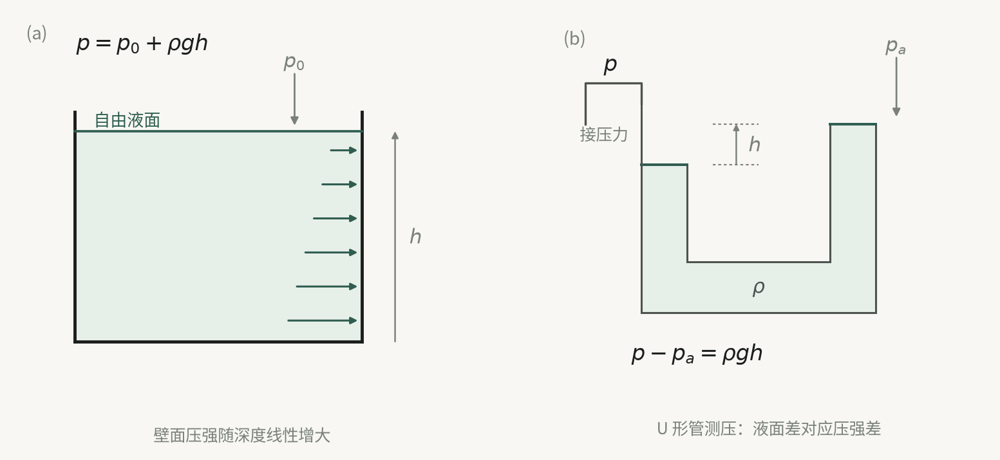
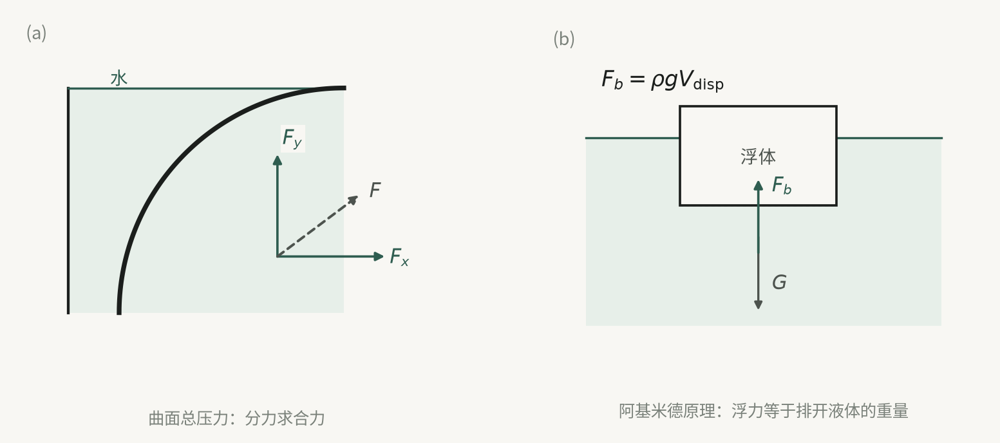

## 一、静力学的研究对象：一个前提推出整个体系

流体静力学研究流体在外力作用下处于平衡时的规律及其工程应用。这里的“静止”有两层含义，需要分清：

- **宏观上无相对运动**：流体内部质点之间、流体层之间没有相对运动，这才是静力学真正依赖的前提；
- **整体可以有运动**：流体作为整体完全可以像刚体一样运动。

按整体相对地球有无运动，教材把静止分为**绝对静止**（整体相对地球静止）和**相对静止**（整体相对地球运动，但内部无相对运动，也就是流体随容器一起做刚体式运动）。这两类问题在 §2.3 和 §2.5 分别处理，但共享同一套方程。

由此立即得到一个贯穿全章的结论：**静止流体内不存在切应力**。原因是切应力来自流体层间的相对运动（第一章的牛顿内摩擦定律 $\tau=\mu\,\mathrm{d}u/\mathrm{d}y$，静止时速度梯度为零），而静止排除了相对运动。既然没有切应力，作用在流体上的表面力只剩沿内法线方向的法向力。

这一点决定了本章所有结论的适用范围：**它们不依赖于流体是否有粘性，对本构关系也无要求**，因此对理想流体和粘性流体同样成立。相对地，凡是涉及 $\rho$ 是否为常数的地方（§2.2 的有势条件、§2.3 的积分、§2.7 的气体），适用范围就会收窄，后面逐一标注。

本章要回答三类问题：静止流体内部的压强场 $p(x,y,z)$，它满足什么方程、由什么边界条件确定；流体对物面（平面、曲面）的总压力作用效果如何；当质量力不只是重力、或密度不再是常数时，上述结论要怎样改写。

后面五节的顺序与此一一对应：**§2.1—§2.2 建立压强场的一般方程，§2.2—§2.4 做积分并给出计量方式，§2.5 换质量力，§2.6 把压强场积成合力，§2.7 换密度。**

## 二、静压强的两个特性

静止流体中只有作用在内法线方向上的表面力，称为静压力；单位面积上的静压力称为**静压强**。教材给出两个特性，这两个特性的证明方式很不相同，值得分开看。

### 特性 1：静压力必指向作用面的内法线方向

这一条用**反证法**证明，逻辑很短但很关键。设静止流体分离体表面 $AB$ 上受到的力 $P_s'$ 向外且不与该面垂直，则可分解为法向分量 $P_{sn}$ 与切向分量 $P_{s\tau}$。若 $P_{sn}$ 是拉力，或 $P_{s\tau}$ 不为零，流体将产生连续不断的变形，也就是运动，这与“静止”的前提矛盾。所以唯一可能的方向就是沿作用面的**内法线**方向。

要注意这条特性的实质：它说的是流体不能承受拉力和剪切力，而不是“压强总是正值”之类的人为约定。也正因为如此，特性的成立只依赖“静止”这一前提，不涉及粘性。

### 特性 2：同一点处压强大小与作用面方位无关

证明在静止流体内任取一个以 $O$ 为顶点、三个互相垂直棱边为 $\mathrm{d}x,\mathrm{d}y,\mathrm{d}z$、斜面为 $ABC$ 的微小四面体，设四个面上的压强分别为 $p_x,p_y,p_z,p_n$，则各面上的表面力为

$$
P_{sx}=\tfrac12 p_x\,\mathrm{d}y\,\mathrm{d}z,\quad
P_{sy}=\tfrac12 p_y\,\mathrm{d}x\,\mathrm{d}z,\quad
P_{sz}=\tfrac12 p_z\,\mathrm{d}x\,\mathrm{d}y,\quad
P_{sn}=p_n\,\mathrm{d}A_n
$$

四面体的质量为 $\mathrm{d}m=\tfrac16\rho\,\mathrm{d}x\,\mathrm{d}y\,\mathrm{d}z$，故质量力在三个方向的分量都是 $\tfrac16\rho\,\mathrm{d}x\,\mathrm{d}y\,\mathrm{d}z\,f_i$（$f_i$ 为单位质量力，单位 $\mathrm{m/s^2}$）。以 $x$ 方向为例列平衡方程：

$$
\tfrac12 p_x\,\mathrm{d}y\,\mathrm{d}z+\tfrac16\rho\,\mathrm{d}x\,\mathrm{d}y\,\mathrm{d}z\,f_x
-p_n\,\mathrm{d}A_n\cos(P_{sn},x)=0
$$

**证明的核心一步在这里**：表面力与面积成正比，是 $\mathrm{d}l^2$ 阶（二阶小量）；质量力与体积成正比，是 $\mathrm{d}l^3$ 阶（三阶小量）。令四面体缩为一点时，质量力相对表面力是高阶小量，可以略去，于是

$$
\tfrac12 p_x\,\mathrm{d}y\,\mathrm{d}z=p_n\,\mathrm{d}A_n\cos(P_{sn},x)
$$

又因 $\mathrm{d}A_n\cos(P_{sn},x)=\tfrac12\mathrm{d}y\,\mathrm{d}z$，代入得 $p_x=p_n$；同理由 $\sum F_y=0$、$\sum F_z=0$ 得 $p_y=p_z=p_n$，故

$$p_x=p_y=p_z$$

四面体是任取的，所以结论是：**从各个方向作用于一点的流体静压强大小相等**，压强不是矢量而是标量，只是空间坐标的函数

$$p=p(x,y,z),\qquad
\mathrm{d}p=\frac{\partial p}{\partial x}\mathrm{d}x+\frac{\partial p}{\partial y}\mathrm{d}y+\frac{\partial p}{\partial z}\mathrm{d}z \tag{2-1}$$

**两个必须分清的点。**其一，“各向同性”限定在**同一点**，绝不是说压强在空间上处处相等；$p$ 随位置变化正是下一节要解的东西。其二，“静压强是标量”不等于“压力是矢量”这句话被推翻：压强是标量场，而一个面上的压力 $pA$ 仍是矢量，方向沿内法线。

作为对照可以点一句：固体中的正应力一般既随方向改变，也可以同时存在切应力；流体静止时正应力各向同性且切应力为零，这个差别正是两种介质力学行为的根本分野（教材未展开，此处仅作提示）。

另外教材在 §2.4 开头说明，“静压强”习惯上常被称为“静压力”，工程上也常把表压直接叫“压力”。读公式时要靠上下文区分：带面积的是力，不带面积的是压强。

## 三、静止流体的平衡微分方程

§2.1 只说明了同一点各方向压强相等，没有说明 $p$ 在空间上如何变化。本节要回答：**要使流体保持平衡，压强场必须满足什么关系？**

在静止流体内取棱边平行于坐标轴、边长 $\mathrm{d}x,\mathrm{d}y,\mathrm{d}z$ 的平行六面体微团，体积 $\mathrm{d}V=\mathrm{d}x\mathrm{d}y\mathrm{d}z$，质量力在三个方向的分量为 $\rho f_x\mathrm{d}V$、$\rho f_y\mathrm{d}V$、$\rho f_z\mathrm{d}V$。

设中心 $A(x,y,z)$ 处压强为 $p$。因压强是坐标的连续函数，把距中心 $\pm\tfrac12\mathrm{d}y$ 处的压强展成泰勒级数：

$$
p\!\left(x,y\pm\tfrac12\mathrm{d}y,z\right)
=p\pm\tfrac12\frac{\partial p}{\partial y}\mathrm{d}y
+\frac18\frac{\partial^2 p}{\partial y^2}(\mathrm{d}y)^2\pm\cdots
$$

$\mathrm{d}y$ 为无限小量时，二阶及以上的项可略去，只取两项已足够精确。于是两个相对面中心的压强为 $p\mp\tfrac12\frac{\partial p}{\partial y}\mathrm{d}y$；六面体足够小，这两个值可作为面上的平均压强，乘以面积 $\mathrm{d}x\mathrm{d}z$ 就是面上的法向力。列 $y$ 方向平衡：

$$
\left(p-\tfrac12\frac{\partial p}{\partial y}\mathrm{d}y\right)\mathrm{d}x\mathrm{d}z
-\left(p+\tfrac12\frac{\partial p}{\partial y}\mathrm{d}y\right)\mathrm{d}x\mathrm{d}z
+\rho\,\mathrm{d}x\mathrm{d}y\,\mathrm{d}z\,f_y=0
$$

$x$、$z$ 方向同理。三式同除以质量 $\rho\,\mathrm{d}x\mathrm{d}y\,\mathrm{d}z$，得单位质量流体的平衡方程

$$
\left.\begin{aligned}
f_x-\frac{1}{\rho}\frac{\partial p}{\partial x}&=0,\\
f_y-\frac{1}{\rho}\frac{\partial p}{\partial y}&=0,\\
f_z-\frac{1}{\rho}\frac{\partial p}{\partial z}&=0
\end{aligned}\right\} \tag{2-2}
$$

即矢量形式 $\boldsymbol{f}=\frac{1}{\rho}\nabla p$。此式 1755 年由欧拉首先导出，故称**欧拉平衡微分方程**。

**与四面体证明的对照是本节最容易被忽略的细节。**四面体那里把质量力略去了，六面体这里一个都不能略：在四面体中，三个坐标面上的表面力都是二阶量，而质量力是三阶量，取极限后质量力消失；在六面体中，两侧面压力各自都是三阶量（$p\cdot\mathrm{d}A$ 中 $p$ 近似为常量、$\mathrm{d}A$ 是二阶），它们的**差值**（含 $\partial p/\partial y$）同样是三阶量，与质量力同阶，谁都去不掉。正因为两者同阶、能相互平衡，才能得到微分方程。把这两个极限混为一谈是常见错误。

式 (2-2) 的物理读法非常有用：**某方向有质量力分量，压强沿该方向必变化；某方向没有质量力分量，压强沿该方向必不变**。这条读法在 §2.3 会立刻兑现——重力场中 $f_x=f_y=0$，于是压强只随 $z$ 变、水平面必为等压面。

关于适用范围，教材明确说明：式 (2-2) **是平衡流体中普遍适用的基本公式**，无论质量力是哪种类型、流体是否可压缩、有无粘性，都成立。它是本章中唯一不加任何附加前提的结论，后面所有公式都是它在特定条件下的积分结果。

## 四、从微分方程到可积形式：力势函数与等压面

式 (2-2) 是三个偏微分方程，要得到可用的代数式，必须积分。本节解决的就是**可积条件**问题。

把式 (2-2) 三式分别乘 $\mathrm{d}x,\mathrm{d}y,\mathrm{d}z$ 后相加：

$$
f_x\mathrm{d}x+f_y\mathrm{d}y+f_z\mathrm{d}z
=\frac{1}{\rho}\left(\frac{\partial p}{\partial x}\mathrm{d}x+\frac{\partial p}{\partial y}\mathrm{d}y+\frac{\partial p}{\partial z}\mathrm{d}z\right)
=\frac{1}{\rho}\mathrm{d}p \tag{2-3}
$$

积分的关键在右端。**只有当 $\rho=\text{常数}$ 时**，$\frac{1}{\rho}\mathrm{d}p=\mathrm{d}(p/\rho)$ 才是全微分；既然右端是全微分，左端也必须是某个坐标函数的全微分。设存在 $U(x,y,z)$ 使

$$
f_x=-\frac{\partial U}{\partial x},\quad
f_y=-\frac{\partial U}{\partial y},\quad
f_z=-\frac{\partial U}{\partial z}
$$

则左端 $= -\mathrm{d}U$，式 (2-3) 化为

$$\mathrm{d}p+\rho\,\mathrm{d}U=0 \tag{2-4}$$

$U$ 称为**力势函数**，具有这样力势函数的质量力称为**有势力**。由此得到一条带前提的结论：**不可压缩流体只有在有势的质量力作用下才能保持平衡。**这里的限制来自“$\rho$ 为常数”这一步；可压缩流体的压强场不能套用这个结论，§2.7 是另起炉灶单独处理的（在给定的温度分布下直接积分状态方程），教材并未给出可压缩流体的普遍有势判据。

### 等压面及其三个性质

流体中压强相等的各点组成的平面或曲面叫**等压面**，其上 $p=\text{常数}$、$\mathrm{d}p=0$。代入式 (2-3) 得等压面的微分方程

$$f_x\mathrm{d}x+f_y\mathrm{d}y+f_z\mathrm{d}z=0 \tag{2-5}$$

等压面有三个性质。

**性质 1：等压面也是等势面。** 由 $\mathrm{d}p=0$ 代入式 (2-4) 得 $\mathrm{d}U=0$，即 $U=C$。

**性质 2：过任意一点的等压面必与该点所受质量力垂直。** 在等压面上任取微元线段 $\mathrm{d}\boldsymbol{l}=(\mathrm{d}x,\mathrm{d}y,\mathrm{d}z)$，则

$$\boldsymbol{f}\cdot\mathrm{d}\boldsymbol{l}=f_x\mathrm{d}x+f_y\mathrm{d}y+f_z\mathrm{d}z=0$$

两矢量均非零而点积为零，故互相垂直。由于 $\mathrm{d}\boldsymbol{l}$ 在等压面上任取，等压面整体与质量力正交。**质量力只有重力时，等压面必为水平面**——这是后面所有自由液面结论的几何依据。

**性质 3：两种互不相混流体的分界面必为等压面。** 在分界面上任取两点 $A$、$B$，设其间有压差 $\mathrm{d}p$ 与势差 $\mathrm{d}U$。因 $A$、$B$ 同在分界面上，$\mathrm{d}p$、$\mathrm{d}U$ 同时满足两种流体的关系：

$$\mathrm{d}p=-\rho_1\mathrm{d}U,\qquad \mathrm{d}p=-\rho_2\mathrm{d}U$$

$\rho_1\ne\rho_2$ 时只有 $\mathrm{d}p=\mathrm{d}U=0$ 才成立，故分界面必为等压面（也即等势面）。

性质 3 是**测压计与连通器分段计算的依据**：跨过两种液体的分界面时，界面本身是等压面，压强在那里连续，不必加减任何 $\rho g h$；而在同一种连续流体内部，向上移动要从压强中减去 $\rho g h$，向下移动要加上 $\rho g h$。

**重力场的力势函数**（例 2.1）：取 $z$ 轴铅垂向上，$f_x=f_y=0$、$f_z=-g$，则

$$\mathrm{d}U=-(f_x\mathrm{d}x+f_y\mathrm{d}y+f_z\mathrm{d}z)=g\,\mathrm{d}z$$

取 $z=0$ 处势函数为零，积分得 $U=gz$。其物理意义是**单位质量流体在基准面以上高度 $z$ 处所具有的位置势能**。代回式 (2-4)，$p+\rho gz=\text{常数}$，这正是下一节静压强基本公式的前身。

## 五、重力场中的压强分布

重力场是最常见的有势力场，本节把式 (2-4) 在 $f=(0,0,-g)$ 下积分。代入式 (2-3)：

$$\mathrm{d}p=-\rho g\,\mathrm{d}z \tag{2-6}$$

对均质流体 $\rho=\text{常数}$，积分得 $p+\rho gz=C$。设 $z=H$ 处 $p=p_0$，则 $C=p_0+\rho gH$，于是

$$p=p_0+\rho g(H-z)=p_0+\rho gh \tag{2-7}$$

其中 $h=H-z$ 为任一点距液面的铅垂深度，称**淹深**。此式称为（不可压缩流体的）**静压强基本公式**。

**它的适用前提必须完整写出**：同一种、均质、不可压缩流体；静止（或相对静止且质量力仅为重力）；流体连续且在同一连通域内；$p_0$ 是自由液面（或所取基准面 $z=H$）上的压强。跨过不同密度的流体、跨过不连通区域、或流体可压缩时，此式不能直接搬用。

由式 (2-7) 可得五条推论：

1. 重力作用下液体内的静压强只是 $z$ 的函数，随深度 $h$ 增大而线性增大；
2. 压强由两部分叠加：液面压强 $p_0$ 与液体自重 $\rho gh$。$p_0$ 由外力通过固体、气体或另一种液体施加于液面而产生；
3. $h$ 相同处 $p$ 相同，故**等压面是水平面**；
4. 连通容器内的同种液体中，与液面平行的面上压强相等，如图 2-5 中 $p_1=p_2=p_0+\rho gh$；
5. **帕斯卡压强传递原理**：密封容器中的静止流体，因部分边界承受外力而产生的静压强，将均匀传递到液体内所有各点。

第 5 条与 §2.1 特性 2（各向同性）合起来，就得到液压传动的基本能力：液体不仅能传递力，而且能改变力的方向、放大或缩小力。如图 2-6，油缸 1 活塞上的力 $P_1$ 使液面产生压强 $p$，该压强沿管道传至油缸 2 的活塞产生 $P_2$；改变油缸 2 的位置即可改变 $P_2$ 的方向，改变其截面积即可改变 $P_2$ 的大小（$P_2=P_1A_2/A_1$，忽略两活塞高度差引起的 $\rho gh$ 项）。要注意放大的是力而不是功：活塞位移与面积成反比。

**测压管路的分段计算**遵循一条固定规则（例 2.2 即此法）：沿路径从已知压强一端走到未知端，向下走加压 $\rho g\Delta h$，向上走减压 $\rho g\Delta h$，每段用该段流体的密度；跨过两种流体的界面时压强连续。例 2.2 中

$$p_B=p_A+\rho_1 g(h+h_1)-\rho_3 g(h_1+h_3)+\rho_2 g h_2=-3.282\times10^4\ \mathrm{Pa}$$

结果为负，说明 $B$ 容器中是真空。

## 六、压力的计量

§2.3 给出的是绝对压强 $p$，而工程仪表测到的往往是与大气压的差值，因此必须把三种“压力”分清楚。本节解决的就是**同一个压强场的不同读数口径**问题。

| 名称 | 定义 | 与 $p_a$ 的关系 | 符号特征 |
|---|---|---|---|
| 绝对压力 | 以绝对真空为零点 | $p$ | 恒为正 |
| 表压（相对压力） | 高出大气压的部分 | $p_g=p-p_a$ | 可正可负 |
| 真空度 | 低于大气压的部分 | $p_v=p_a-p$ | 恒为正 |

绝对压小于大气压时相对压力为负，此时工程上用真空度表示：

$$p_v=p_a-p \tag{2-8}$$

几条换算关系要记牢：$p=p_a+p_g$；$p_v=-p_g$，即**真空度就是负表压的绝对值**；由定义并考虑到 $p\ge 0$，真空度不会超过当地大气压 $p_a$。工程上不加说明地说的“压力”，通常指表压。

计量单位有三种，教材都给了：

| 类别 | 常用单位 | 说明 |
|---|---|---|
| 应力单位 | $\mathrm{Pa}=\mathrm{N/m^2}$，$\mathrm{bar}=10^5\mathrm{Pa}$ | 法定单位制，多用于理论计算 |
| 液柱高单位 | $\mathrm{mH_2O}$、$\mathrm{mmHg}$ | 由 $p=\rho gh$ 反算，间接表示压强 |
| 大气压单位 | $\mathrm{atm}$ | 北纬 45° 海平面、$15\,^\circ\mathrm{C}$ 下测定 |

$$1\ \mathrm{atm}=760\ \mathrm{mmHg}=1.033\ \mathrm{kgf/cm^2}=1.01325\ \mathrm{bar}=1.01325\times10^5\ \mathrm{Pa}$$

液柱高单位要注意：同样的液柱高度，不同液体对应的压强不同（$p=\rho gh$ 中 $\rho$ 不同），所以写成“$\mathrm{mmHg}$”时指的是汞柱而非水柱。做题时若 $h$ 用 mm、$\rho g$ 用 SI 单位，务必先统一量纲。

图 2-1　重力场中的压强分布与 U 形管测压：绝对压、表压与真空度的关系。

## 七、相对平衡：惯性力并入质量力

前面所有推导都局限在“质量力只有重力”。当流体随容器一起加速或旋转时，流体内部仍无相对运动（因此 §2.1、§2.2 全部成立），但整体有加速度。本节的思路只有一句话：**把坐标系固连在容器上，在此非惯性系中流体是静止的，只需把惯性力当作一种质量力并入 $\boldsymbol{f}$，欧拉平衡微分方程的形式不变。**

这一处理的前提是：流体已随容器达到新的相对平衡（内部无相对运动）；流体不可压缩（沿用 $\rho=\text{常数}$）；自由液面压强 $p_0$ 均匀。

### 7.1 匀速直线运动

容器作匀速直线运动时加速度为零，惯性力为零，质量力仍只有重力，$f_x=f_y=0$、$f_z=-g$。**与绝对静止完全相同**，等压面为一簇水平面，$p=p_0+\rho gh$。

### 7.2 等加速直线运动

设容器以等加速度 $a$ 沿 $x$ 轴正向运动（图 2-8）。新的平衡状态下，单位质量力除重力外还有与运动方向相反的惯性力：

$$f_x=-a,\qquad f_y=0,\qquad f_z=-g$$

代入式 (2-3)：

$$-a\,\mathrm{d}x-g\,\mathrm{d}z=\frac{1}{\rho}\mathrm{d}p
\quad\Longrightarrow\quad
\mathrm{d}p+\rho a\,\mathrm{d}x+\rho g\,\mathrm{d}z=0$$

积分得 $p+\rho ax+\rho gz=C$。由边界条件 $x=0,z=0$ 处 $p=p_0$ 定出 $C=p_0$，故

$$p=p_0-\rho ax-\rho gz \tag{2-9}$$

液面上 $p=p_0$，故自由液面方程为

$$\rho ax+\rho gz=0,\qquad \text{即斜率}\ \frac{\mathrm{d}z}{\mathrm{d}x}=-\frac{a}{g} \tag{2-10}$$

等压面由 $\mathrm{d}p=0$ 得 $a\,\mathrm{d}x+g\,\mathrm{d}z=0$，斜率同为 $-a/g$，所以**等压面是平行于自由液面的一簇平面**。

把式 (2-9) 改写为

$$p=p_0-\rho g\left(\frac{a}{g}x+z\right)$$

括号内 $-\left(\frac{a}{g}x+z\right)$ 恰是自由液面以下的**铅垂淹深** $h_z$，于是

$$p=p_0+\rho g h_z \tag{2-11}$$

**形式与绝对静止的式 (2-7) 完全一致。**这不是巧合：等效重力方向改变了，但只要把“深度”理解为沿自由液面法向量的深度，原公式照用。这条经验在解题时很省事，但前提是自由液面必须已经确定。

### 7.3 等角速度旋转（绕铅垂轴）

容器绕垂直轴以角速度 $\omega$ 旋转，液体很快成为整体随容器转动，相互间无相对运动。质量力除重力外还有离心力 $\omega^2 r$，方向背离转轴：

$$f_x=\omega^2 r\cos(r,x)=\omega^2 x,\quad
f_y=\omega^2 r\cos(r,y)=\omega^2 y,\quad
f_z=-g$$

代入式 (2-3)：

$$\mathrm{d}p=\rho\left(\omega^2 x\,\mathrm{d}x+\omega^2 y\,\mathrm{d}y-g\,\mathrm{d}z\right)$$

积分并利用 $r^2=x^2+y^2$，得

$$p=\rho\left(\frac{\omega^2 r^2}{2}-gz\right)+C$$

由 $r=0,z=0$ 处 $p=p_0$ 定出 $C=p_0$：

$$p=p_0+\rho\frac{\omega^2 r^2}{2}-\rho gz \tag{2-13}$$

等压面由 $\mathrm{d}p=0$ 得 $\frac{\omega^2r^2}{2}-gz=C$，这是**一簇对称于 $z$ 轴的旋转抛物面**。液面上 $p=p_0$、$z=z_0$，故自由液面方程

$$z_0=\frac{\omega^2r^2}{2g} \tag{2-14}$$

代入式 (2-13) 得 $p=p_0+\rho g(z_0-z)=p_0+\rho g h_z$，与式 (2-11) 同形。

### 7.4 两个顶盖限位的特例

当容器**盛满液体且加顶盖**时，自由液面无法形成抛物面，但压强分布仍按抛物面规律（公式形式不变，只是积分常数由新的边界条件确定）。

| 情形 | 边界条件 | 关键点压强 | 工程应用 |
|---|---|---|---|
| 顶盖**中心**开口 | 中心 $p=p_0$ | 边缘 $p_0+\dfrac{\rho\omega^2R^2}{2}$ | 离心铸造，边缘压强高、铸件密实 |
| 顶盖**边缘**开口 | 边缘 $p=p_0$ | 中心 $p_0-\dfrac{\rho\omega^2R^2}{2}$（真空） | 离心泵、风机吸液与增压 |

两式的差别只在于积分常数由哪一点定出，这正说明：**相对平衡问题的求解流程是“写单位质量力 → 代入式 (2-3) 积分 → 用边界条件定常数”**，抛物面规律本身不是前提。

### 7.5 推广：绕水平轴旋转（例 2.5）

圆筒绕水平 $x$ 轴以 $\omega$ 旋转时，

$$f_x=0,\qquad f_y=\omega^2 y,\qquad f_z=\omega^2 z-g$$

积分得等压面为绕 $x$ 轴的柱面抛物面族。不满液时气体聚在中心形成半径 $R_0$ 的气柱，由“气柱内 $p$ 仍为 $p_0$”定常数，得

$$p=p_0-\rho\frac{\omega^2(R_0^2-r^2)}{2}+\rho g(R_0-r)\cos\theta$$

端盖总压力积分后**重力项消失**，即端面受力与重力无关：

$$P=\pi(R^2-R_0^2)p_0+\frac{\pi\rho\omega^2}{4}(R^2-R_0^2)^2$$

满液时中心压强不变，$p=p_0+\rho gR+\frac{\rho\omega^2r^2}{2}-\rho g r\cos\theta$，端面总压力为 $\pi R^2p_0+\pi\rho gR^3+\frac{\pi\rho\omega^2}{4}R^4$。这个例子说明：**积分常数由“哪一点的压强已知”决定，而该点未必在自由液面上。**

## 八、平面上总压力：大小与作用点必须分开算

工程上不只关心某点的压强，还要知道整个物面受到的合力。静止流体作用在物面上的总压力为

$$\boldsymbol{P}=-\int_A p\,\boldsymbol{n}\,\mathrm{d}A \tag{2-15}$$

$\boldsymbol{n}$ 是物面单位法向量（指向流体）。平面情形下所有 $\mathrm{d}\boldsymbol{P}$ 方向一致，可以标量积分；曲面情形下方向逐点不同，必须分解——这是 §2.9 的内容。

设平面 $A$ 与自由液面成倾角 $\theta$，液面压强 $p_0$，取 $O$ 为液面与平面的交线上的原点、$Ox$ 沿交线、$y$ 为平面内的下坡方向，则 $dA$ 处的压强

$$p=p_0+\rho gh=p_0+\rho g\,y\sin\theta$$

积分：

$$P=\int_A(p_0+\rho gy\sin\theta)\,\mathrm{d}A=p_0A+\rho g\sin\theta\int_A y\,\mathrm{d}A$$

而 $\int_A y\,\mathrm{d}A$ 是平面 $A$ 对 $Ox$ 轴的面积矩，等于 $y_CA$（$y_C$ 为形心 $C$ 到 $Ox$ 轴的距离），且 $y_C\sin\theta=h_C$，故

$$P=p_0A+\rho gAy_C\sin\theta=(p_0+\rho gh_C)A \tag{2-16}$$

**结论的准确表述是：总压力大小等于形心处的压强乘以面积，方向垂直指向作用面。**这句话只确定了大小，没有确定位置——恰恰是最容易读错的地方。

### 压力中心

设总压力作用点（**压力中心**）$D$ 的坐标为 $(x_D,y_D)$。令总压力对 $Ox$ 轴的力矩等于各微元压力对同轴力矩之和：

$$y_DP=\int_A y\,\mathrm{d}P=\int_A(p_0+\rho gy\sin\theta)y\,\mathrm{d}A
=p_0Ay_C+\rho g\sin\theta\int_A y^2\,\mathrm{d}A$$

$\int_Ay^2\mathrm{d}A$ 是面积对 $Ox$ 轴的惯性矩 $J_x$，由平行轴定理 $J_x=J_C+y_C^2A$，代入 $P$ 的表达式得

$$y_D=\frac{p_0Ay_C+\rho g(J_C+y_C^2A)\sin\theta}{p_0A+\rho gAy_C\sin\theta} \tag{2-17}$$

同理对 $Oy$ 轴取矩，用惯性积 $J_{xy}=J''_{xy}+Ax_Cy_C$ 得

$$x_D=\frac{p_0Ax_C+\rho g(J''_{xy}+Ax_Cy_C)\sin\theta}{p_0A+\rho gAy_C\sin\theta} \tag{2-18}$$

当 $p_0=0$（或取表压计算）时两式大幅简化：

$$y_D=y_C+\frac{J_C}{Ay_C},\qquad x_D=x_C+\frac{J''_{xy}}{Ay_C}$$

**这两条简化式值得单独记住，因为它们把几何与受力分开了。**$J_C>0$，故 $y_D>y_C$ 恒成立：**压力中心永远在形心之下**。物理原因很直白——压强随深度线性增大，下半部分受力更大，合力点必然偏下。同时 $y_C\to\infty$ 时 $\frac{J_C}{Ay_C}\to 0$，压力中心趋近形心，这解释了“深水闸门可按形心近似”的常用做法，但它只是近似，不是恒等式。

若图形有平行于 $Ox$ 或 $Oy$ 的对称轴，则 $J''_{xy}=0$，从而 $x_D=x_C$——压力中心落在对称轴上。

**本节前提**：均质不可压缩流体、静止、$p_0$ 在液面上均匀、平面为单侧受压。若平面两侧都有流体或都有大气压作用，应先判断哪些部分相互抵消（下节例 2.4 就是这种处理），再对净压强积分。

## 九、曲面上总压力：分力、压力体与作用点

曲面各点的 $\mathrm{d}\boldsymbol{P}$ 方向不一致，不能直接作标量积分。本节的办法是**先分解、再积分、后合成**。

在曲面上取微元 $\mathrm{d}A$，$\mathrm{d}P=p\,\mathrm{d}A=(p_0+\rho gh)\mathrm{d}A$，分解为 $\mathrm{d}P_x$ 与 $\mathrm{d}P_z$：

$$\mathrm{d}P_x=p\sin\theta\,\mathrm{d}A=p\,\mathrm{d}A_x,\qquad
\mathrm{d}P_z=p\cos\theta\,\mathrm{d}A=p\,\mathrm{d}A_z$$

其中 $\mathrm{d}A_x$、$\mathrm{d}A_z$ 分别是 $\mathrm{d}A$ 在垂直面和水平面上的投影。

### 水平分力

$$P_x=\int_A(p_0+\rho gh)\mathrm{d}A_x=(p_0+\rho gh_C)A_x \tag{2-19}$$

$A_x$ 是曲面在垂直面上的投影面积，$h_C$ 是 $A_x$ **形心**到液面的铅垂距离。也就是说：**曲面所受水平分力，等于该曲面在垂直面上的投影平面所受的总压力**，方向水平指向曲面，作用线过 $A_x$ 的压力中心。

### 垂直分力与压力体

$$P_z=p_0A_z+\rho g\int_A h\,\mathrm{d}A_z$$

其中 $\int_A h\,\mathrm{d}A_z$ 是曲面 $A$ 与经曲面外缘所作的垂直面以及液面所围成的几何体体积 $\tau$，该几何体称为**压力体**，于是

$$P_z=p_0A_z+\rho g\tau \tag{2-20}$$

$A_z$ 是曲面在水平面上的投影面积。注意 $p_0A_z$ 这一项不能漏：它来自液面压强沿投影面累加，教材在式 (2-16) 与 (2-19) 中把它与 $\rho gh$ 合写成 $(p_0+\rho gh_C)A$，形式不同而实质相同。

**压力体的虚实是本节的核心难点。**判定标准不是“体积画在哪”，而是**压力体所占区域内是否真的有流体**：

- 压力体内充满流体（流体位于曲面上方）→ **实压力体**，$P_z$ 方向向下；
- 压力体内没有流体（流体位于曲面下方，或曲面是“外侧”受压）→ **虚压力体**，$P_z$ 方向向上。

教材例 2.4 的弧形闸门就是虚压力体：压力体由弧面向上延伸至液面围成，但该区域内实际上并无流体，故 $P_z$ 向上。**虚压力体并不改变 $P_z$ 的大小公式，只改变它的方向**——这一点务必分清。

### 合成与作用点

$$P=\sqrt{P_x^2+P_z^2} \tag{2-21}$$

方向：教材以**与垂线的夹角** $\alpha$ 定义，

$$\tan\alpha=\frac{P_x}{P_z} \tag{2-22}$$

作用点这样确定：垂直分力的作用线通过**压力体的重心**指向受压面；水平分力的作用线通过 $A_x$ 的**压力中心**指向受压面；两线交点给出总压力的作用线，其与曲面的交点 $D$ 即作用点。

**角度定义的坑在这里**：式 (2-22) 的 $\alpha$ 从垂线量起，而例 2.4 中定义的 $\theta$ 从水平线量起、$\tan\theta=P_z/P_x$。两者互余，不能混用。

**圆弧面的特殊便利**（例 2.4）：圆柱面或球面上每一点的 $\mathrm{d}\boldsymbol{P}$ 都沿半径方向，故合力作用线必过圆心。于是作用点可由“过圆心、与水平面成 $\theta$ 角的直线与圆弧的交点”直接定出，无需先求压力体重心。这个性质只对圆弧/球面成立，一般曲面不适用。

例 2.4 的计算同时演示了两件事：闸门两侧都有大气压作用，故取 $p_0=0$ 只需算表压部分；$P_x=\frac12\rho gR^2b\sin^2\alpha=39200\ \mathrm{N}$，$P_z=\frac18\rho gR^2(\pi-4\sin\alpha\cos\alpha)b\approx22375\ \mathrm{N}$，$P\approx4.51\times10^{4}\ \mathrm{N}$，$\theta\approx29.7^\circ$。

### 三向曲面

对三向曲面，做法与两向完全一致，只是多一个 $y$ 方向分量：

$$P_y=(p_0+\rho gh_C)A_y \tag{2-23}$$

$A_y$ 是曲面在垂直于 $y$ 轴平面上的投影面积，$h_C$ 是该投影面形心的淹深。于是

$$P=\sqrt{P_x^2+P_y^2+P_z^2} \tag{2-24}$$

其中 $P_x$、$P_z$ 仍按式 (2-19)、式 (2-20) 求，$P_z$ 依旧是压力体法——注意 $P_z$ 的形式在三向情形下不变，因为压力体只涉及铅垂方向。

## 十、浮力与阿基米德原理

§2.9 的压力体法一旦用于**封闭曲面**，就自动得到浮力——这是本章最漂亮的衔接：浮力不是新的物理定律，而是曲面总压力在封闭曲面上的必然结果。

设体积为 $\tau$ 的物体完全浸入密度为 $\rho$ 的流体中（图 2-14）。水平方向四周流体施加的压力相互抵消（封闭曲面上各方向的投影关系使 $\oint p\,\mathrm{d}A_x=0$、$\oint p\,\mathrm{d}A_y=0$），总水平分量为零。铅垂方向则要分上下两部分看：

- 下侧曲面 $ACB$ 上作用着向下的压力 $P_{\mathrm{I}}=\rho g\tau_{\mathrm{I}}$；
- 上侧曲面 $ADB$ 上作用着向上的压力 $P_{\mathrm{II}}=\rho g(\tau_{\mathrm{I}}+\tau)$。

两者相减：

$$P=P_{\mathrm{II}}-P_{\mathrm{I}}=\rho g(\tau+\tau_{\mathrm{I}})-\rho g\tau_{\mathrm{I}}=\rho g\tau \tag{2-25}$$

向下的 $P_{\mathrm{I}}$ 与向上的 $P_{\mathrm{II}}$ 恰好是两个虚、实压力体之差，$\tau_{\mathrm{I}}$ 被消掉了，剩下的只有物体所排开的那部分体积。

**结论：**完全浸入流体中的物体受到流体作用的铅垂向上浮力，等于被物体排开的流体重量，**与浸入深度无关**。同理可证不完全浸入时浮力等于浸入部分排开的流体重量。

三点补充说明：

1. **作用点**：浮力作用在被排开流体的重心 $C_\tau$ 上，称为浮心；它与物体自身的重心 $C_g$ 一般并不重合，只有当物体完全均质时两者才重合。这一点直接影响到倾覆问题。
2. **阿基米德原理**：物体在流体中失去的重量等于其排开流体的重量。这是式 (2-25) 的另一种表述方式，二者等价。
3. **边界条件**：推导中以“物体表面完全被流体包围”为前提（否则上下压力体之差就无从计算）。若物体与容器底面完全贴合、底部无流体渗入，上述结论不再适用——这一情形教材未展开，此处只作提示。

**浮体的稳定性**（稳心、定倾中心、复原力矩等）教材本章未涉及，需要借助浮心与重心相对位置另行讨论。

图 2-2　曲面总压力的分力与压力体；浮力等于排开液体的重量。

## 十一、大气的平衡：当 $\rho$ 不再是常数

§2.3 的积分依赖 $\rho=\text{常数}$，而气体的密度是压力和温度的函数，因此**式 (2-6) 仍然成立（它只要求静止且质量力仅为重力），但不能直接积分**。本节解决的就是这个“不能积分”的困境：办法是补充两个条件——状态方程与温度随高度的分布。

前提：静止、只受重力、完全气体、温度分布已知（按国际标准大气给定基准）。

**完全气体状态方程**

$$p=\rho RT \tag{2-27}$$

$R$ 为气体常数，干燥空气 $R=286.85\ \mathrm{N\cdot m/(kg\cdot K)}$。

### 对流层（$0\sim11000\ \mathrm{m}$）

国际标准大气规定海平面 $T_0=288\ \mathrm{K}$、$p_0=1.013\ \mathrm{bar}$。实测统计给出温度随高度线性下降：

$$T=T_0-\vartheta z,\qquad \vartheta=0.0065\ \mathrm{K/m} \tag{2-26}$$

把式 (2-27) 代入式 (2-6) 得 $\mathrm{d}p=-\frac{pg}{RT}\mathrm{d}z$，再代入式 (2-26)：

$$\frac{\mathrm{d}p}{p}=-\frac{g\,\mathrm{d}z}{R(T_0-\vartheta z)}$$

分离变量积分：

$$\ln p=\frac{g}{R\vartheta}\ln(T_0-\vartheta z)+C \tag{2-28}$$

由 $z=0$ 处 $p=p_0$ 定出 $C=\ln p_0-\frac{g}{R\vartheta}\ln T_0$，最终得**幂律**：

$$\frac{p}{p_0}=\left(1-\frac{\vartheta z}{T_0}\right)^{\frac{g}{R\vartheta}} \tag{2-29}$$

代入数据：

$$p=1.013\left(1-\frac{z}{4.43\times10^{4}}\right)^{5.256}\ (\mathrm{bar}),\qquad 0\le z\le11000\ \mathrm{m} \tag{2-30}$$

指数 $g/(R\vartheta)=9.8/(286.85\times0.0065)\approx5.256$，常数 $T_0/\vartheta=288/0.0065\approx4.43\times10^{4}\ \mathrm{m}$。

### 同温层（$11000\sim25000\ \mathrm{m}$）

此层温度近似不变，$T\approx216.5\ \mathrm{K}=T_d$。由状态方程，等温时压强与密度成正比：

$$\frac{p}{p_d}=\frac{\rho}{\rho_d} \tag{2-31}$$

下标 $d$ 指两层交界处（$z_d=11000\ \mathrm{m}$），该处 $p_d=0.226\ \mathrm{bar}$（由式 (2-30) 算得）。代入式 (2-6)：

$$\mathrm{d}p=-\frac{p\rho_d}{p_d}g\,\mathrm{d}z$$

积分并用 $z=z_d$ 处 $p=p_d$ 定常数：

$$\ln\frac{p}{p_d}=\frac{g}{RT_d}(z_d-z)$$

即**指数律**：

$$\frac{p}{p_d}=\mathrm{e}^{\frac{g}{RT_d}(z_d-z)} \tag{2-33}$$

代入数据：

$$p=0.226\,\mathrm{e}^{\frac{11000-z}{6340}}\ (\mathrm{bar}),\qquad 11000\le z\le25000\ \mathrm{m} \tag{2-34}$$

其中 $RT_d/g=286.85\times216.5/9.8\approx6340\ \mathrm{m}$。

| 层 | 高度范围 | 温度分布 | 压强规律 |
|---|---|---|---|
| 对流层 | $0\sim11\,\mathrm{km}$ | 线性下降 | 幂律，式 (2-29) |
| 同温层 | $11\sim25\,\mathrm{km}$ | 近似等温 | 指数律，式 (2-33) |

**两段规律的形式差别完全来自温度假设的差别**：$T$ 线性下降 → 幂函数；$T$ 恒定 → 指数函数。两式在 $z=11000\ \mathrm{m}$ 处连续，靠的正是把交界处压强取作第二段的边界条件。

与液体的对照要记牢：液体 $\rho$ 为常数，压强随深度**线性**增大；气体 $\rho$ 随 $p$ 变化，压强随高度**按比例衰减**，不存在 $p=p_0+\rho gh$ 那种线性关系。把静压强基本公式套到大气上，是最典型的一类误用。教材只讨论到 $25000\ \mathrm{m}$，更高层未涉及。

## 十二、易错辨析

把本章最容易混淆的几组关系集中对照一遍。

**1. 表压、绝对压、真空度**

$p_v=-p_g$，真空度就是负表压的绝对值。出现“真空”的前提是 $p<p_a$，此时表压为负而真空度为正，两个数不能同时称作“压力为负”。由 $p\ge0$ 可知 $p_v\le p_a$。计算时先明确用的是哪一种口径，全程不能混用；例 2.2 算出 $p_B=-3.282\times10^4\ \mathrm{Pa}$，若用绝对压表达则应为 $p_a-3.282\times10^4\ \mathrm{Pa}$。

**2. 形心与压力中心**

总压力**大小**用形心压强乘面积 $(p_0+\rho gh_C)A$；总压力**位置**在形心之下，$y_D=y_C+\frac{J_C}{Ay_C}$。二者只在 $y_C\to\infty$ 或 $p_0$ 极大时才近似重合，是近似而非恒等。把“合力作用在形心”当成普遍结论是本章最常见的错误。

**3. 压力体的虚与实**

判据是压力体区域内**是否真的有流体**，不是体积画在液面上方还是下方。虚压力体不改变 $P_z=\rho g\tau$ 的大小，只把方向翻成向上。

**4. 两个角度定义**

式 (2-22) 的 $\tan\alpha=P_x/P_z$，$\alpha$ 自**垂线**量起；例 2.4 的 $\tan\theta=P_z/P_x$，$\theta$ 自**水平线**量起。两者互余，代公式前先看清定义。

**5. $p=p_0+\rho gh$ 的前提**

须同时满足：同一种、均质、不可压缩流体；静止；只受重力；同一连通域；$h$ 自自由液面铅垂向下量。跨过两种流体的分界面要利用“分界面是等压面”重新起步（性质 3），不能把两种密度混在一个 $\rho gh$ 里。

**6. 相对平衡中的“深度”**

式 (2-11) 中的 $h_z$ 是**沿自由液面法向**的深度，不是铅垂深度。等加速时自由液面倾斜、等角速度旋转时自由液面是抛物面，$h_z$ 都要按新的自由液面来量。若直接用铅垂深度代入，结果必错。

**7. 压强是标量，压力是矢量**

特性 2 说的是同一点处各方向压强大小相等，这使 $p$ 成为标量场，也正是帕斯卡原理能“改变力的方向”的依据；但具体某个面上的压力 $pA$ 仍是矢量，方向沿内法线。

**8. 两次“取极限”不能混**

四面体证明中略去质量力（表面力二阶、质量力三阶）；六面体推导中两者都不能略（压力差与质量力同为三阶）。前者求的是同一点不同方位的压强关系，后者求的是压强梯度与质量力的关系，极限过程不同，结论层次也不同。

**9. 欧拉方程与静压强基本公式的层次**

式 (2-2) 是普适的（任意有势质量力、可压缩、有粘性皆可）；式 (2-7) 是它在“重力场 + $\rho=\text{常数}$”下的积分结果。前者不能反过来当作后者的推广形式使用，后者也不能越出其前提去解释气体压强。

**10. 量纲与单位**

液柱高单位换成压强必须乘 $\rho g$，且汞柱与水柱不可互换；$1\ \mathrm{bar}=10^5\ \mathrm{Pa}$，$1\ \mathrm{atm}=1.01325\times10^5\ \mathrm{Pa}$，两者不等。工程算题中 $h$ 常以 mm 给出而 $\rho g$ 以 SI 代入，统一量纲这一步不能省。

本章的骨架可以概括为一条链：**静止 → 无切应力 → 只有法向压力 → 压强各向同性、为标量场 → 欧拉平衡微分方程 → 有势条件下积分 → 等压面 → 重力场得 $p=p_0+\rho gh$ → 换质量力得相对平衡、换密度得大气分布 → 把压强场积成平面/曲面/封闭曲面上的合力。**每一环的成立都有明确前提，前提一变，公式的形式或适用范围就随之改变——这正是读静力学时最需要留意的地方。