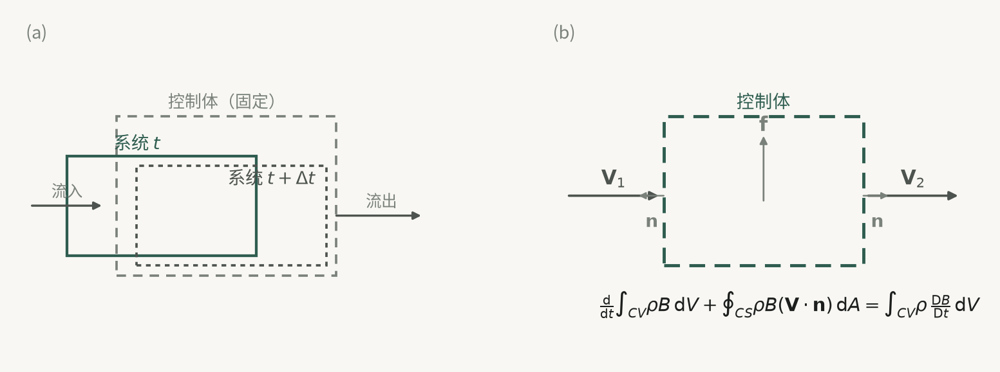
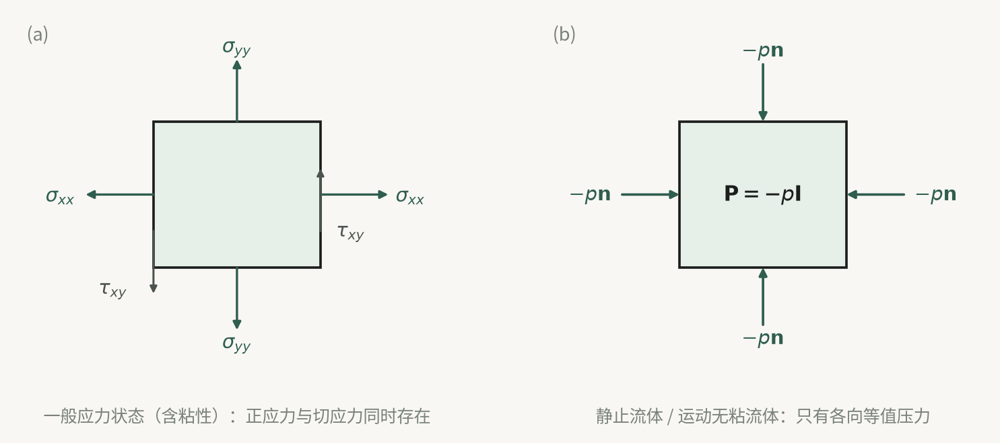

## 全章的逻辑起点：物理定律指的是物质，方程写的是空间场

本章不是把几条守恒律并排陈列，而是用一条明确的线索串起来：**所有基本物理定律（质量守恒、动量平衡、能量守恒）原本都是针对"确定的流体团"（系统）陈述的，而流体力学实际采用欧拉描述，考察的是固定空间区域（控制体）。** 两者之间必须有一座桥——体积分的随体导数，也就是雷诺输运方程。

这条线索决定了本章几乎所有方程的形态：每条守恒律都出现**积分形式**（对有限控制体，用于求总力、总力矩、总能量交换）和**微分形式**（对每一点成立，用于求速度、压力分布）两套；每个微分方程都有两条推导路线（微元控制体法、有限控制体 + 奥高公式法）；而每种简化（定常、不可压缩、无粘、完全气体）都只是在这条主线上砍掉某一项，并附带相应的适用前提。

因此，读本章应始终问三个问题：这个式子是从哪条物理定律来的？它经过了雷诺输运这一步吗？它把哪些项丢掉了、丢掉这些项需要什么前提？

## 一、系统与控制体：为什么要换着眼点

### 1.1 这一节要解决什么

在后面导出方程之前，必须先决定"研究对象"是什么。物理定律只认物质系统，工程问题只认空间区域，这个矛盾必须在这一节说清，否则后面所有"随体导数"的推导都失去动机。

### 1.2 流体的系统

系统是某一确定的流体团，可以小到微元内的流体微团，也可以大到有限体积，在连续介质假设下由确定的、连续分布的流体质点组成。系统以外称外界，分隔二者的界面称系统的边界。系统具有两个特征：

1. **随流体运动而运动**：体积、形状、位置都可变，但系统内的流体质点始终留在系统内（边界随流体变形，没有质点穿越）。
2. **与外界无质量交换**，但可以有力的相互作用，也可以有能量（热和功）的交换。

以系统为着眼点的好处是可以直接套用物理学基本定律的原始表达式，物理上直观；代价是得到的方程用拉格朗日变量描述，而工程上关心的往往是物理量的空间分布而非某个流体团的去向，所以不便应用。

### 1.3 流场中的控制体

控制体是流场中相对于某坐标系固定不动的空间体积，形状任意，大小可无限小也可有限；其封闭表面称控制面。关键的一点容易被忽略：**控制面可以是实在的流体面（过流断面、自由液面、流固界面），也可以是假想的几何面；控制体内并不要求处处充满被研究的流体。**

控制体的两个特征恰好与系统相反：

1. 一旦取定，相对坐标系固定，体积与形状不随流体运动而变；
2. 流体可以穿越控制面，因此控制体与外界既有质量交换，也有力和能量的交换。

采用控制体与欧拉描述相联系，空间范围确定不变，与实际工程流动条件一致，便于使用场论工具，数学表达通用性好；代价是不能直接套用物理定律，必须先把"系统物理量随时间的变化率"转换成控制体的积分形式——**正是这一转换（拉格朗日到欧拉）使得流体力学方程成为非线性的偏微分方程。**

### 1.4 对照

| 项目 | 系统 | 控制体 |
|---|---|---|
| 相对坐标系 | 随流体运动 | 固定不动 |
| 体积与形状 | 可变 | 不变 |
| 质量交换 | 无 | 有 |
| 描述方法 | 拉格朗日 | 欧拉 |

### 1.5 应遵循的基本定律

本章要用的定律分两类：一类反映物质运动的普适特性——质量守恒、牛顿运动定律（动量平衡律、动量矩平衡律）、能量守恒（热力学第一定律）；一类反映流体自身的物质特性——本构方程（应力张量与应变率张量的固有关系，本书只用牛顿流体）与状态方程（热力学性质）。后一类不是"普适"的，它把具体的流体材料性质带进方程组，也正因此方程组才可能封闭。

图 3-1　系统与控制体的区别，以及控制体上的通量与质量力；雷诺输运定理把系统变化率翻译成场量。

## 二、体积分随体导数：把系统变化率翻译成场量

### 2.1 这一节要解决什么

给定系统内某物理量的总量 $I(t)=\int_{\tau(t)}\phi\,\mathrm{d}\tau$（$\phi$ 是单位体积的该物理量，欧拉变量 $\phi=\phi(\boldsymbol r,t)$），如何用固定控制体上的积分表示 $\mathrm{D}I/\mathrm{D}t$？这就是全部推导要用的工具。

### 2.2 推导思路

按定义取极限 $\dfrac{\mathrm{D}I}{\mathrm{D}t}=\lim_{\Delta t\to 0}\dfrac{I(t+\Delta t)-I(t)}{\Delta t}$。**关键观察是 $\tau(t+\Delta t)\neq\tau(t)$**：系统随流体运动，在 $\Delta t$ 内一侧流出体积 $\tau_1$、另一侧流入体积 $\tau_3$，故 $\tau(t+\Delta t)=\tau(t)+\tau_1-\tau_3$。于是极限拆成三项：

- 公共体积 $\tau(t)$ 上的项 → 被积函数对时间的偏导，即 $\dfrac{\partial}{\partial t}\int_{\tau}\phi\,\mathrm{d}\tau$；
- 流出部分：$\mathrm{d}\tau_1=(\boldsymbol V\cdot\boldsymbol n)\Delta t\,\mathrm{d}A$，贡献 $\int_{A_1}\phi(\boldsymbol V\cdot\boldsymbol n)\mathrm{d}A$；
- 流入部分：$\mathrm{d}\tau_3=-(\boldsymbol V\cdot\boldsymbol n)\Delta t\,\mathrm{d}A$，负号来自该处速度与外法线成钝角，故 $\boldsymbol V\cdot\boldsymbol n<0$，代入后整体变为 $+\int_{A_2}\phi(\boldsymbol V\cdot\boldsymbol n)\mathrm{d}A$。

两面积分合并为对封闭面 $A$ 的积分。再令 $\tau(t)$ 就是相对坐标系固定的控制体 $\tau$、其表面为 $A$，得**雷诺输运方程**

$$
\frac{\mathrm{D}}{\mathrm{D}t}\int_{\tau(t)}\phi\,\mathrm{d}\tau
=\frac{\partial}{\partial t}\int_{\tau}\phi\,\mathrm{d}\tau+\oint_{A}\phi(\boldsymbol V\cdot\boldsymbol n)\,\mathrm{d}A .
$$

### 2.3 怎么读这个式子

左边是系统的量，右边是控制体的量，二者数值相等但含义不同。右边两项的物理来源必须分清：

- $\dfrac{\partial}{\partial t}\int_\tau \phi\,\mathrm{d}\tau$：控制体内该量的**局部变化率**，来源于流场的**非定常性**；
- $\oint_A\phi(\boldsymbol V\cdot\boldsymbol n)\mathrm{d}A$：单位时间净流出控制面的 $\phi$ 通量，来源于流场的**不均匀性**。**符号约定：$\boldsymbol n$ 为外法线，流出为正、流入为负**，这一点决定了后面所有方程中通量项的位置。

适用上要注意两点：一是该式只要求相应积分存在，并不要求 $\phi$ 在 $\tau$ 内处处连续可微（正因如此，后面积分形式的连续性方程允许 $\tau$ 内流体分布不连续）；二是**在非惯性系中同样成立**，只需把控制体取为相对动坐标系固定。

### 2.4 第二条改写（雷诺第二输运方程）

若把 $\phi$ 换成 $\rho\phi$，并假定 $\rho,\phi,\boldsymbol V$ 在 $\tau+A$ 上一阶偏导连续，用奥高公式与随体导数公式，再代入连续性方程 $\mathrm{D}\rho/\mathrm{D}t+\rho\nabla\cdot\boldsymbol V=0$，可得

$$
\frac{\mathrm{D}}{\mathrm{D}t}\int_{\tau(t)}\rho\phi\,\mathrm{d}\tau=\int_{\tau}\rho\frac{\mathrm{D}\phi}{\mathrm{D}t}\,\mathrm{d}\tau .
$$

它的用处是：**把"对一个运动流体团积分再求导"直接变成"对控制体积分单位质量的随体导数"**，后面推导运动方程和能量方程的微分形式时都要用它。注意它已经用掉了连续性方程，不是纯运动学恒等式。

## 三、连续性方程：质量守恒的两种写法

### 3.1 这一节要解决什么

把"确定的流体质量不生不灭"写成数学式。取 $\phi=\rho$，$\mathrm{D}m/\mathrm{D}t=0$，代入输运方程即得结果。

### 3.2 积分形式

$$
\frac{\partial}{\partial t}\int_{\tau}\rho\,\mathrm{d}\tau+\oint_{A}\rho(\boldsymbol V\cdot\boldsymbol n)\,\mathrm{d}A=0,
\qquad
\oint_{A}\rho(\boldsymbol V\cdot\boldsymbol n)\,\mathrm{d}A=-\frac{\partial}{\partial t}\int_{\tau}\rho\,\mathrm{d}\tau .
$$

读法：**控制体内流体质量随时间的局部减少率，等于净流出控制面的质量流量。** 式中 $\oint_A\rho(\boldsymbol V\cdot\boldsymbol n)\mathrm{d}A$ 就是净质量流量；允许 $\tau$ 内流体分布不连续。

三种逐级加码的简化，前提不能混用：

| 简化 | 附加前提 | 结果 |
|---|---|---|
| 定常 | $\partial/\partial t=0$ | $\oint_A\rho(\boldsymbol V\cdot\boldsymbol n)\mathrm{d}A=0$ |
| 单进单出 | 只有 $A_1$ 进、$A_2$ 出 | 质量流量之差等于体积内质量减少率 |
| 再加速度、密度均匀 | $A_1,A_2$ 为物理量均匀的平面 | $Q_{m1}=Q_{m2}$ |

第三级的工程用法最常见，但它同时要求定常、单一进出口、截面上参数均匀三个条件，缺一不可。

### 3.3 微分形式：两条路线

**路线一（微元控制体）**：前提是流场中物理量时时处处连续可微，并且微元形状要与坐标系匹配——要得直角坐标下的方程，就取正六面体。以 $A(x,y,z)$ 为角点取边长 $\mathrm{d}x,\mathrm{d}y,\mathrm{d}z$ 的六面体，认为与 $A$ 相交的三个面上速度和密度均匀，其余三面按泰勒展开取一阶小量。$x$ 方向净流出质量 $\dfrac{\partial(\rho u)}{\partial x}\mathrm{d}x\mathrm{d}y\mathrm{d}z$，三个方向相加得净流出总量；控制体体积不变，流失必然表现为密度减少 $-\dfrac{\partial\rho}{\partial t}\mathrm{d}x\mathrm{d}y\mathrm{d}z$。二者相等即得

$$
\frac{\partial\rho}{\partial t}+\frac{\partial(\rho u)}{\partial x}+\frac{\partial(\rho v)}{\partial y}+\frac{\partial(\rho w)}{\partial z}=0,
\qquad
\frac{\partial\rho}{\partial t}+\frac{\partial(\rho u_i)}{\partial x_i}=0 .
$$

**路线二（有限控制体 + 奥高公式）**：只要求在 $\tau$ 内物理量连续可微。把面积分化为 $\int_\tau\nabla\cdot(\rho\boldsymbol V)\mathrm{d}\tau$，偏导与空间积分可交换次序，得 $\int_\tau[\partial\rho/\partial t+\nabla\cdot(\rho\boldsymbol V)]\mathrm{d}\tau=0$；被积函数连续而 $\tau$ 任取，故被积函数为零。原文指出这条路线"要简洁得多"。

矢量形式与随体导数形式：

$$
\frac{\partial\rho}{\partial t}+\nabla\cdot(\rho\boldsymbol V)=0,
\qquad
\frac{\mathrm{D}\rho}{\mathrm{D}t}+\rho\nabla\cdot\boldsymbol V=0 .
$$

**适用范围**：直角坐标下的分量式适用于任何流体的三维非定常可压缩流动，不限于牛顿流体、不限于有粘无粘。

### 3.4 两种简化

- 定常可压缩：$\nabla\cdot(\rho\boldsymbol V)=0$；
- 不可压缩：$\nabla\cdot\boldsymbol V=0$，**与是否定常无关**——这是最容易被记错的一条。

### 3.5 运动学性质

连续性方程是运动学方程，与作用力无关，因此对粘性与无粘流动形式相同；在非惯性系的相对运动中形式也不变，只要控制体相对动坐标固定、并把 $\boldsymbol V$ 换成相对速度 $\boldsymbol V_{\mathrm r}$。

### 3.6 两个例子的启示

例 3.1 验证 $u_i=Ax_i/R^3$ 满足不可压缩条件，纯粹是 $\partial u_i/\partial x_i=0$ 的直接计算，说明"不可压缩"是对速度场的运动学约束，与压力、粘性无关。例 3.2 中可压缩流体沿同心球面运动（$v_r=0$），改用球坐标后方程立刻简化——提示**坐标系的选择应服从流动的对称性**，附录Ⅱ给出的柱、球坐标表达式就是为此准备的。

## 四、运动方程：动量平衡律

### 4.1 这一节要解决什么

质量守恒只给出一个方程，不足以确定速度场。本节把"总动量的时间变化率等于体积力与表面力之和"写成积分与微分形式，先得到**含应力张量的、对任何流体都成立**的方程，为下一步引入本构关系作铺垫。

### 4.2 积分形式

微元体内动量 $\mathrm{d}\boldsymbol k=\rho\boldsymbol V\mathrm{d}\tau$，控制体内总动量 $\boldsymbol k=\int_{\tau(t)}\rho\boldsymbol V\mathrm{d}\tau$。按动量平衡律 $\mathrm{D}\boldsymbol k/\mathrm{D}t=\sum\boldsymbol F$，右边是体积力 $\int_\tau\rho\boldsymbol f\,\mathrm{d}\tau$ 与表面力 $\oint_A\boldsymbol p_n\,\mathrm{d}A$ 之和。代入输运方程得

$$
\frac{\partial}{\partial t}\int_{\tau}\rho\boldsymbol V\,\mathrm{d}\tau+\oint_{A}\rho\boldsymbol V(\boldsymbol V\cdot\boldsymbol n)\,\mathrm{d}A
=\int_{\tau}\rho\boldsymbol f\,\mathrm{d}\tau+\oint_{A}\boldsymbol p_n\,\mathrm{d}A .
$$

左边第一项是控制体内总动量的局部变化率，第二项是单位时间净流出的**动量通量**；右边分别是体积力与表面力的合力。该式同样不要求物理量在 $\tau$ 内连续。定常时化为

$$
\oint_{A}\rho\boldsymbol V(\boldsymbol V\cdot\boldsymbol n)\,\mathrm{d}A=\int_{\tau}\rho\boldsymbol f\,\mathrm{d}\tau+\oint_{A}\boldsymbol p_n\,\mathrm{d}A,
$$

这就是工程上求流体与固体间总作用力的基本工具（第 4 章展开）。

### 4.3 微分形式：一个值得记住的论证

微元六面体上，与 $A$ 相交的三个面各有三个应力分量，其余三个面按泰勒展开取一阶小量。这里有一个只在本节出现的论证：**表面力与面积成正比，是 $\mathrm{d}x,\mathrm{d}y,\mathrm{d}z$ 的二阶小量；体积力与体积成正比，是三阶小量。**因此在微元体内可认为体积力密度处处相同，即单位体积体积力为 $\rho\boldsymbol f$。于是 $x$ 方向上有 6 个表面力分量与 1 个体积力分量，按 $ma=\sum F$ 整理得

$$
\rho\frac{\mathrm{D}u}{\mathrm{D}t}=\rho f_x+\frac{\partial p_{xx}}{\partial x}+\frac{\partial p_{yx}}{\partial y}+\frac{\partial p_{zx}}{\partial z},
$$

$y$、$z$ 方向同理，合写得

$$
\rho\frac{\mathrm{D}u_i}{\mathrm{D}t}=\rho f_i+\frac{\partial p_{ji}}{\partial x_j}\qquad(i=1,2,3).
$$

指标的位置需要留意：$p_{ji}$ 的第一个下标表示作用面的法向、第二个下标表示应力分量的方向，因此求导要用**第一个**下标所对应的坐标，写出来就是上式。写成与坐标系无关的矢量形式

$$
\rho\frac{\mathrm{D}\boldsymbol V}{\mathrm{D}t}=\rho\boldsymbol f+\nabla\cdot\boldsymbol P .
$$

式中 $\boldsymbol P$ 是应力张量，$\nabla\cdot\boldsymbol P$ 由三个面上的应力矢量对各自坐标求偏导再相加得到。式(3-28)每一项都是对**单位体积流体**而言，因此也可以读作：作用在单位体积流体上的惯性力、体积力、表面力三者相平衡。

用有限控制体路线同样可以导出：由第二输运方程把左边换为 $\int_\tau\rho\frac{\mathrm{D}\boldsymbol V}{\mathrm{D}t}\mathrm{d}\tau$，由广义奥高公式把表面力项换为 $\int_\tau\nabla\cdot\boldsymbol P\,\mathrm{d}\tau$，代入积分形式后得 $\int_\tau(\rho\frac{\mathrm{D}\boldsymbol V}{\mathrm{D}t}-\rho\boldsymbol f-\nabla\cdot\boldsymbol P)\mathrm{d}\tau=0$，被积函数连续而 $\tau$ 任取，故被积函数为零。

**适用前提**：该式对任何流体（牛顿或非牛顿、粘性或无粘）的任意运动都成立，只要求在惯性系中写出。它之所以"对任何流体都成立"，是因为应力张量 $\boldsymbol P$ 尚未具体化——代价是方程不封闭，必须补本构关系。

### 4.4 Lamb-Gromeko 型：把涡量请进方程

运动方程中的对流项 $(\boldsymbol V\cdot\nabla)\boldsymbol V$ 是全部非线性困难的来源。利用矢量恒等式

$$
(\boldsymbol V\cdot\nabla)\boldsymbol V=\nabla\Big(\frac{V^2}{2}\Big)+(\nabla\times\boldsymbol V)\times\boldsymbol V,
$$

并记涡量 $\boldsymbol\omega=\nabla\times\boldsymbol V$，运动方程可以改写成

$$
\frac{\partial\boldsymbol V}{\partial t}+\nabla\Big(\frac{V^2}{2}\Big)+\boldsymbol\omega\times\boldsymbol V=\boldsymbol f+\frac{1}{\rho}\nabla\cdot\boldsymbol P .
$$

这一形式的用意不在计算速度场，而在**改造方程的结构**：对流项被拆成一个梯度项和一个与涡量成正比的项。于是在无旋（$\boldsymbol\omega=0$）或沿流线、涡线方向（$\boldsymbol\omega\times\boldsymbol V$ 与该方向垂直）时，方程有可能化为常微分方程而便于积分——第 4 章的伯努利定理正是从这里出发的。它突出的是流场的有旋性，而不是速度分布。

### 4.5 非惯性系中的相对运动方程

研究大气、海洋、旋转机械中的流动时，用固定在旋转物体上的坐标系更方便。按达朗贝尔原理，把牵连加速度与科氏加速度反号后作为**附加在单位质量流体上的体积力**，即可沿用惯性系的形式：

$$
\rho\frac{\mathrm{D}\boldsymbol V_{\mathrm r}}{\mathrm{D}t}=\rho\big(\boldsymbol f-\boldsymbol a_{\mathrm e}-2\boldsymbol\Omega\times\boldsymbol V_{\mathrm r}\big)+\nabla\cdot\boldsymbol P,
$$

其中 $\boldsymbol V_{\mathrm r}$ 为相对速度；牵连加速度 $\boldsymbol a_{\mathrm e}$ 可含平动加速度、切向加速度 $\frac{\mathrm{d}\boldsymbol\Omega}{\mathrm{d}t}\times\boldsymbol r$ 与向心加速度 $\boldsymbol\Omega\times(\boldsymbol\Omega\times\boldsymbol r)$ 三部分；$2\boldsymbol\Omega\times\boldsymbol V_{\mathrm r}$ 为科氏加速度，$\boldsymbol\Omega$ 是动系转动角速度，$\boldsymbol r$ 是动系中的位置矢径，$\nabla$ 也是在动系中取的。注意：**惯性力项以负号出现在体积力一侧**，大小等于质量乘相应的加速度。

### 4.6 静止是一个特例

在式(3-41)、(3-42)或(3-43)中令 $\boldsymbol V=0$，都得到

$$
\nabla p=\rho\boldsymbol f ,
$$

即第 2 章的欧拉平衡微分方程。这说明**流体静力学是流体动力学的特殊情况**；同时提醒我们，方程中出现的 $p$ 就是热力学压力，它既要满足运动（或平衡）方程，又要在每一点满足热力学状态方程（3.5 节）。

图 3-2　一点应力状态的应力张量；静止流体与运动无粘流体中应力张量退化为各向等值压力。

## 五、本构关系：从一维牛顿粘性定律到广义牛顿定律

### 5.1 这一节要解决什么

运动方程(3-28)中的应力张量 $\boldsymbol P$ 有 9 个分量（因对称性独立的是 6 个），远多于方程个数。必须给出 $\boldsymbol P$ 与运动学量之间的关系，也就是本构方程，方程才可能封闭。不同流体有不同的本构方程，本节只处理牛顿流体。

### 5.2 出发点是实验事实

最简单的一维平行剪切流动有牛顿粘性定律 $\tau=\mu\frac{\mathrm{d}u}{\mathrm{d}y}$。按应力张量与应变率张量分量的记号，取 $\tau=p_{yx}$、$\frac12\big(\frac{\partial u}{\partial y}+\frac{\partial v}{\partial x}\big)=\varepsilon_{yx}$，则可写成

$$
p_{yx}=2\mu\,\varepsilon_{yx}.
$$

即**一点上的切应力与该点切应变率成正比，比例系数为 $2\mu$**，这是被大量实验证实的一维结论。

### 5.3 Stokes 的三条假设

把上述结论推广到任意三维运动，靠实验很难穷尽，斯托克斯改用数学演绎，提出三条假设：

1. 应力张量与应变率张量成**线性**关系（应力与变形速度线性）；
2. 这种线性关系在流体中是**各向同性**的；
3. 流体静止时应变率为零，流体中的应力就是**各向等值的静压强**。

由 1、2 两条，张量关系的一般形式只能是

$$
\boldsymbol P=a\boldsymbol E+b\boldsymbol I ,
$$

其中 $\boldsymbol I$ 为二阶单位张量，$a,b$ 为标量，与运动状态和坐标系选择无关。

### 5.4 定出 $a$ 与 $b$

把上式写成分量形式，与一维结果对照即得 $a=2\mu$；三个正应力相加得

$$
p_{xx}+p_{yy}+p_{zz}=2\mu(\nabla\cdot\boldsymbol V)+3b,
$$

故 $b=\frac13(p_{xx}+p_{yy}+p_{zz})-\frac23\mu\nabla\cdot\boldsymbol V$。再由假设 3，流体静止时只有各向等值静压强，于是**把三个正应力平均值取负号定义为压强**

$$
p=-\frac13(p_{xx}+p_{yy}+p_{zz}),
$$

代入后得 $b=-p-\frac23\mu\nabla\cdot\boldsymbol V$，于是

$$
\boldsymbol P=-p\boldsymbol I+2\mu\boldsymbol E-\frac23\mu(\nabla\cdot\boldsymbol V)\boldsymbol I
=-p\boldsymbol I+\boldsymbol\tau,
$$

其中

$$
\boldsymbol\tau=2\mu\boldsymbol E-\frac23\mu(\nabla\cdot\boldsymbol V)\boldsymbol I
$$

称**偏应力张量**（粘性切应力张量）。分量形式为

$$
p_{ij}=-p\delta_{ij}+2\mu\Big(\varepsilon_{ij}-\frac13\varepsilon_{kk}\delta_{ij}\Big),
\qquad
\varepsilon_{ij}=\frac12\Big(\frac{\partial u_i}{\partial x_j}+\frac{\partial u_j}{\partial x_i}\Big),
$$

显式写出即：三个正应力含 $-p$、$2\mu\frac{\partial u}{\partial x}$ 形式的粘性正应力，以及 $-\frac23\mu\nabla\cdot\boldsymbol V$ 的修正；三个切应力均为 $\mu\big(\frac{\partial u}{\partial y}+\frac{\partial v}{\partial x}\big)$ 型。式(3-36)、(3-37)合称**广义牛顿粘性定律**。

### 5.5 前提与必须说明的边界

- 它是**牛顿流体**的本构方程：应力与应变率线性、各向同性。非牛顿流体（如聚合物溶液）不适用，须另给本构关系。原文称"大量的应用实践证明，此本构方程对多数常见流体是适用的"——这是经验判断，不是定理。
- 式中 $-p$ 的 $p$ 是由三个正应力平均值定义的**力学压强**。在可压缩流动中把它等同于热力学压强，等价于对体积粘性（第二粘性系数）作附加假定；原文直接采用"$p$ 就是热力学压力"这一结论，未展开该假定，使用时应当知道这一步并非无代价。
- 由本构关系可见，粘性应力只在**存在速度梯度**时才出现；均匀流动或静止流体中应力退化为各向等值压强。

## 六、N-S 方程与 Euler 方程

### 6.1 代入：可压缩 N-S 方程

把本构方程代入运动方程(3-28)，得

$$
\rho\frac{\mathrm{D}\boldsymbol V}{\mathrm{D}t}=\rho\boldsymbol f-\nabla p+2\nabla\cdot(\mu\boldsymbol E)-\frac23\nabla(\mu\nabla\cdot\boldsymbol V).
$$

若 $\mu$ 为常数或空间均匀，则

$$
\rho\frac{\mathrm{D}\boldsymbol V}{\mathrm{D}t}=\rho\boldsymbol f-\nabla p+\mu\nabla^2\boldsymbol V+\frac{\mu}{3}\nabla(\nabla\cdot\boldsymbol V).
$$

两式称**可压缩流体的纳维–斯托克斯方程**，适用于可压缩粘性流体。

### 6.2 不可压缩 N-S 方程

不可压缩时 $\nabla\cdot\boldsymbol V=0$，通常再取 $\mu$ 为常数，上式末项消失：

$$
\rho\frac{\mathrm{D}\boldsymbol V}{\mathrm{D}t}=\rho\boldsymbol f-\nabla p+\mu\nabla^2\boldsymbol V ,
$$

分量形式即三个方向上"惯性项 = 体积力 − 压力梯度 + $\mu$ 乘速度的拉普拉斯"。式(3-41)、(3-42)称**不可压缩流体的 N-S 方程**。

### 6.3 各项的物理意义

| 项 | 含义 | 备注 |
|---|---|---|
| $\rho\frac{\mathrm{D}\boldsymbol V}{\mathrm{D}t}$ | 单位体积流体的惯性力 | 含局部与对流两部分 |
| $\rho\boldsymbol f$ | 单位体积质量力 | 只重力时 $\boldsymbol f=\boldsymbol g$ |
| $-\nabla p$ | 压力梯度力 | 由法向应力产生 |
| $\mu\nabla^2\boldsymbol V$ | 粘性扩散项 | 只在速度分布不均匀处起作用 |

可压缩与不可压缩 N-S 的差别不只是 $\nabla\cdot\boldsymbol V=0$，还在于**可压缩情形保留了 $\frac{\mu}{3}\nabla(\nabla\cdot\boldsymbol V)$ 这一项**，它把体积膨胀率的不均匀转化为力。

### 6.4 无粘：Euler 方程

令 $\mu=0$，本构方程退化为 $\boldsymbol P=-p\boldsymbol I$，运动方程成为

$$
\rho\frac{\mathrm{D}\boldsymbol V}{\mathrm{D}t}=\rho\boldsymbol f-\nabla p ,
$$

即**欧拉运动方程**。它在形式对可压缩与不可压缩流动相同，只要忽略粘性即可；也就是说，"无粘"这一条简化同时丢掉了本构关系中的全部粘性项，使方程从二阶降为一阶——这一点在定解条件里会带来后果（见 9.4 节：无粘时壁面只要求法向速度连续）。

## 七、能量方程：总能量、动能、内能三层

### 7.1 这一节要解决什么

连续性方程与运动方程共 4 个标量方程（不可压缩情形）或 5 个（含密度的可压缩情形），一旦涉及热效应、热与功的交换，就还需要一个把温度（或内能、焓、熵）与速度场联系起来的方程。能量方程就是热力学第一定律对运动流体的表达式：**确定流体的总能量时间变化率，等于单位时间内外力对它做的功与传给它的热量之和。**

### 7.2 积分形式

微元体内单位质量流体的能量为 $e+\frac{v^2}{2}$（$e$ 为热力学内能，$\frac{v^2}{2}$ 为动能），控制体内总能量 $E=\int_{\tau(t)}\rho\big(e+\frac{v^2}{2}\big)\mathrm{d}\tau$。热与功各两项：

- 热量 $\sum Q_h$：热源项 $\int_\tau\rho q\,\mathrm{d}\tau$（辐射、燃烧、化学反应等）+ 越过控制面的热传导 $\int_A k\nabla T\cdot\boldsymbol n\,\mathrm{d}A$，遵循傅里叶定律，$k$ 为导热系数，**以流体吸热为正**；
- 功 $\sum N$：体积力做功 $\int_\tau\rho\boldsymbol f\cdot\boldsymbol V\mathrm{d}\tau$ + 表面力做功 $\oint_A\boldsymbol p_n\cdot\boldsymbol V\mathrm{d}A$（前提是 $\tau$ 内无其他物体）。

代入后即得积分形式能量方程。**符号约定必须与 $\boldsymbol n$ 的外法线约定一起核对**：导热项的符号取决于温度梯度与外法线的相对方向，判断某个具体问题中流体是吸热还是放热时，应按实际热流方向确认，而不宜只套结论。与连续性、运动方程的积分形式一样，它不要求物理量在 $\tau$ 内连续。

### 7.3 微分形式的一般式

用第二输运方程处理左边、用奥高公式处理两个面积分（其中 $\boldsymbol p_n=\boldsymbol n\cdot\boldsymbol P$），得

$$
\rho\frac{\mathrm{D}}{\mathrm{D}t}\Big(e+\frac{v^2}{2}\Big)=\rho q+\nabla\cdot(k\nabla T)+\rho\boldsymbol f\cdot\boldsymbol V+\nabla\cdot(\boldsymbol P\cdot\boldsymbol V).
$$

这是对任何流体任意运动都成立的最一般形式。

### 7.4 拆成两个方程

**动能方程**：把运动方程两边点乘 $\boldsymbol V$，

$$
\rho\frac{\mathrm{D}}{\mathrm{D}t}\Big(\frac{v^2}{2}\Big)=\rho\boldsymbol f\cdot\boldsymbol V+\boldsymbol V\cdot(\nabla\cdot\boldsymbol P).
$$

它与运动方程等价，因而**不独立**——只是运动方程的另一种写法。

**内能方程**：两式相减，并利用 $\nabla\cdot(\boldsymbol P\cdot\boldsymbol V)-\boldsymbol V\cdot(\nabla\cdot\boldsymbol P)=\boldsymbol P:\boldsymbol E$，得

$$
\rho\frac{\mathrm{D}e}{\mathrm{D}t}=\rho q+\nabla\cdot(k\nabla T)+\boldsymbol P:\boldsymbol E .
$$

这一式对任何流体的任意运动都适用，是"用内能表示的能量方程"。

### 7.5 牛顿流体：粘性耗散函数

把 $\boldsymbol P=-p\boldsymbol I+\boldsymbol\tau$ 代入，注意到 $\boldsymbol I:\boldsymbol E=\nabla\cdot\boldsymbol V$，得

$$
\rho\frac{\mathrm{D}e}{\mathrm{D}t}=\rho q+\nabla\cdot(k\nabla T)-p(\nabla\cdot\boldsymbol V)+\Phi,
\qquad
\Phi=\boldsymbol\tau:\boldsymbol E=2\mu\boldsymbol E^2-\frac23\mu(\nabla\cdot\boldsymbol V)^2 .
$$

$\Phi$ 称**粘性耗散函数**，代表粘性力做功造成的能量耗散。把 $\boldsymbol E$ 与 $\nabla\cdot\boldsymbol V$ 的分量式代入可写成三个切应变率平方与三个正应变率差的平方之和，形式上是平方和，因此

$$
\Phi\ge 0 .
$$

这意味着：**牛顿流体运动中，粘性力做功总是不断转化为热能（使温度升高），再转为内能，过程不可逆，总是造成能量损耗。** 注意 $-p\nabla\cdot\boldsymbol V$ 与 $\Phi$ 的角色不同：前者是压力对可压缩流体做的**可逆**体积功，可正可负；后者始终非负，是纯粹的**不可逆**损失。不可压缩时 $\nabla\cdot\boldsymbol V=0$，$p\nabla\cdot\boldsymbol V$ 项消失，只剩 $\Phi=2\mu\boldsymbol E^2$。

### 7.6 用温度表示

对常比定容热容的完全气体，$e=c_VT$，内能方程成为

$$
\rho c_V\frac{\mathrm{D}T}{\mathrm{D}t}=\rho q+\nabla\cdot(k\nabla T)-p(\nabla\cdot\boldsymbol V)+\Phi,
$$

适用于**有粘性的可压缩流动**，典型是粘性影响不能忽略的高速气流。若流动不可压缩，且 $\mu,k$ 为常数，则

$$
\rho c_V\frac{\mathrm{D}T}{\mathrm{D}t}=\rho q+k\nabla^2T+\Phi ,
$$

用于求解粘性不可压缩流场中的温度分布，此时 $\Phi=2\mu\boldsymbol E^2$。

### 7.7 适用范围阶梯

丢掉不同项，就得到不同层次的能量表述，前提必须一并记住：

| 前提 | 能量方程的形态 |
|---|---|
| 可压缩、有粘、有导热 | 需完整温度方程，含 $\Phi$ |
| 不可压缩、有粘、有导热 | $\rho c_V\frac{\mathrm{D}T}{\mathrm{D}t}=\rho q+k\nabla^2T+\Phi$ |
| 可压缩、无粘、无传热 | 等熵，用等熵过程方程替代 |
| 不可压缩、无粘、无传热 | 全场 $T=$ 常数 |

最后一行值得注意：**"不可压缩且绝热无粘"时能量方程并不给出新的动力学信息，只给出温度均匀这一结论**——这也是后文粘性不可压缩模型中能量方程与动量方程解耦的根源。

非惯性系中的能量方程有两种处理：一是在体积力项中追加惯性力项；二是直接对非惯性系中的系统用第一定律，形式与惯性系相同，例如无粘绝热流动在惯性系中为 $\mathrm{D}s/\mathrm{D}t=0$，在非惯性系中为 $\mathrm{D}'s/\mathrm{D}t=0$，差别只在随体导数的取法。

## 八、热力学状态方程：可压缩流动不可缺少的一环

### 8.1 为什么必须引入

可压缩流动中 $\rho$ 会变化，而 $\rho$ 本身是热力学变量。于是方程组多出一个未知量 $\rho$（相对不可压缩情形），必须补一个表征热力学变量之间内在关系的关系式，习惯上称状态方程。它是反映流体自身热力学性质的本构方程，与前述普适守恒律性质不同。

### 8.2 热动平衡假设

热力学系统在无外界影响时，各状态参量有确定值、不随时间变化、特征均匀，称平衡态；平衡态下所有热力学参量中**只有两个是独立变量**。热力学考察的系统不考虑整体机械运动，因而其规律确切地说是"热静力学"。

运动流体的温度、密度、压强经常不均匀且随时间变化，一般不是严格平衡态，过程也不可逆。但基于连续介质假设，**大多数流动（即使超声速）中每一瞬间每一点的热力学状态仍无限接近平衡态**：每个流体质点内仍含足够多的分子，其热运动与碰撞极快（远小于 $10^{-6}$ s），使质点内的热力学参量均匀且有确定值。这就是热动平衡假设。有了它，流场中任一点任一时刻只有两个独立热力学变量，状态方程才有意义。

### 8.3 一般形式与液体

选压强 $p$ 与温度 $T$ 为独立变量，把其余参量写成它们的函数：

$$
\rho=\rho(p,T),\qquad e=e(p,T).
$$

液体：一般取 $\rho=$ 常数，$e=c_VT$，且 $c_V\approx c_p=$ 常数。

### 8.4 完全气体

常温常压下（压强不大于 20 MPa、温度不低于 253 K），空气、蒸汽、燃气及各种工业气体都可近似看作**完全气体**，即满足克拉珀龙状态方程且比热容为常数的气体：

$$
p=\rho RT,
$$

$R=R_0/M$，$R_0=8312\ \mathrm{J/(kmol\cdot K)}$ 为普适气体常数，$M$ 为摩尔质量。例如空气取 $M=28.96\ \mathrm{kg/kmol}$ 得 $R\approx 287\ \mathrm{J/(kg\cdot K)}$；水蒸气取 $M=18$ 得 $R\approx 462\ \mathrm{J/(kg\cdot K)}$。式中 $T$ 为热力学温度（K），$p$ 必须是**绝对压强**。高压或超低温状态下应改用更精确的状态方程。

### 8.5 一处必须辨析的术语

**完全气体 ≠ 理想气体。** 在流体力学中，"理想气体"指忽略粘性的气体；"完全气体"指满足克拉珀龙方程、比热容为常数的气体，**完全可以有粘性**。本章的粘性可压缩方程组用的就是完全气体模型加牛顿粘性，二者并不矛盾。

### 8.6 常比热容完全气体的常用关系

| 量 | 表达式 |
|---|---|
| 状态方程 | $p=\rho RT$ |
| 内能 | $e=c_VT$ |
| 焓 | $h=c_pT=\frac{\gamma}{\gamma-1}\frac{p}{\rho}$ |
| 比热容 | $c_p=\frac{\gamma R}{\gamma-1},\ c_V=\frac{R}{\gamma-1}$ |

并满足 $c_p-c_V=R$、$\gamma=c_p/c_V$（比热比或绝热指数）。第一定律还可写成熵的形式

$$
T\frac{\mathrm{D}s}{\mathrm{D}t}=\frac{\mathrm{D}e}{\mathrm{D}t}+p\frac{\mathrm{D}}{\mathrm{D}t}\Big(\frac{1}{\rho}\Big)
=\frac{\mathrm{D}h}{\mathrm{D}t}-\frac{1}{\rho}\frac{\mathrm{D}p}{\mathrm{D}t},
$$

这一式是把能量方程改写成熵、焓形式的桥梁。

### 8.7 正压流体与斜压流体

这是一条**从状态方程角度对流体作的分类**，不是从粘性或压缩性角度：

- 一般情形 $\rho=\rho(p,T)$，称**斜压流体**；
- 若 $\rho=\rho(p)$，密度只是压强的函数，称**正压流体**。广义地说，正压流体是力学特征与热力学特征无关的流体。

正压流体的价值有两条：一是**速度场的求解不需要能量方程**（密度可由压强直接给出），且动力粘度 $\mu=$ 常数；二是伯努利定理、开尔文定理等一些重要定理的证明常需假设正压条件。

完全气体的三种典型正压情形：不可压缩流动 $\rho=$ 常数；等温流动 $p=C$；绝热流动 $p=C\rho^{\gamma}$（$C$ 为常数，$\gamma$ 为比热比）。这三种情况下压力只与密度有关而与温度无关，对应流场称正压流场。

## 九、封闭性与定解条件

### 9.1 封闭是什么意思

封闭性指：针对具体流动问题建立的基本方程组中，**未知量个数与方程个数是否一致**。一致则称封闭。检查封闭性是为了保证解存在，给定解条件是为了保证解唯一，二者都不能省。

### 9.2 全耦合方程组

由连续性方程、含应力张量的运动方程、温度形式的能量方程与状态方程组成的方程组，在体积力 $\boldsymbol f$ 与热源项 $q$ 已知（例如只有重力则 $\boldsymbol f=\boldsymbol g$，无燃烧与辐射则 $q=0$）、$\mu,k,c_V$ 为已知函数或常数时，独立未知量为 $\rho,p,T$ 与 $\boldsymbol V$ 的三个分量共 6 个，标量方程也正好 6 个，故封闭。其适用前提是：①单相连续介质与热动平衡假设成立；②牛顿粘性流体模型与完全气体模型；③在惯性参考系内运动。

这一方程组原则上可求解粘性可压缩流动，特别是粘性效应不可忽略的高速气体绕流与防热问题。但非线性与方程间的强耦合使它不可能直接求解，必须进一步假设、简化，设计出既抓住主要特征又易于求解的理论模型——这正是 3.6.3 节四种模型的由来。

### 9.3 求解的一般过程

①把实际流动问题抽象为流体力学模型（介质模型 + 运动模型）——原文强调这是**最重要也最困难**的一步，因为不存在对任何流动都适用的微分方程组；②建立数学模型，给出方程组并检查封闭性、配以定解条件；③求解（解析、数值或近似）；④分析讨论结果，与实验对比，偏差大则回头检查或修改模型。注意第④步会**回到第①步**，这是一个闭环而非单向流程。

### 9.4 初始条件

在某个确定时刻 $t=t_0$ 给出流场中每一点的流动状态，例如 $\boldsymbol V(x,y,z,t_0)=\boldsymbol V_0$、$p(x,y,z,t_0)=p_0$。**方程组中只出现对时间的一阶偏导数**，所以只需给出各物理量在初始时刻的分布，不必给时间导数。定常流动不需要初始条件。

### 9.5 边界条件

边界条件指任一时刻流体在边界上必须满足的条件，分两类：给出与力有关的条件称**动力学边界条件**，给出与速度有关的条件称**运动学边界条件**。

**（1）流–固界面**。设流体不穿过固壁且流动不分离，则粘性流体

$$
\boldsymbol V=\boldsymbol V_{\mathrm b},
$$

无粘性流体

$$
\boldsymbol V\cdot\boldsymbol n=\boldsymbol V_{\mathrm b}\cdot\boldsymbol n .
$$

前者即**无滑移条件**：无论速度多大，流体都粘在壁面上，切向与法向速度都相同，既不分离也无相对滑动。后者只要求法向速度连续，**允许壁面上存在相对滑移**——这正是"忽略粘性"在边界条件上的直接后果，也是无粘模型不能反映摩擦阻力的原因。静止壁面时分别退化为 $\boldsymbol V=0$ 与 $\boldsymbol V\cdot\boldsymbol n=0$。

若把壁面写成 $F(x,y,z,t)=0$，让壁面上一点随壁面运动并仍满足该方程，泰勒展开取一阶小量，可得等价的**运动学条件**

$$
\frac{\partial F}{\partial t}+\boldsymbol V\cdot\nabla F=\frac{\mathrm{D}F}{\mathrm{D}t}=0,
$$

静止壁面时 $\partial F/\partial t=0$，化为 $\boldsymbol V\cdot\nabla F=\boldsymbol V\cdot\boldsymbol n=0$。

需要温度时另给：不绝热时 $T=T_{\mathrm b}$；绝热壁面 $q_w=k\frac{\partial T}{\partial n}=0$。

一点重要限制：**流固界面上一般给不出动力学边界条件**，因为壁面上的压力与切应力分布通常正是待求的未知量。原文对静止与运动的壁面、粘性与无粘、圆与偏心圆柱（例 3.3）分别给出条件，说明同一个物理界面在不同模型下写法不同，不能混用。

**（2）两种互不相混的液–液界面**：除 $\rho_1\neq\rho_2$ 外，其余物理量连续，即 $\boldsymbol V_1=\boldsymbol V_2$、$p_1=p_2$、$T_1=T_2$、$q_{w1}=q_{w2}$、$\tau_1=\tau_2$。

**（3）自由液面**：与固壁不同，自由液面一般会变形，其形状通常事先未知，因此**运动学与动力学条件往往要同时给出**。动力学方面，一般不计表面张力与气液间粘性切应力，故液面压力 $p=p_0$、粘性切应力 $\tau=0$；运动学方面可借用无粘流体法向速度连续的条件，得 $\frac{\mathrm{D}F}{\mathrm{D}t}=0$。该式具有双重作用：**已知或假定 $F$，它是关于速度的边界条件；已知或假定速度分布，它是求自由面形状的方程。** 例 3.4 中，底部河床 $F=z+h=0$ 给静止壁面条件，自由面 $F=z-\zeta=0$ 给变形液面条件，两者形式一致而含义不同。

**（4）无穷远处**：物体在较大范围流体中运动或远场来流绕物体时，扰动影响在足够远处可忽略，该处即视为无穷远边界，常表示为已知的均匀物理量，如 $r\to\infty$ 时 $\boldsymbol V=\boldsymbol V_\infty$、$p=p_\infty$。

这里要补一句原文的提醒：本节只讨论了常见的几类边界面条件，远不是全部；而且**当对方程作简化处理时，方程的性质和未知量常常随之改变，边界条件的个数与表达式也必须相应变化**。这是使用本章方程时最容易出错的地方之一——例如无粘时二阶的粘性项消失，壁面条件就从两个分量降为法向一个分量；不可压缩时密度不再是变量，密度边界条件也自动消失。

## 十、四种常用封闭模型对照

把 3.6.3 节的四个模型放在一起看，可以清楚看出"丢掉哪一项 → 换来哪一类问题"的对应关系。

| 模型 | 前提 | 未知量/方程 | 典型用途 |
|---|---|---|---|
| 粘性正压 | 牛顿流体、完全气体且 $\rho=\rho(p)$、$\mu$ 常数 | 5 / 5，无能量方程 | 绝热或等温的高速气流 |
| 粘性不可压缩 | $\rho$ 常数、$\mu$ 常数 | 4 / 4 | 低速气体与液体、管内流与绕流阻力 |
| 无粘不可压缩 | $\rho$ 常数、$\mu=0$、$k=0$ | 4 / 4 | 自由面流动、表面波、绕流压力分布 |
| 经典气体动力学 | 常比热容完全气体、$\mu=0$、$k=0$、忽略体积力 | 5 / 5，能量方程换为等熵式 | 接近或超过声速的气体运动 |

几句话补充每个模型的"边界"：

**粘性正压模型**之所以能省掉能量方程，是因为正压流场中密度、压力、速度都与温度无关，且 $\mu$ 为常数。它主要用于高速气流，但要求流动中无热量输入或生成、流场内部也无热传导，即要求绝热或等温。原文特别指出这一要求的严格性：**有粘性或出现激波都会造成机械能损耗并转为热能，对绝热流动这是允许的，但它会导致内部热传导出现，因此严格意义上的等温或绝热流动很难实现，正压流场模型只是一种近似**；气体经激波、声波传播等可近似看作绝热流动。该方程组通常需数值求解。

**粘性不可压缩模型**在求解速度场时能量方程不参与耦合：若只关心速度与压力，不必引入能量方程；若关心粘性耗散引起的温升与温度分布，则在解出 $(u,v,w)$ 之后**回代**温度方程即可，属于解耦的后处理。这组方程的价值在于既能给出速度与压力分布，又能给出流场中粘性切应力分布，从而解释绕流阻力与管道压力损失。

**无粘不可压缩模型**是研究液体与低速气体时最理想化的模型，用于河道、槽道中有自由面的流动或液体表面波可得较满意结果。对液体绕流，粘性影响绝大多数情况下局限于物面附近的薄边界层内，因此用该模型算得的**物面压力分布是足够正确的**——但这句话只担保压力分布，不担保阻力。

**经典气体动力学模型**把能量方程换成了等熵方程 $\mathrm{D}(p/\rho^{\gamma})/\mathrm{D}t=0$（等价于 $p/\rho^\gamma$ 沿质点不变）。这里有一个极易误解之处：**等熵方程只要求每个流体质点的熵在流动过程中不变，不同质点的熵可以不同，因而整个流场的熵并不一定是常数。** 该模型用于各种管道、叶轮机械通道中的高速气流或物体在大气中的高速运动，结果与实际气动特征相当接近。

若干主要模型在柱坐标、球坐标下的标量形式集中在附录Ⅱ，需要时查用即可，不必强记。

## 十一、易错辨析

**1. 守恒形式与非守恒形式。**
$\frac{\partial\rho}{\partial t}+\nabla\cdot(\rho\boldsymbol V)=0$ 与 $\frac{\mathrm{D}\rho}{\mathrm{D}t}+\rho\nabla\cdot\boldsymbol V=0$ 描述同一件事，但前者把通量写在散度里，是守恒（通量）形式；后者把密度的随体变化率单独提出。同理，动量方程 $\frac{\partial(\rho\boldsymbol V)}{\partial t}+\nabla\cdot(\rho\boldsymbol V\boldsymbol V)=-\nabla p+\cdots$ 与 $\rho\frac{\mathrm{D}\boldsymbol V}{\mathrm{D}t}=-\nabla p+\cdots$ 也不是"两个方程"。两者在数学上可以互化，但**只有守恒形式在激波等间断面上仍以积分意义成立**，这是数值计算偏爱守恒形式的原因。

**2. 随体导数与局部导数。**
$\frac{\mathrm{D}}{\mathrm{D}t}=\frac{\partial}{\partial t}+\boldsymbol V\cdot\nabla$。$\partial/\partial t$ 是固定空间点看变化，反映非定常性；$\boldsymbol V\cdot\nabla$ 是随质点运动看到的变化，反映不均匀性。雷诺输运方程右边的两项正好分别对应这两件事——这不是巧合，而是同一个分解在积分层面的体现。定常流动 $\partial/\partial t=0$，但 $\mathrm{D}/\mathrm{D}t$ 一般不为零。

**3. 通量方向与正负号。**
所有 $\oint_A(\cdot)(\boldsymbol V\cdot\boldsymbol n)\mathrm{d}A$ 型项都以外法线 $\boldsymbol n$ 为正方向，**流出为正**。定常时净流出为零；非定常时净流出等于体积内该量的减少率（连续性方程右边带负号就是这个道理）。管道只有一个进口一个出口时，原文把进口面的 $\boldsymbol n$ 方向改动过（图 3-3 注明"注意 $\boldsymbol n$ 方向已改变"），此时通量项写成 $Q_{m1}-Q_{m2}$，符号一定要跟着 $\boldsymbol n$ 的取法走。

**4. 不可压缩与"密度不变"不是一回事的边界。**
本章中"不可压缩"严格指 $\nabla\cdot\boldsymbol V=0$，这是运动学约束，与定常与否无关；而"密度为常数"是它的常见推论与使用前提。分层流动、变密度流动中密度可以变化而速度场仍无辐散，此时连续性方程要用 $\nabla\cdot\boldsymbol V=0$ 而不是 $\rho=$ 常数。原文对此未展开，此处只作提示。

**5. N-S 方程的适用条件。**
写成 $\rho\frac{\mathrm{D}\boldsymbol V}{\mathrm{D}t}=\rho\boldsymbol f-\nabla p+\mu\nabla^2\boldsymbol V$ 这一简洁形式，需要三条同时成立：连续介质、牛顿流体、$\mu$ 为常数且 $\nabla\cdot\boldsymbol V=0$。若流体可压缩，必须保留 $\frac{\mu}{3}\nabla(\nabla\cdot\boldsymbol V)$；若 $\mu$ 随温度显著变化（高速气流、大温差），则要用 $2\nabla\cdot(\mu\boldsymbol E)$ 的形式，不能把 $\mu$ 提到散度外。**把不可压缩 N-S 直接用于气体高速流动，是本章最典型的越界使用。**

**6. 完全气体与理想气体。**
完全气体关乎热力学性质（克拉珀龙方程 + 常数比热容），理想气体关乎力学性质（无粘）。两者互不包含：完全气体可以有粘性，无粘气体也未必满足克拉珀龙方程。

**7. 静力学是动力学的特例，而不是另一套理论。**
$\nabla p=\rho\boldsymbol f$ 是三条运动方程在 $\boldsymbol V=0$ 时的共同退化结果，而且这个 $p$ 与运动方程中的 $p$、状态方程中的 $p$ 是同一个量。

**8. 定常与均匀。**
定常是 $\partial/\partial t=0$（同一点不随时间变），均匀是 $\nabla(\cdot)=0$（同一时刻处处相同）。定常流动完全可以是不均匀的（如定常渐扩管流），而本章所有积分形式方程的通量项恰恰来自不均匀性。

**9. 无粘边界条件不等于"流体不接触壁面"。**
$\boldsymbol V\cdot\boldsymbol n=\boldsymbol V_{\mathrm b}\cdot\boldsymbol n$ 只约束法向，切向可滑移；它也**不允许**流体穿过壁面。反过来，粘性的 $\boldsymbol V=\boldsymbol V_{\mathrm b}$ 之所以成立，前提是"流动不分离"——一旦分离，壁面附近出现回流，无滑移条件在分离点下游就不再以这种简单形式成立。

**10. 自由液面条件的两重身份。**
$\frac{\mathrm{D}F}{\mathrm{D}t}=0$ 既是速度的边界条件，又是液面形状的演化方程，取决于哪个量已知。把它只当作"速度条件"记，会在求液面形状的问题中卡住。

---

把这一章压缩成一句话：**从系统到控制体的转换（雷诺输运）提供了统一模板，四条守恒律按此模板各生成一对积分/微分方程；本构关系与状态方程把应力、密度与运动学量、热力学量联系起来，使方程组封闭；而每一种简化都同时改变方程、未知量、边界条件三件事，因此使用任何一个方程之前，先问清它丢掉了什么、为此付出了什么前提。**