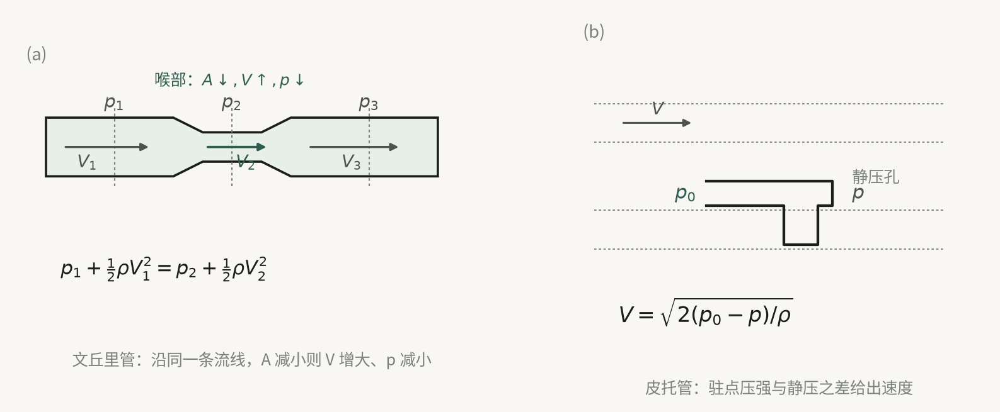
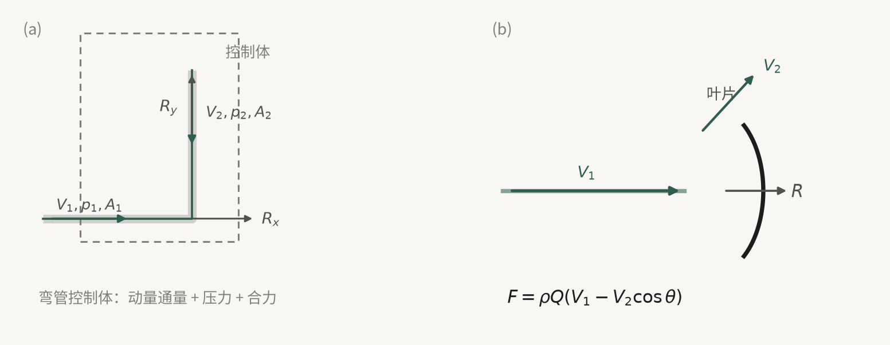

## 这一章要解决的两个问题

第 3 章给出的是微分形式的基本方程组。对绝大多数真实流动，这套方程无法解析求解，数值求解也要付出高昂代价。但工程上提出的问题往往并不需要完整流场，而只是两类更粗的信息：

- 沿流程（沿一条流线、沿管轴）上**速度和压力如何变化**；
- 流体与固体之间**总的合力或合力矩**是多少。

本章针对这两类问题各给出一条出路。第一类：把运动微分方程沿一条流线积分一次，得到**伯努利方程**，它本质上是运动方程的一次积分，把偏微分方程降为沿流线的代数关系。第二类：放弃求流场分布，直接在有限控制体上使用**积分形式的动量定理和动量矩定理**，把微分方程降为代数方程。

本章反复使用的两种数学操作——沿流线积分（得到一维分布）与控制体面积分（得到总力）——就是全章的结构主线。物理上则始终限定在**无粘性**这一前提之内；一旦引入粘性，伯努利方程要加损失项，动量方程本身却不受影响（见后文）。

## 一维模型：把三维压成一维的代价与条件

### 一维、准一维与它们的现实性

**一维流动**指流场中所有流动物理量（速度、压力、密度等）只与一个空间坐标有关；若这些量还与时间有关，就是一维非定常流，否则是一维定常流。

严格意义的一维流动在自然界和工程中几乎不存在——真实管道截面上参数总是不均匀的。可行的做法有两种：

1. **取流线为坐标线**。沿一条流线、沿微元流束的中心流线、或沿平面（空间辐射状）流线的对称流动，可以认为是比较严格的一维流动。这是理论推导的本义。
2. **取截面平均**。对工业管道、槽道，假定截面上参数均匀分布，或按截面平均值计算，就得到**准一维流动**。它不仅研究速度、压力等参数**沿管轴方向（即流动方向）的变化规律；并且还要研究过流截面面积沿流动方向变化所引起的流量、动量、动量矩和能量等的变化**。

这种模型要成立，原文给出三条几何条件，它们共同界定了模型的适用范围：

1. 沿程过流截面面积**变化小且连续**——这样才可以认为截面上所有流体都沿管轴方向流动；
2. 轴线的**弯度很小**，即轴线曲率半径远大于过流截面的半径或等效半径——这样弯曲流动产生的离心力对截面上压力分布没有影响；
3. 所研究的**管段长度远大于过流截面直径**或等效直径。

这里需要说明记号。本章沿用原书习惯：一维流动（含准一维）用 $V=V(s,t)$ 表示沿管轴 $s$ 的**截面平均流速**，$A=A(s)$ 为过流截面积；直角坐标分量仍记作 $(u,v,w)$。但 $u$ 在涡轮机部分另指叶轮的**牵连速度** $u=r\omega$，须按上下文区分。相对速度记 $V_\mathrm{r}$，随体导数 $D/Dt$，涡量 $\boldsymbol{\omega}=\nabla\times\boldsymbol{V}$。

一维模型的价值在于代价小、结论有工程意义：长流程管路与管网设计可直接用它计算；涡轮机叶轮通道这类复杂流动，也先用一维方法求截面平均流速、初步确定流道几何，再用二维或三维方法精算。

### 一个示范：从三维方程“删项”得到一维方程

原文用例 4.1 演示了这条路径，值得单独说明，因为它展示了简化的一般手法。

等截面细管 $ABC$ 在 $B$ 处直角转折，$BC$ 水平、$AB$ 竖直向上，$AB=BC=a$，$A$ 端敞口通大气，$C$ 端阀门突然打开，忽略粘性。由于细管等截面、忽略粘性，可认为管内是**不可压缩一维非定常流**。取 $x$ 轴水平、$z$ 轴竖直向上。

$AB$ 段只有 $z$ 向速度 $w$，连续性方程简化为 $\partial w/\partial z=0$，即 $w=w(t)$；运动方程在 $x$、$y$ 方向退化为 $\partial p/\partial x=\partial p/\partial y=0$，在 $z$ 方向为

$$
\frac{\partial w}{\partial t}+w\frac{\partial w}{\partial z}=-g-\frac{1}{\rho}\frac{\partial p}{\partial z}
\quad\Longrightarrow\quad
\frac{\mathrm{d}w}{\mathrm{d}t}=-g-\frac{1}{\rho}\frac{\partial p}{\partial z}.
$$

$BC$ 段同理得 $\dfrac{\mathrm{d}u}{\mathrm{d}t}=-\dfrac{1}{\rho}\dfrac{\partial p}{\partial x}$。

这个例子的真正要点在**定解条件的计数**：方程中速度只出现对时间的一阶导数，所以只需一个关于速度的初始条件（$t=0$ 时 $w=u=0$）；压力只出现对坐标的一阶偏导，所以只需一个关于压力的边界条件（$t>0$ 时自由液面处 $p=p_\mathrm{a}$）。再注意到 $x_0+z_0=2a$，于是 $\mathrm{d}z_0/\mathrm{d}t=-\mathrm{d}x_0/\mathrm{d}t$、$\mathrm{d}w/\mathrm{d}t=-\mathrm{d}u/\mathrm{d}t$，两段方程就耦合成可解的定解问题。**方程的阶数决定定解条件的个数**，这一点在后续所有一维问题中通用。

### 变截面管流的三个基本方程

当截面积沿程变化时，基本方程不能由微分形式直接简化，而要**对第 3 章的积分形式方程取微元管段 $\tau=A\,\mathrm{d}s$ 作控制体**，或由微分方程简化后再积分。取沿管轴坐标 $s$，$A=A(s)$，$V=V(s,t)$，$\rho=\rho(s,t)$。

**连续性方程。** 由积分形式连续性方程，控制体只有一个入口截面和一个出口截面、截面上参数均匀，得 $\dfrac{\partial\rho}{\partial t}A\,\mathrm{d}s+(\rho VA)_2-(\rho VA)_1=0$，展开即

$$
A\frac{\partial\rho}{\partial t}+\frac{\partial}{\partial s}(\rho VA)=0 .
$$

这是**可压缩一维非定常**管流的连续性方程。它的三种常用简化必须分清前提：

| 前提 | 结论形式 | 含义 |
| --- | --- | --- |
| 不可压缩 | $VA=Q=$ 常数 | 体积流量守恒 |
| 可压缩且定常 | $\rho VA=Q_m=$ 常数 | 质量流量守恒 |
| 等截面 | $\dfrac{\partial\rho}{\partial t}+\dfrac{\partial}{\partial s}(\rho V)=0$ | 沿流线的一维形式 |

可压缩定常时还可写成便于分析变截面的微分形式

$$
\frac{\mathrm{d}\rho}{\rho}+\frac{\mathrm{d}V}{V}+\frac{\mathrm{d}A}{A}=0 ,
$$

它直接说明：亚声速与超声速下，截面积变化对速度的影响方向相反（这一结论本身要配合状态方程与动量方程才能定量）。原文特别指出：**连续性方程与流体粘性无关**。

**运动方程。** 把积分形式动量方程用于同一控制体，得

$$
\frac{\partial}{\partial t}(\rho V)A\,\mathrm{d}s+\frac{\partial}{\partial s}(\rho V^2A)\mathrm{d}s=\sum F_s ,
$$

其中 $\sum F_s$ 是作用在微元控制体内流体上所有外力在轴向 $s$ 的合力。按图 4-3 的几何关系，取体积力为重力、侧表面压力取平均值 $p+\mathrm{d}p/2$、侧壁粘性切应力平均值 $\tau_\mathrm{w}$，则

$$
\sum F_s=-\rho gA\,\mathrm{d}s\cos\alpha-A\frac{\partial p}{\partial s}\mathrm{d}s-\tau_\mathrm{w}\,\mathrm{d}A\cot\theta ,
$$

$\alpha$ 为重力方向与 $\mathrm{d}s$ 的夹角，$\theta$ 为 $\mathrm{d}s$ 段管壁扩张角。无粘性时 $\tau_\mathrm{w}=0$，得

$$
A\frac{\partial}{\partial t}(\rho V)+\frac{\partial}{\partial s}(\rho V^2A)=-\rho gA\cos\alpha-A\frac{\partial p}{\partial s}.
$$

这是重力场中**无粘性可压缩一维非定常**流的运动方程。两种简化：

- 定常、忽略重力：利用 $\rho VA=$ 常数化简为
$$
V\,\mathrm{d}V+\frac{\mathrm{d}p}{\rho}=0 ,
$$
这是气体在变截面（收缩、缩放）管道中一维定常流动最常用的运动方程；
- 等截面，记 $-g\cos\alpha=f_s$：
$$
\rho\Big(\frac{\partial V}{\partial t}+V\frac{\partial V}{\partial s}\Big)=\rho f_s-\frac{\partial p}{\partial s},
$$
它对可压缩和不可压缩流体**形式上相同**。

**能量方程。** 同样取 $\tau=\mathrm{d}\tau$，忽略热辐射等热源项，令通过与控制面交换的热流量为 $Q_h$，体积力只有重力，$g\cdot V=-gV\,\mathrm{d}z/\mathrm{d}s$，压力作功项化为 $-\dfrac{\partial}{\partial s}(pVA)\mathrm{d}s$，整理得

$$
\frac{\partial}{\partial t}\Big[\rho\Big(e+\frac{V^2}{2}\Big)\Big]A\,\mathrm{d}s+\frac{\partial}{\partial s}\Big[\rho VA\Big(e+\frac{V^2}{2}\Big)\Big]\mathrm{d}s+\rho VA\frac{\partial}{\partial s}(gz)\mathrm{d}s+\frac{\partial}{\partial s}(pVA)\mathrm{d}s=Q_h ,
$$

这里 $e$ 是单位质量内能。令 $A=$ 常数即得沿流线的一维能量方程。它的三种简化对应三类流体：

- **定常**（此时 $\rho VA=$ 常数）：
$$
\mathrm{d}\Big(e+\frac{p}{\rho}+\frac{V^2}{2}+gz\Big)=\frac{Q_h}{\rho VA},
$$
这是无粘性可压缩流体一维定常流的能量方程；
- **定常、完全气体、绝热、忽略重力**（记焓 $h=e+p/\rho$）：
$$
h+\frac{V^2}{2}=\text{常数},\qquad \mathrm{d}h+V\,\mathrm{d}V=0 ,
$$
原文称之为**可压缩流动的伯努利方程**；
- **定常、不可压缩、无粘性、无热交换**（$\mathrm{d}e=0$，$Q_h=0$，$\rho=$ 常数，$VA=$ 常数）：
$$
\frac{p}{\rho}+\frac{V^2}{2}+gz=\text{常数}.
$$

最后这个就是**不可压缩流动的伯努利方程**的管流形式。注意它是从能量方程得到的，并且用了一维假设；下一节将从运动方程重新推出它，届时会发现并不需要一维，只需要“沿同一条流线”。

**方程组的闭合。** 对完全气体的一维定常**等熵**管流，连续性方程 $\dfrac{\mathrm{d}\rho}{\rho}+\dfrac{\mathrm{d}V}{V}+\dfrac{\mathrm{d}A}{A}=0$、运动方程 $V\,\mathrm{d}V+\dfrac{\mathrm{d}p}{\rho}=0$、能量方程 $\mathrm{d}h+V\,\mathrm{d}V=0$，再补充等熵条件

$$
\frac{\mathrm{d}p}{\mathrm{d}\rho}=\frac{\gamma p}{\rho}
$$

（$\gamma$ 为比热比），构成封闭的微分方程组，这是气体动力学的基本出发点。**“等熵”不是可有可无的补充，而是把能量方程与状态关系接起来的必要条件**。

## 弯道与缓变流：伯努利方程能写在一个截面上的理由

前面的推导只考虑沿轴线的流动。若管道弯曲，垂直于轴线方向会出现什么？把问题简化为无粘性不可压缩流体在弯管内的定常平面运动，沿中心流线 $s$ 速度为 $V$，径向速度为 0，体积力只有重力。在柱坐标下用 $r\mathrm{d}\theta=\mathrm{d}s$、$V_\theta=V$，运动方程的两个分量给出

$$
-\frac{V^2}{r}=-g\frac{\partial z}{\partial r}-\frac{1}{\rho}\frac{\partial p}{\partial r},
\qquad
V\frac{\partial V}{\partial s}=-g\frac{\partial z}{\partial s}-\frac{1}{\rho}\frac{\partial p}{\partial s}.
$$

后一式即 $\dfrac{\partial}{\partial s}\Big(\dfrac{p}{\rho}+\dfrac{V^2}{2}+gz\Big)=0$，就是沿轴线（中心流线）的伯努利方程。前一式给出

$$
\frac{\partial}{\partial r}(p+\rho gz)=\frac{\rho V^2}{r}.
$$

若流动在水平面内或重力可忽略，则 $\dfrac{\mathrm{d}p}{\mathrm{d}r}=\dfrac{\rho V^2}{r}$。这说明：**弯道过流截面上的径向压强梯度由弯曲流动的离心力造成**，压强从内侧向外侧逐渐增大。其后果是截面上形成从外侧沿壁流向内侧的**二次流**，二次流与主流叠加成螺旋流动，造成局部能量损失——这正是弯曲管段局部阻力的物理来源，也说明**弯道内部不是一维流动**。

关键的一步在极限情形：若轴线曲率半径很大（$r\to\infty$），即管内流线几乎都是平行直线，则上式退化为

$$
p+\rho gz=\text{常数}\quad(\text{同一过流截面上}),
$$

忽略重力时整个截面上 $p$ 相等。原文把流线几乎都是平行直线的流段称为**缓变流区域**，实际上就是等直或接近等直的管段。这条结论给伯努利方程的应用带来极大方便：**只有在缓变流截面上，才能用截面上的一个点代表整个截面的 $z$ 和 $p$**，从而使“沿一条流线成立”的伯努利方程可以写成两个截面之间的关系式。这也解释了 4.1.1 中第三条几何条件（管段长度远大于直径）的用途。

## 伯努利方程：运动方程沿流线的首次积分

### 积分需要五个前提

从兰姆-葛罗米柯型运动方程出发：

$$
\frac{\partial \boldsymbol{V}}{\partial t}+\nabla\Big(\frac{V^2}{2}\Big)+\boldsymbol{\omega}\times\boldsymbol{V}
=\boldsymbol{f}+\frac{1}{\rho}\nabla\cdot\mathbf{P}.
$$

无粘性时应力张量 $\mathbf{P}=-p\mathbf{I}$，方程化为

$$
\frac{\partial \boldsymbol{V}}{\partial t}+\nabla\Big(\frac{V^2}{2}\Big)+\boldsymbol{\omega}\times\boldsymbol{V}
=\boldsymbol{f}-\frac{1}{\rho}\nabla p .
$$

要能积分，需两个假定：

1. **体积力有势**：存在势函数 $U$ 使 $\boldsymbol{f}=-\nabla U$（直角坐标下 $f_x=-\partial U/\partial x$ 等）；
2. **正压流体**：密度只是压力的函数 $\rho=f(p)$，从而可引入正压函数
$$
P=\int\frac{\mathrm{d}p}{\rho},\qquad \nabla P=\frac{\nabla p}{\rho}.
$$
不可压缩流场、完全气体的等温流场与绝热（无粘时即等熵）流场都属正压流场。

代入后得

$$
\frac{\partial \boldsymbol{V}}{\partial t}+\nabla\Big(\frac{V^2}{2}+U+P\Big)+(\nabla\times\boldsymbol{V})\times\boldsymbol{V}=0 .
$$

若流动再**定常**，则

$$
\nabla\Big(\frac{V^2}{2}+U+P\Big)+(\nabla\times\boldsymbol{V})\times\boldsymbol{V}=0 .
$$

沿一条流线取微元弧长矢量 $\mathrm{d}\boldsymbol{s}$ 点乘两边。由于流线定义 $\mathrm{d}\boldsymbol{s}\parallel\boldsymbol{V}$，故 $[(\nabla\times\boldsymbol{V})\times\boldsymbol{V}]\cdot\mathrm{d}\boldsymbol{s}=0$，剩下全微分 $\mathrm{d}\big(\tfrac{V^2}{2}+U+P\big)=0$，积分得

$$
\frac{V^2}{2}+\int\frac{\mathrm{d}p}{\rho}+U=C(\psi),
$$

$\psi$ 标记所选流线。这就是**伯努利积分（伯努利定理）**。它的成立条件共五条，缺一不可：

1. 流体无粘性；
2. 体积力有势；
3. 流场正压；
4. 流动定常；
5. 沿同一条流线。

同一条流线上 $C(\psi)$ 相同，**不同流线一般取不同的常数值**。这是本章最容易出错的一条。

### 不可压缩与可压缩两种具体形式

**不可压缩。** $\rho=$ 常数，$P=\int\mathrm{d}p/\rho=p/\rho$；体积力只有重力时取 $z$ 轴竖直向上，$U=gz$（可加常数），代入得

$$
\frac{V^2}{2}+\frac{p}{\rho}+gz=C(\psi)
\quad\text{或}\quad
\frac{V^2}{2g}+\frac{p}{\rho g}+z=C_1(\psi).
$$

它与由能量方程得到的管流形式完全一致。原文对此的说明很重要：对无粘性不可压缩流体，流动中不存在热效应，**由运动方程积分得到的伯努利方程就是能量方程**；但两者的前提不同——能量方程那一版假定了一维，这一版不要求一维，只要求在同一条流线上成立。**这说明不可压缩时不需要额外的绝热条件。**

**可压缩。** 对常比热完全气体且流动绝热（即等熵），由 $p=c\rho^\gamma$ 得 $\mathrm{d}p/\mathrm{d}\rho=\gamma p/\rho$，于是

$$
P=\int\frac{\mathrm{d}p}{\rho}=\frac{\gamma}{\gamma-1}\frac{p}{\rho}=h ,
$$

重力场中

$$
\frac{V^2}{2}+\frac{\gamma}{\gamma-1}\frac{p}{\rho}+gz=h+\frac{V^2}{2}+gz=C(\psi),
$$

忽略重力即 $h+\frac{V^2}{2}=C(\psi)$。原文强调：对无粘性可压缩流动，**只有当流动绝热时，由运动方程得到的伯努利方程才与能量方程相同**。可压缩而等温（如长输气管）时正压函数 $P$ 要另取表达式，不能套用上式的 $\gamma/(\gamma-1)$ 形式。

小结成对照表（表内只列关键前提）：

| 形式 | 流体 | 关键前提 |
| --- | --- | --- |
| $V^2/2+p/\rho+gz=C(\psi)$ | 不可压缩 | 无粘、定常、沿流线 |
| $h+V^2/2+gz=C(\psi)$ | 完全气体 | 再加绝热（等熵） |
| $p+\frac12\rho V^2=p_0$ | 不可压缩 | 再加忽略重力或同一水平面 |

### 物理意义：单位重量流体的能量守恒

以 $\dfrac{V^2}{2g}+\dfrac{p}{\rho g}+z=C_1(\psi)$ 逐项解释（各项对**单位重量**流体而言）：

- $\dfrac{V^2}{2g}$：单位重量流体的动能；
- $\dfrac{p}{\rho g}$：单位重量流体的压力能（压力能对单位重量流体所作功的能力）；
- $z$：单位重量流体的位置势能（重力能作的功）；
- 三项之和：单位重量流体的总机械能。

于是伯努利方程的物理意义是：**同一条流线上各点单位重量流体的总机械能相等**。

关于常数是否全场相同，原文给出明确判据：若同一流动中所有流线都起始于同一点（如无穷远处、同一容器的自由液面），且在起始处具有相同的 $V$、$p$、$z$，则所有流线的总机械能相同，此时可在流场任意两点之间列伯努利方程。无粘性不可压缩**无旋流动**就具有这一性质，故对无旋流可不选流线、只选两点。

若流动在同一水平面上或忽略重力，方程化为

$$
p+\frac{1}{2}\rho V^2=p_0 ,
$$

其中 $p$ 为静压（静压强），$\frac12\rho V^2$ 为单位体积流体的动能、称**动压**，$p_0$ 为**滞止压强**（驻点压强、总压）。此时同一流线上总压相等，于是“压强大则流速小”，反之亦然。

量纲上要分清三套：$V^2/2+p/\rho+gz$ 是单位质量能量（$\mathrm{J/kg}=\mathrm{m^2/s^2}$）；$V^2/2g+p/\rho g+z$ 是长度（水头，$\mathrm{m}$）；$p+\frac12\rho V^2$ 是单位体积能量（$\mathrm{Pa}$）。

### 几何意义：总水头线

式中的每一项都具有长度量纲，沿用水力学命名：$z$ 为**位置水头**（位头）；$\dfrac{p}{\rho g}$ 为**压力水头**（压强水头、测压管水头，简称压头）；$\dfrac{V^2}{2g}$ 为**速度水头**（测速管水头，简称速度头）；三者之和为**总水头**。于是几何意义是：**同一条流线上各点的总水头为同一常数，各点总水头的连线（理想总水头线）是一条与基准面平行的水平线**。这条水平线也是后文判断“加损失项、加减泵扬程后总水头线如何变化”的基准。

### 沿一条流线的应用：皮托管与小孔出流

**皮托管。** 测静压的孔必须**垂直内壁面开**，因为静压是流体中的法向表面应力；皮托管一端必须**正对来流**。当来流进入皮托管使管内液体静止时，管口 1 点就是**滞止点**（$V_1=0$）。1 点与同一水平流线上的 2 点之间用伯努利方程，管道水平且 $V_1=0$：

$$
V_2=\sqrt{\frac{2}{\rho}(p_1-p_2)}=\sqrt{2gh}.
$$

式中 $p_2$ 是静压、$p_1$ 是总压；因 2 点在缓变流截面上、1 点管内液体静止，两点都遵循静止流体的压力分布，故 $\dfrac{p_1}{\rho g}-\dfrac{p_2}{\rho g}=h_1-h_2=h$，$h$ 即速度头。

测气体时不能直接用水柱，要用**皮托-静压管**（中心内管测总压，环形套管测静压，同一截面侧壁等间隔开多个静压孔，两端接 U 形差压计，差压计液体密度 $\rho_1$）：

$$
V=\sqrt{\Big(\frac{\rho_1}{\rho}-1\Big)2gh}\;\xrightarrow{\ \rho_1\gg\rho\ }\;V=\sqrt{\frac{\rho_1}{\rho}\,2gh},
$$

$\rho$ 为气体密度，$h$ 为测压计液柱的铅垂高度差。原文明确指出：由于所用伯努利方程忽略了粘性并假定流线平直，**实际流速将略小于上式的理论值**。

**小孔定常出流。** 容器侧壁小孔出流，流动非定常；但当液体得到补充使液位不降，或容器横截面积远大于小孔面积、在不太长的时间内可认为液位不降时，可按定常处理。所有流线起始于液面 1 处且参数相同，故伯努利积分常数全场一致，因此也可在流场中任选两点列式（先取 1 与 3、再取 3 与 2 得到同样结果）。以 1（液面，$V_1=0$，$z_1=h$）与 2（出流截面，$p_2=p_\mathrm{a}$，$z_2=0$）列式：

$$
V_2=\sqrt{\frac{2}{\rho}(p_1-p_\mathrm{a})+2gh},
$$

敞口容器 $p_1=p_\mathrm{a}$ 时 $V_2=\sqrt{2gh}$。这就是“位置势能转化为出口动能”的最简单例子。

### 用在两个截面上的应用：文丘里管与射流泵

管道一维流动中应用伯努利方程，有三条操作要求：

1. 把管道中心轴线看成一条流线（若假定截面上参数均匀）；用截面平均法时 $V=Q/A$，平均动能写作 $\alpha V^2/2g$，$\alpha$ 为**动能修正系数**，无粘流动常取 $\alpha=1$；
2. **必须在两个缓变流截面上列式**——只有缓变流截面上 $p/\rho g+z$ 处处相同，才可用截面上一点代表整个截面；
3. 与连续性方程 $A_1V_1=A_2V_2=Q$ 联立，两个方程一般可解两个未知量。

**文丘里流量计。** 由收缩段、喉部、扩散段组成。在 1-1（面积 $A_1$）与 2-2（喉部面积 $A_2$）两个缓变流截面上列伯努利方程和连续性方程；U 形差压计（液体密度 $\rho_1$）的等压面条件给出

$$
\Big(\frac{p_1}{\rho g}+z_1\Big)-\Big(\frac{p_2}{\rho g}+z_2\Big)=\Big(\frac{\rho_1}{\rho}-1\Big)h .
$$

与连续性方程联立得

$$
Q=\frac{A_1A_2}{\sqrt{A_1^2-A_2^2}}\sqrt{2gh\Big(\frac{\rho_1}{\rho}-1\Big)} .
$$

实际流动因粘性损失与截面速度分布不均，需乘流量修正系数，约 $0.95\sim0.99$。

**射流泵。** 原理同样是伯努利方程：喷嘴出口的高速射流在 2-2 截面造成真空，把下方容器 B 的液体吸上来并与射流一起输送到下游。所求上游液位 $H_1$ 受两个条件制约——既要在 2-2 造成足够真空度把液体抽上来，又要在 2-2 有足够动能把液体送到下游高度。对 2-2 与出口 4-4 列方程，再利用 2-2 到 B 液面管段中压强按静水规律分布得 $p_2=-\rho gH_3$，最后在 1-1 与 2-2 之间列式，得

$$
H_1=\frac{H_2+H_3}{1-\big(d_2/d_4\big)^4}-H_3 ,
$$

可见必须 $d_2<d_4$。实际有损失，所需 $H_1$ 还要提高，或将容器 A 密封加压。

### 四项推广

**（1）沿程有分流或汇流。** 此时不能只对一个过流截面用单位重量流体的伯努利方程，要按**总机械能守恒**（即乘以重量流量 $\rho gQ$）列式：

$$
\rho gQ_1\Big(\frac{V_1^2}{2g}+\frac{p_1}{\rho g}+z_1\Big)
=\rho gQ_2\Big(\frac{V_2^2}{2g}+\frac{p_2}{\rho g}+z_2\Big)
+\rho gQ_3\Big(\frac{V_3^2}{2g}+\frac{p_3}{\rho g}+z_3\Big),
$$

配合质量守恒 $Q_1=Q_2+Q_3$。它与分别对 1-2、1-3 列单位重量伯努利方程等价。例 4.6 用这一思路证明：射流冲击平板后分流，若各流股都处于大气压中、不计重力与损失，则 $V_1=V_2=V_3$，**与平板倾斜角无关**。这个结论的适用范围就是这三个条件，加了重力或损失后不再成立。

**（2）沿程有能量输入或输出。** 管路上有流体机械时

$$
\frac{V_1^2}{2g}+\frac{p_1}{\rho g}+z_1\pm H=\frac{V_2^2}{2g}+\frac{p_2}{\rho g}+z_2 ,
$$

$H$ 是单位重量流体与机械之间的能量交换：泵类工作机械（水泵、风机、压缩机）流体获得能量，取“$+$”；原动机类马达（水轮机、液压马达、汽轮机、燃气轮机）流体输出能量，取“$-$”。理论总功率 $N=\rho gQH$。水力发电例中 $H=H_1-\dfrac{V_2^2}{2g}$，

$$
N=\rho Q\Big(gH_1-\frac{1}{2}V_2^2\Big),
$$

由此看出提高功率的两条途径（增大流量、提高上游水头）以及应尽量减小下游排水速度。

**（3）一维准定常流动。** 大容器孔口出流实际上是非定常的。当 $A_2\le 0.1A_1$ 时，自由液面下降很慢，可把整个过程切成许多 $\mathrm{d}t$ 时段，每个时段内按定常流动处理，这就是**准定常出流**。由定常伯努利方程加连续性得

$$
V_2=\frac{\sqrt{2gh}}{\sqrt{1-(A_2/A_1)^2}}\approx\sqrt{2gh},
$$

再由质量守恒写出液面与时间的微分关系

$$
\mathrm{d}t=\frac{-A_1\,\mathrm{d}h}{A_2\sqrt{2gh}},
$$

给定 $A_1(h)$ 即可积分。等截面直柱容器从 $h_0$ 降到 $h$ 需

$$
t=\frac{A_1}{A_2}\sqrt{\frac{2}{g}}\big(\sqrt{h_0}-\sqrt{h}\big),
$$

泄空时 $t=\dfrac{2A_1h_0}{Q_0}$（$Q_0=A_2\sqrt{2gh_0}$）。即**准定常泄空时间恰为定常放出同量液体所需时间的两倍**，这个倍数关系只对等截面直柱形容器成立。同样的方程可研究“充满”过程。例 4.8 的虹吸管问题是这一方法的直接延伸：由瞬时定常伯努利方程得 $V=\sqrt{2g(z-h_0+2h)}$，再积分得

$$
t=\frac{1}{\sqrt{2g}}\Big(\frac{D}{d}\Big)^2\big(\sqrt{z+h_0}-\sqrt{z-h_0}\big),
$$

结果与液体种类、管路布局无关只是**忽略一切损失**的产物，实际时间都要长一些。

**（4）沿程有能量损失。** 若保证流动绝热，伯努利方程可推广到有沿程损失的一维管流：

$$
\frac{\alpha_1V_1^2}{2g}+\frac{p_1}{\rho g}+z_1\pm H
=\frac{\alpha_2V_2^2}{2g}+\frac{p_2}{\rho g}+z_2+h_{w1\text{-}2},
$$

$h_{w1\text{-}2}$ 是 1 到 2 之间单位重量流体的能量损失（含沿程阻力损失与局部阻力损失，恒为正，写在能量较低的一侧），$\alpha_1,\alpha_2$ 通常取 1。这就是**粘性总流的伯努利方程**，此时已不属于“无粘”范畴，须注意它不再是运动方程的积分，而是机械能平衡式。

### 非定常流动

去掉定常假设，沿一条**瞬时流线**从 1 积分到 2，注意到速度方向与 $\mathrm{d}\boldsymbol{s}$ 一致，多出一项：

$$
\frac{V_1^2}{2}+\frac{p_1}{\rho}+gz_1=\frac{V_2^2}{2}+\frac{p_2}{\rho}+gz_2+\int_1^2\frac{\partial V}{\partial t}\mathrm{d}s=C(\psi,t).
$$

这就是**无粘性不可压缩流体的非定常伯努利方程**：$C(\psi,t)$ 表示**同一时刻**沿同一条瞬时流线为常数。它同样可用于二维、三维流动，特别是所有瞬时流线都来自或通过某均匀区域的流动（无旋流动）。处理管道非定常一维流动时，瞬时流线就是管轴且不随时间变化，此时基本方程组为

$$
AV=Q(t),\qquad
\frac{V_1^2}{2}+\frac{p_1}{\rho}+gz_1=\frac{V_2^2}{2}+\frac{p_2}{\rho}+gz_2+\int_1^2\frac{\partial V}{\partial t}\mathrm{d}s .
$$

由已知的 $Q(t)$ 与 $A(s)$ 可定出沿流线各点的 $V$ 与 $p$。

例 4.9 说明非定常项的效应不可忽略：直柱容器孔口出流，取流线 1→2，因容器内液体整体以相同 $\partial V_1/\partial t$ 下降，有 $\displaystyle\int_1^2\frac{\partial V}{\partial t}\mathrm{d}s=h\frac{\mathrm{d}V_1}{\mathrm{d}t}$，于是得到关于 $V_1$（或关于 $h$）的非线性常微分方程，需数值求解。以准定常结果作零级近似（令 $\mathrm{d}V_1/\mathrm{d}t=0$）再逐次逼近到一级，得

$$
V_1=\Big[\frac{2gh}{(A_1/A_2)^2-1}\Big]^{1/2}\cdot\frac{1}{\sqrt{1-(A_2/A_1)^2}},
$$

即因非定常效应，液面下降速度**至少增大** $\big[1-(A_2/A_1)^2\big]^{-1/2}$ 倍，泄空时间至少缩短同样倍数，且此效应随 $A_2/A_1$ 增大而更明显。**“准定常”只是一个近似，而不是等价**。

### 非惯性坐标系

对无粘性流体，在运动坐标系中有

$$
\frac{D\boldsymbol{V}_\mathrm{r}}{Dt}
=\boldsymbol{f}-\boldsymbol{a}_0
-\boldsymbol{\omega}\times(\boldsymbol{\omega}\times\boldsymbol{r})
-\frac{\mathrm{d}\boldsymbol{\omega}}{\mathrm{d}t}\times\boldsymbol{r}
-2\boldsymbol{\omega}\times\boldsymbol{V}_\mathrm{r}
-\frac{1}{\rho}\nabla p,
$$

其中 $\boldsymbol{a}_0$ 为坐标系平移加速度，$\boldsymbol{\omega}$ 为转动角速度，$\boldsymbol{V}_\mathrm{r}$ 为相对速度，$\boldsymbol{r}$ 为动坐标系中的矢径。与惯性系相比，体积力里多出四项**惯性力**：平移惯性力 $-\boldsymbol{a}_0$、离心惯性力 $-\boldsymbol{\omega}\times(\boldsymbol{\omega}\times\boldsymbol{r})$、欧拉惯性力 $-\frac{\mathrm{d}\boldsymbol{\omega}}{\mathrm{d}t}\times\boldsymbol{r}$、科氏惯性力 $-2\boldsymbol{\omega}\times\boldsymbol{V}_\mathrm{r}$。它们在一定的简化条件下仍可积出伯努利方程。

**等加速直线运动坐标系。** 取 $\boldsymbol{a}_0$ 为常矢量、$\boldsymbol{\omega}=0$，仍假定不可压缩、体积力只有重力，用矢量恒等式 $(\boldsymbol{V}\cdot\nabla)\boldsymbol{V}=\nabla(V^2/2)+(\nabla\times\boldsymbol{V})\times\boldsymbol{V}$ 整理得

$$
\frac{\partial\boldsymbol{V}_\mathrm{r}}{\partial t}
+\nabla\Big(\frac{V_\mathrm{r}^2}{2}+\frac{p}{\rho}+gz+\boldsymbol{a}_0\cdot\boldsymbol{r}\Big)
+(\nabla\times\boldsymbol{V}_\mathrm{r})\times\boldsymbol{V}_\mathrm{r}=0 .
$$

沿相对运动的一条瞬时流线积分：

$$
\frac{V_{\mathrm{r}1}^2}{2}+\frac{p_1}{\rho}+gz_1+(\boldsymbol{a}_0\cdot\boldsymbol{r})_1
=\frac{V_{\mathrm{r}2}^2}{2}+\frac{p_2}{\rho}+gz_2+(\boldsymbol{a}_0\cdot\boldsymbol{r})_2
+\int_1^2\frac{\partial V_\mathrm{r}}{\partial t}\mathrm{d}s ,
$$

相对运动定常时去掉积分项，右端为 $C(\psi)$。多出的一项 $(\boldsymbol{a}_0\cdot\boldsymbol{r})$ 相当于给重力势加了一个“惯性力势”。

例 4.10 把这层意思讲得很清楚：电梯以等加速度 $a$ 竖直上升、水箱底面附近的水龙头打开，取动坐标与容器固结、$D\gg d$，按非惯性系中的一维定常相对运动处理，$\boldsymbol{a}_0=a\boldsymbol{k}$、$\boldsymbol{r}=z\boldsymbol{k}$，则

$$
V_2=\sqrt{\frac{2(g+a)h}{1-(d/D)^4}} .
$$

也就是说，惯性力在这里的作用相当于把重力加速度换成了**等效重力加速度** $g+a$。

**等角速度旋转坐标系。** 设坐标系仅绕 $z$ 轴以 $\omega$ 等速旋转，$\boldsymbol{a}_0=0$、$\mathrm{d}\boldsymbol{\omega}/\mathrm{d}t=0$，并注意 $\boldsymbol{\omega}\times(\boldsymbol{\omega}\times\boldsymbol{r})=-\nabla\big(\omega^2\frac{x^2+y^2}{2}\big)$，得

$$
\frac{\partial\boldsymbol{V}_\mathrm{r}}{\partial t}
+\nabla\Big[\frac{V_\mathrm{r}^2}{2}+\frac{p}{\rho}+gz-\omega^2\frac{x^2+y^2}{2}\Big]
+(\nabla\times\boldsymbol{V}_\mathrm{r})\times\boldsymbol{V}_\mathrm{r}
+2\boldsymbol{\omega}\times\boldsymbol{V}_\mathrm{r}=0 .
$$

注意科氏力项 $2\boldsymbol{\omega}\times\boldsymbol{V}_\mathrm{r}$ 中含 $\nabla\times$ 之外的结构，因此**只有在相对运动定常、并且沿一条流线积分**（此时科氏力与流线方向垂直、不作功）时才得到简洁结果：

$$
\frac{V_\mathrm{r}^2}{2}+\frac{p}{\rho}+gz-\omega^2\frac{x^2+y^2}{2}=C(\psi).
$$

把这类结果用于旋转叶轮：$u=r\omega$ 为牵连速度，$w$ 为与流线相切的相对速度，沿通道中心流线从 1 到 2 有

$$
\frac{w_1^2}{2g}+\frac{p_1}{\rho g}+z_1+\frac{u_2^2-u_1^2}{2g}
=\frac{w_2^2}{2g}+\frac{p_2}{\rho g}+z_2 ,
$$

其中 $\dfrac{u_2^2-u_1^2}{2g}=\dfrac{(r_2^2-r_1^2)\omega^2}{2g}$ 表示**离心力对单位重量流体作的功**。记 $H_i=\dfrac{w_i^2}{2g}+\dfrac{p_i}{\rho g}+z_i$，则

$$
H_2-H_1=\frac{u_2^2-u_1^2}{2g}.
$$

流体由里向外（$r_2>r_1$）时 $H_2-H_1>0$，离心力作正功，是**泵工况**（水泵、风机）；由外向里（$r_2<r_1$）时 $H_2-H_1<0$，离心力作负功，是**马达工况**（水轮机）。这一小段结论后面会与动量矩定理得到的欧拉方程互相印证。

图 4-1　文丘里管与皮托管：沿同一条流线的伯努利方程，以及用驻点压强与静压之差测速。

## 动量定理：当只关心总力时

### 为什么换工具

伯努利方程给出的是速度、压力**沿流线或沿截面的分布**；工程上另有一类问题，不需要流场每一点的压力，只要流体与物体之间的**总作用力或总力矩**。这时直接用积分形式的动量（矩）定理，比解微分方程或做伯努利积分方便得多。代价是：动量方程给出的是合力，不给分布，也不给作用点位置（后者要靠动量矩方程）。

### 系统与控制体

这是控制体分析必须先交代清楚的一步：

| 对比项 | 系统 | 控制体 |
| --- | --- | --- |
| 对象 | 确定的流体质点集合 | 人为选定的空间区域 |
| 边界 | 随流体运动，无质量穿越 | 几何面，流体可自由穿越 |
| 方程形式 | 牛顿定律可直接用 | 需经输运方程转换 |
| 得到的结果 | 质点系的历史 | 空间区域上的通量平衡 |

转换靠雷诺输运方程，把“系统动量变化率”化成“控制体内动量变化率 + 控制面动量通量”。这就是式 (4-63) 中时间导数项与面积分项并存的由来，也是所有“通量方向与正负号”问题的根源：**面积分一律取外法线 $\boldsymbol{n}$ 为正，流入为负、流出为正**，所以化简后总是“出口项减进口项”。

### 积分形式动量方程及其简化

$$
\frac{\partial}{\partial t}\int_\tau\rho\boldsymbol{V}\,\mathrm{d}\tau
+\oint_A\rho\boldsymbol{V}(\boldsymbol{V}\cdot\boldsymbol{n})\,\mathrm{d}A=\sum\boldsymbol{F}.
$$

原文强调三点，都是适用范围：

1. **只对惯性坐标系成立**，控制体 $\tau$ 必须相对惯性系固定；
2. 形式**与流体粘性无关**，有粘性时也成立；
3. $\sum\boldsymbol{F}$ 是作用在控制体内流体上所有外力的矢量和。因控制体是人为选定的、方程允许 $\tau$ 内物理量不连续，所以也允许 $\tau$ 内有其他物体，此时

$$
\sum\boldsymbol{F}=\int_\tau\rho\boldsymbol{f}\,\mathrm{d}\tau+\oint_A\boldsymbol{p}_n\,\mathrm{d}A+\boldsymbol{R},
$$

$\boldsymbol{R}$ 是 $\tau$ 内所含物体对流体的总作用力（反作用力）。前两项是质量力与表面力，第三项是固体对流体之力——**求流体对固体的作用力时，最后要取反号**。

直角坐标下的三个标量方程即 $x,y,z$ 三分量形式。简化链条如下，每一步都增加一条前提：

- 定常：$\displaystyle\oint_A\rho\boldsymbol{V}(\boldsymbol{V}\cdot\boldsymbol{n})\mathrm{d}A=\sum\boldsymbol{F}$；
- 再加“只有一个出口面 $A_2$、一个进口面 $A_1$”（$A_1$ 上取内法线）：$\displaystyle\int_{A_2}\rho_2\boldsymbol{V}_2(\boldsymbol{V}_2\cdot\boldsymbol{n}_2)\mathrm{d}A_2-\int_{A_1}\rho_1\boldsymbol{V}_1(\boldsymbol{V}_1\cdot\boldsymbol{n}_1)\mathrm{d}A_1=\sum\boldsymbol{F}$；
- 再加“截面上参数均匀或按平均值计算”：$Q_{m2}\boldsymbol{V}_2-Q_{m1}\boldsymbol{V}_1=\sum\boldsymbol{F}$；
- 若 1、2 之间无质量增减，$Q_{m1}=Q_{m2}=Q_m$：

$$
Q_m(\boldsymbol{V}_2-\boldsymbol{V}_1)=\sum\boldsymbol{F},
\qquad
Q_m(u_2-u_1)=\sum F_x,\ \ Q_m(v_2-v_1)=\sum F_y,\ \ Q_m(w_2-w_1)=\sum F_z .
$$

### 弯管受力：控制体与投影符号

例 4.11 是这套方法的范式。已知进口直径 $d_1$、出口直径 $d_2$、转角 $\theta$、密度 $\rho$、体积流量 $Q$，进出口相对压强 $p_1,p_2$，弯管在水平面内，求流体对弯管的作用力。

操作两步：**选控制体**（弯管内壁面 + 进出口过流截面），把待求的固壁作用力集中到控制面上；**选坐标系**（图中直角坐标），尽量减少方程个数。速度由连续性方程给出 $V_1=Q/(\pi d_1^2/4)$、$V_2=Q/(\pi d_2^2/4)$。设弯管对流体的反作用力为 $\boldsymbol{R}$，则

$$
\sum F_x=p_1\frac{\pi}{4}d_1^2-p_2\frac{\pi}{4}d_2^2\cos\theta-R_x,
\qquad u_1=V_1,\ u_2=V_2\cos\theta,
$$

代入 $\rho Q(u_2-u_1)=\sum F_x$ 得

$$
R_x=p_1\frac{\pi}{4}d_1^2-p_2\frac{\pi}{4}d_2^2\cos\theta-\rho Q(V_2\cos\theta-V_1);
$$

同理 $v_1=0$、$v_2=-V_2\sin\theta$，$\sum F_y=p_2\frac{\pi}{4}d_2^2\sin\theta-R_y$，得

$$
R_y=p_2\frac{\pi}{4}d_2^2\sin\theta+\rho QV_2\sin\theta .
$$

流体对弯管的作用力 $\boldsymbol{F}=-\boldsymbol{R}$。原文特别讨论了三件事，都是易错点：

- 用**相对压强**是因为固壁外表面也受大气压作用，控制面上大气压的合力相互抵消；
- 弯管水平，重力与流动方向无关，$\sum\boldsymbol{F}$ 中只含表面力合力。原始方程中这个表面力**可以包含粘性切应力**，这里笼统记作 $\boldsymbol{R}$，粘性影响就体现在 $p_1$、$p_2$ 上；因此在 $V_1,V_2$ 已知时 $p_1,p_2$ 只能给一个，另一个要用（计及粘性时的）伯努利方程求；
- 投影符号必须逐项核对，如 $v_2=-V_2\sin\theta$。

### 轴流式涡轮机的欧拉方程

以轴线为中心用圆柱面切割叶轮并展开，得到**平面翼栅**：一组形状相同、互相平行的翼型，间距称栅距 $t$；取叶片高度方向为单位长度，按平面流动分析。控制体取两相邻叶片通道（侧边界为两条中心流线），与翼栅固结——只要转速恒定，它就是随牵连速度 $u$ 平移的惯性系。

设进出口平均绝对速度 $V_1,V_2$ 与叶片运动方向成 $\alpha_1,\alpha_2$，牵连速度均为 $u$，速度三角形中 $\beta_1,\beta_2$ 为叶片安装角（保证相对速度与叶片面相切）。两侧中心流面上的压强分布反对称、互相抵消，忽略重力，则周向与轴向平衡为

$$
R_x=Q_m(V_{2x}-V_{1x}),\qquad
R_y=Q_m(V_{2y}-V_{1y})+(p_2-p_1)t ,
$$

其中 $Q_m=\rho_1V_{1y}t=\rho_2V_{2y}t$，$R_x,R_y$ 是单位高度叶片对流体的反作用力分量。单位时间动叶轮对流体的机械功率 $N=R_xu$，折成单位重量流体：

$$
H=\frac{u}{g}(V_{2x}-V_{1x})=\frac{u}{g}(V_{2u}-V_{1u}),
$$

这就是**轴流式涡轮机的欧拉方程**。$V_{2u},V_{1u}$ 是绝对速度的周（切）向分量——注意这里是**绝对速度**，不是相对速度。$H>0$ 表示机械对流体的作用，流体获得能量（轴流压缩机、轴流泵、轴流风机）；$H<0$ 表示流体对机械作功（汽轮机、燃气轮机、水轮机）。由于动叶轮无轴向运动，轴向推力 $R_y$ 不作功；若把控制体取在两叶片之间的通道内而不包围叶片，可用可压缩流伯努利方程说明动叶进出口流体的**相对总焓保持不变**。

原文还说明了一个设计上的必然结果：随叶片高度增加牵连速度 $u$ 增大而绝对速度基本不变，相对速度方向随之改变，为使相对速度在每一个圆周截面上都与叶片面相切，**叶片必须沿高度逐渐扭曲**。这一段的适用范围也要说清：它建立在无粘一维、进出口参数均匀、转速恒定、忽略重力之上。

### 螺旋桨：动量方程与伯努利方程配合

螺旋桨定常旋转、同时以 $V_1$ 匀速前进，按相对性原理等价于流体以 $V_1$ 流过固定螺旋桨。上游截面 ① 参数均匀；接近桨盘时速度增、压强减（加速区，有滑流边界）；到桨盘前 ② 处平均速度 $V_2$、压强 $p_2$；通过桨盘流体获得能量，③ 处压强升到 $p_3$ 而速度不变（质量守恒）；之后压强继续转化为速度，到下游 ④ 处 $p_4=p_1$、速度最大 $V_4$。

两个控制体给出两个推力表达式：取 ①④ 与滑流边界围成的控制体（四周压力相同相互抵消）：

$$
T=\rho Q(V_4-V_1);
$$

取 ②③ 与桨盘外缘围成的控制体：

$$
T=(p_3-p_2)\frac{\pi}{4}D^2 .
$$

再用两段伯努利方程（①—②、③—④，均可视为无粘、无外功段）把压强差化为速度差：

$$
p_2=p_1+\frac{\rho}{2}(V_1^2-V_2^2),\qquad
p_3=p_1+\frac{\rho}{2}(V_4^2-V_2^2),
$$

两式相减得 $p_3-p_2=\frac{\rho}{2}(V_4^2-V_1^2)$，与上式联立并用 $V_2=Q/A$（$A=\pi D^2/4$）可得

$$
V_2=\frac{V_1+V_4}{2},\qquad
T=2\rho Q\Big(\frac{Q}{A}-V_1\Big)=2\rho Q(V_2-V_1).
$$

**桨盘处的速度恰为远前方与远后方速度的算术平均**，这是动量方程与伯努利方程配合的经典结果。若改在 ①④ 之间列含能量交换的伯努利方程，则 $H=\frac{1}{2g}(V_4^2-V_1^2)=\frac{1}{g}V_2(V_4-V_1)$，流体获得的总功率 $N_0=\rho gQH$，而输出（推力）功率 $N=TV_1=\rho QV_1(V_4-V_1)$，故理论效率

$$
\eta=\frac{N}{N_0}=\frac{V_1}{V_2}.
$$

由此产生一个内在矛盾：要推力大需 $Q$ 大或 $V_2-V_1$ 大，但 $V_2-V_1$ 大时效率低，存在优化问题。这一段的所有结论都在“忽略粘性与重力、忽略越过桨盘时的扭转、用桨盘代替螺旋桨”之下成立；螺旋桨内部流场本身是复杂三维问题，须数值求解。

### 非惯性系中的动量方程与火箭推力

把四项惯性力并入体积力，控制体与非惯性系固结、速度换为相对速度 $\boldsymbol{V}_\mathrm{r}$，得

$$
\frac{\partial}{\partial t}\int_\tau\rho\boldsymbol{V}_\mathrm{r}\mathrm{d}\tau
+\oint_A\rho\boldsymbol{V}_\mathrm{r}(\boldsymbol{V}_\mathrm{r}\cdot\boldsymbol{n})\mathrm{d}A
=\int_\tau\rho\big[\boldsymbol{f}-\boldsymbol{a}_0-\boldsymbol{\omega}\times(\boldsymbol{\omega}\times\boldsymbol{r})
-\frac{\mathrm{d}\boldsymbol{\omega}}{\mathrm{d}t}\times\boldsymbol{r}-2\boldsymbol{\omega}\times\boldsymbol{V}_\mathrm{r}\big]\mathrm{d}\tau
+\oint_A\boldsymbol{p}_n\mathrm{d}A .
$$

相对运动定常、一进一出且截面上相对参数均匀时简化为

$$
Q_{m2}\boldsymbol{V}_{\mathrm{r}2}-Q_{m1}\boldsymbol{V}_{\mathrm{r}1}=\sum\boldsymbol{F}.
$$

**这里必须用相对速度**，与惯性系版本的形式差别正在于此。

例 4.13 的火箭问题展示了为何要用非惯性系：火箭作竖直加速运动，控制体随火箭运动，相对运动定常、相对动量几乎不变，故时间导数项为零，只剩出口的相对动量通量 $-Q_{me}V_e$ 与外力。外力含出口压力项 $(p_e-p_a)A_e$、体积力项 $-(g+a_0)(M_{02}-Q_{me}t)$ 以及其余表面上压力积分所定义的推力 $T$。整理得

$$
T=Q_{me}V_e+(p_e-p_a)A_e-(g+a_0)(M_{02}-Q_{me}t),
$$

再对火箭本体用牛顿第二定律 $M_{01}a_0=T-D-M_{01}g$，得质心运动微分方程

$$
a_0=\frac{Q_{me}V_e+(p_e-p_a)A_e-D}{M_0-Q_{me}t}-g .
$$

可见推力的两个来源是**动量推力** $Q_{me}V_e$ 与**压力推力** $(p_e-p_a)A_e$；而 $V_e,p_e,Q_{me}$ 需由发动机内部流场计算，阻力 $D$ 需由外部绕流计算，两者都还要靠试验验证——这正说明了“一维＋控制体”方法的定位：给出总体量，不给出流场细节。

图 4-2　弯管控制体与射流冲击叶片：动量定理中的动量通量、压力与合力。

## 动量矩定理：当只关心总力矩时

### 方程与简化

原文对此有明确限定：**动量矩方程只是补充方程，不是独立方程**，凡能用它求解的问题原则上都能用动量定理求解；微分形式的动量矩方程在流体力学中只用于证明应力张量中切应力互等。但在两类问题上它方便得多：求流体与固体之间的总作用力矩或总作用力的作用点；求转动物体或涡轮机叶轮通道中流体与固体的相互作用力矩。

$$
\frac{\partial}{\partial t}\int_\tau\rho(\boldsymbol{r}\times\boldsymbol{V})\mathrm{d}\tau
+\oint_A(\boldsymbol{r}\times\boldsymbol{V})(\rho\boldsymbol{V}\cdot\boldsymbol{n})\mathrm{d}A=\sum\boldsymbol{M},
$$

$\boldsymbol{r}$ 为某参考点到 $\mathrm{d}\tau$ 或 $\mathrm{d}A$ 的矢径。同样：只对惯性系成立；与粘性无关；$\sum\boldsymbol{M}$ 包括质量力矩、表面力矩，以及 $\tau$ 内物体对流体的总反作用力矩 $\boldsymbol{M}_0$。简化条件与动量方程一一对应：

- $\tau$ 内动量矩不随时间变化：$\displaystyle\oint_A(\boldsymbol{r}\times\boldsymbol{V})(\rho\boldsymbol{V}\cdot\boldsymbol{n})\mathrm{d}A=\sum\boldsymbol{M}$；
- 再加一进一出、截面上参数均匀、定常：
$$
Q_{m2}(\boldsymbol{r}_2\times\boldsymbol{V}_2)-Q_{m1}(\boldsymbol{r}_1\times\boldsymbol{V}_1)=\sum\boldsymbol{M},
$$
$\boldsymbol{r}_1,\boldsymbol{r}_2$ 是同一参考点到进出口截面形心的矢径；
- 再加“忽略体积力和控制面上表面力的合力矩，或其合力矩为零”：
$$
Q_m\big[(\boldsymbol{r}_2\times\boldsymbol{V}_2)-(\boldsymbol{r}_1\times\boldsymbol{V}_1)\big]=\boldsymbol{M}_0 .
$$

### 径流式涡轮机的欧拉方程

控制体包围整个叶轮，取与外机壳固结的惯性系，进出口截面为控制面的一部分，叶轮旋转角速度 $\omega$ 恒定，忽略一切损失。这里有一个容易困惑之处：对惯性系而言，叶轮通道内流体的绝对运动是**非定常**的；但转速恒定、进出口条件不变时，控制体内流体的**合动量矩不随时间变化**，故时间导数项仍为零。此外：质量力对水平 $y$ 轴对称分布，其力矩为零；进出口截面上只有压力且作用线都通过 $y$ 轴，表面力矩也为零。于是化为上一条最简形式，按速度三角形展开：

$$
M_0=Q_m(V_2r_2\cos\alpha_2-V_1r_1\cos\alpha_1)=Q_m(r_2V_{2u}-r_1V_{1u}),
$$

$M_0$ 是通过转轴传递的力矩，$V_{1u},V_{2u}$ 为绝对速度的周向分量。轴功率 $N=M_0\omega=Q_m(u_2V_{2u}-u_1V_{1u})$，折成单位重量流体：

$$
H=\frac{1}{g}(u_2V_{2u}-u_1V_{1u}).
$$

这是**径流式（含混流式）涡轮机的欧拉方程**。与轴流式相比，唯一的形式差别是**牵连速度不再相等**（$u_1\ne u_2$）；两者 $H$ 的含义相同，$H>0$ 为泵工况、$H<0$ 为马达工况。这与前面非惯性系伯努利方程得到的 $H_2-H_1=(u_2^2-u_1^2)/2g$ 相呼应：后者是理想、无外功、沿相对流线的能量关系，前者是包含转轴力矩的总体关系，两者前提不同，不可混用。

### 非惯性系中的动量矩方程与洒水器

$$
\begin{aligned}
&\frac{\partial}{\partial t}\int_\tau(\boldsymbol{r}\times\boldsymbol{V}_\mathrm{r})\rho\,\mathrm{d}\tau
+\oint_A(\boldsymbol{r}\times\boldsymbol{V}_\mathrm{r})(\rho\boldsymbol{V}_\mathrm{r}\cdot\boldsymbol{n})\mathrm{d}A\\
&=\int_\tau\boldsymbol{r}\times\Big[\boldsymbol{f}-\boldsymbol{a}_0-\boldsymbol{\omega}\times(\boldsymbol{\omega}\times\boldsymbol{r})
-\frac{\mathrm{d}\boldsymbol{\omega}}{\mathrm{d}t}\times\boldsymbol{r}-2\boldsymbol{\omega}\times\boldsymbol{V}_\mathrm{r}\Big]\rho\,\mathrm{d}\tau
+\oint_A\boldsymbol{r}\times\boldsymbol{p}_n\mathrm{d}\tau ,
\end{aligned}
$$

$\tau$ 相对于运动坐标系固定；若 $\tau$ 内还有物体，则 $\sum\boldsymbol{M}$ 中再加物体对流体的总反作用力矩。

例 4.14 的洒水器值得细看，因为它给出了**两种解法互检**的范例。两旋臂不等长（$a$、$b$），每侧喷嘴体积流量均为 $Q$，管径 $d$，等速旋转，忽略摩擦与损失，求 $\omega$。

*解法一（非惯性系）：* 控制体与旋臂固结，柱坐标原点在轴心。相对流动定常，时间导数项为零；两个出流截面方向与 $r$ 正交，进口 $r_1\approx0$，故面积分只剩

$$
\oint_A(\boldsymbol{r}\times\boldsymbol{V}_\mathrm{r})(\rho\boldsymbol{V}_\mathrm{r}\cdot\boldsymbol{n})\mathrm{d}A=\rho QV_\mathrm{r}(a+b).
$$

惯性力矩中 $\boldsymbol{a}_0=0$、$\boldsymbol{r}\times[\boldsymbol{\omega}\times(\boldsymbol{\omega}\times\boldsymbol{r})]=0$、$\mathrm{d}\boldsymbol{\omega}/\mathrm{d}t=0$，重力取矩不在 $z$ 方向，只有科氏力项

$$
\int_\tau-2\boldsymbol{r}\times(\boldsymbol{\omega}\times\boldsymbol{V}_\mathrm{r})\rho\,\mathrm{d}\tau
=2\rho\int r\omega V_\mathrm{r}s\,\mathrm{d}r=\rho Q\omega(a^2+b^2),
$$

其中 $s$ 为管截面积、$\mathrm{d}\tau=s\,\mathrm{d}r$、$Q=sV_\mathrm{r}$；喷嘴出口压力矩为零。代入方程即得

$$
\omega=\frac{a+b}{a^2+b^2}V_\mathrm{r},\qquad V_\mathrm{r}=\frac{4Q}{\pi d^2}.
$$

*解法二（惯性系）：* 控制体改为包围整个洒水器管路，可直接套用径流式涡轮机的欧拉方程。忽略摩擦与损失时 $M_0=0$，$r_1\approx0$，故 $r_2V_{2u}=0$，即

$$
aV_{2u1}+bV_{2u2}=0,\qquad V_{2u1}=V_\mathrm{r}-a\omega,\quad V_{2u2}=V_\mathrm{r}-b\omega,
$$

代回同样得 $\omega=\dfrac{a+b}{a^2+b^2}V_\mathrm{r}$。两法结果一致，关键在**绝对速度＝相对速度＋牵连速度**：惯性系里用绝对周向分量 $V_{\mathrm{r}}-r\omega$，非惯性系里相对速度与科氏力矩配对，二者是同一件事的两种记账方式。

## 易错辨析

- **伯努利必须沿同一条流线**（或全场积分常数相同的特殊情形，如各流线同源于参数相同的均匀区、无粘不可压缩无旋流）。不同流线一般 $C(\psi)$ 不同，跨流线相减是常见错误。
- **可压缩时多一条“绝热（等熵）”要求**；不可压缩时不需要，因为流动中无热效应。等温可压缩流不能套 $\frac{\gamma}{\gamma-1}\frac{p}{\rho}$。
- **必须在缓变流截面上取 $p$ 和 $z$**。截面处在急变区（弯头、阀门、突扩）时，“截面上 $p+\rho gz$ 处处相同”不成立，用一点代表整个截面就错了。这也是 4.1.1 三条几何条件的实际用途。
- **损失项 $h_w$ 恒为正，写在能量较低的一侧**；泵的 $H$ 取“$+$”、马达取“$-$”，符号错一个方向整题反号。有损失的伯努利方程已不是运动方程的积分，而是机械能平衡，且原文只在绝热前提下推广到可压缩情形。
- **相对速度与绝对速度不能混用**：非惯性系动量（矩）方程中用 $\boldsymbol{V}_\mathrm{r}$；涡轮机欧拉方程中用绝对速度的周向分量 $V_{1u},V_{2u}$ 与牵连速度 $u$；洒水器两解法之差正在于此。
- **动量方程与粘性无关，伯努利方程要求无粘**。动量方程里未显式出现的粘性效应被“吸收”进压强，所以已知速度时进出口压强只能给一个，另一个要靠伯努利方程补。
- **用相对压强**：固壁外表面有大气压，控制面上大气压相互抵消；但出口射入大气的自由射流与压力推力项 $(p_e-p_a)A_e$ 要单独考虑。
- **动能修正系数 $\alpha$**：无粘流动常取 1；一旦计及真实截面速度分布不均，$\alpha\ne1$，且平均动能不是 $\frac{1}{2}\rho V^2$。
- **准定常只是近似**：判据是 $A_2\le0.1A_1$ 一类的小截面比；非定常项使泄空速度至少增大 $\big[1-(A_2/A_1)^2\big]^{-1/2}$ 倍。等截面直柱容器准定常泄空时间为定常出流的两倍，这个“两倍”只对该形状成立，不能外推到变截面容器。
- **一维模型的边界**：弯道内存在由离心力造成的径向压强梯度与二次流，本身就是非一维、有局部损失的流动；涡轮机叶轮内的一维计算只用于初步设计，精确结果须用准三维或三维理论。