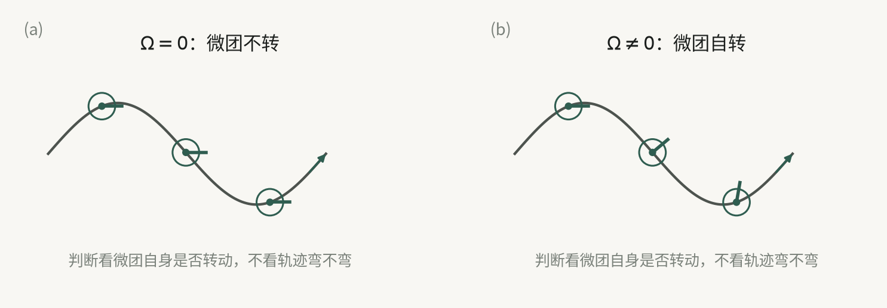
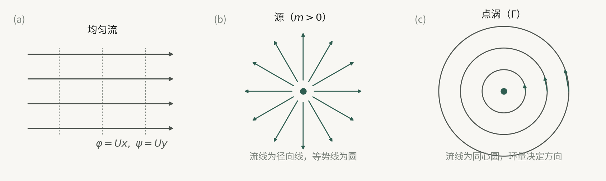
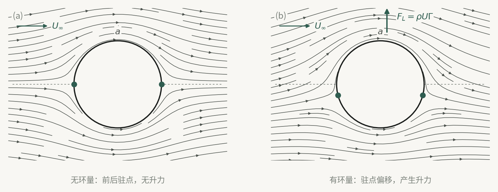

## 5.1 有旋与无旋：看微团自身是否转动

本章讨论的对象是不可压缩、无粘性（理想）流体的平面二维流动。把三维绕流简化为二维，依赖的条件是：绕无限长柱形物体流动，且物体长度足够长，使垂直于柱体轴线的各平行平面内流动可视为相同；工程中“严格二维”并不存在，只有当某一方向物理量变化很小、该方向速度接近零时才可近似为平面二维流动。本节要解决的是：用什么量刻画流体微团的转动，以及“有旋/无旋”的判据究竟是什么。

流体微团一般可分解为平移、转动、线变形和角变形。旋转角速度定义为两条互相垂直的微团中心线在单位时间内绕同一转轴转过的角度，其三分量为

$$
\Omega_x=\frac12\left(\frac{\partial w}{\partial y}-\frac{\partial v}{\partial z}\right),\quad
\Omega_y=\frac12\left(\frac{\partial u}{\partial z}-\frac{\partial w}{\partial x}\right),\quad
\Omega_z=\frac12\left(\frac{\partial v}{\partial x}-\frac{\partial u}{\partial y}\right),
$$

矢量形式为

$$
\boldsymbol\Omega=\frac12\operatorname{rot}\boldsymbol V=\frac12\nabla\times\boldsymbol V.
$$

定义涡量

$$
\boldsymbol\omega=2\boldsymbol\Omega=\nabla\times\boldsymbol V.
$$

有旋流动指流体微团旋转角速度不为零；无旋流动指 $\boldsymbol\Omega=0$。因此无旋的充要条件是

$$
\frac{\partial v}{\partial x}=\frac{\partial u}{\partial y},\qquad
\frac{\partial u}{\partial z}=\frac{\partial w}{\partial x},\qquad
\frac{\partial w}{\partial y}=\frac{\partial v}{\partial z}.
$$

关键辨析：有旋、无旋仅由流体微团本身是否转动决定，与微团运动轨迹是否为圆无关。微团沿圆周运动但自身方向不变，可以是无旋；轨迹不是圆但微团自转，可以是有旋。判断还与所研究流体区域有关：一部分流体存在某一方向涡流，另一部分存在等强度反向涡流，对整个区域可相互抵消而表现为无旋。原文用河床凹凸流动说明：两条中心线反向转动相同角度可抵消，而整体同向转动则为有旋。

图 5-1　有旋与无旋：判断看流体微团自身是否转动，不看轨迹是否弯曲。

## 5.2 涡线、涡管、涡束与涡通量：涡量场的几何描述

本节要解决的是：如何像用流线、流管描述速度场那样，定量描述涡量场。涡量场为 $\boldsymbol\omega(x,y,z,t)=2\boldsymbol\Omega$。

涡线是某一给定时刻 $t$ 的曲线，曲线上每点切线与该点流体微团涡量方向相同，即瞬时转动轴线。涡线微分方程为

$$
\frac{\mathrm dx}{\omega_x(x,y,z,t)}
=\frac{\mathrm dy}{\omega_y(x,y,z,t)}
=\frac{\mathrm dz}{\omega_z(x,y,z,t)},
$$

其中 $t$ 为参变量。与流线一样，涡线本身是欧拉方法的瞬时概念；非定常时其形状位置随时间变化，只有定常流动中才保持不变。

在给定瞬时取一条不是涡线的封闭曲线，过其上每点作涡线，形成管状表面，称为涡管；涡管内充满作旋转运动的流体，称为涡束。

涡通量（也称涡管强度）定义为

$$
J=\int_A \boldsymbol\omega\cdot\boldsymbol n\,\mathrm dA
=\int_A \omega_n\,\mathrm dA
=2\int_A \Omega_n\,\mathrm dA.
$$

其中 $\boldsymbol n$ 为曲面 $A$ 上微元面积的外法线单位向量。涡通量是标量，可正可负。

涡量场的重要性质是

$$
\nabla\cdot\boldsymbol\omega
=\nabla\cdot(\nabla\times\boldsymbol V)=0,
$$

称为涡量连续方程，表明涡量场为无源场。由此得到同一时刻同一涡管的涡通量守恒：与同一涡管相连的任意两个曲面上的涡通量相等。对断面较小的涡管，有效截面近似为平面，有

$$
\omega_1 A_1=\omega_2 A_2.
$$

因此同一时刻截面积越小处涡量越大；但角速度不可能无限大，涡管截面不能收缩到零。涡管不能在流体内部产生或终止，只能始于边界、终于边界，或在流体内部自成封闭涡环。原文同时指出，实际流体有粘性时涡管强度会随时间衰减。

## 5.3 速度环量与 Stokes 定理：把涡通量化为周线积分

本节要解决的问题是：涡通量是旋转角速度在面积上的积分，不便直接测量；能否用围绕涡束的速度分布来表示涡通量。为此引入速度环量

$$
\Gamma=\oint_L \boldsymbol V\cdot\mathrm d\boldsymbol s
=\oint_L(u\,\mathrm dx+v\,\mathrm dy+w\,\mathrm dz).
$$

环量是标量，其正负既取决于速度方向，也取决于积分绕行方向。为统一符号，规定逆时针绕行封闭周线为正方向，即封闭周线所包围区域总在积分方向左侧，面积法线与绕行正方向成右手螺旋关系。

Stokes 定理：当单连通有限封闭周线内有涡束时，沿封闭周线的速度环量等于该周线内所有涡束的涡通量之和：

$$
\Gamma_L=\oint_L \boldsymbol V\cdot\mathrm d\boldsymbol s
=2\iint_A \Omega_n\,\mathrm dA
=\iint_A \omega_n\,\mathrm dA.
$$

证明思路是：先对微元矩形周线求环量，利用速度分量泰勒展开，得

$$
\mathrm d\Gamma
=\left(\frac{\partial v}{\partial x}-\frac{\partial u}{\partial y}\right)\mathrm dx\,\mathrm dy
=2\Omega_z\,\mathrm dA
=\mathrm dJ.
$$

再把有限单连通区域划分为无数微元矩形，相邻内周线积分方向相反、互相抵消，只剩外周四环量，从而得到有限区域结论。对空间曲面，将曲面细分为微元曲面，相邻微元公共周线积分抵消，得到空间 Stokes 定理：沿空间任一封闭周线 $L$ 的速度环量等于张于该周线上的空间曲面 $A$ 的涡通量。

对多连通区域，需要用辅助线段把多连通区域化为单连通区域。若有 $n$ 个内周线，则

$$
\Gamma_{L_1}-\sum_{i=1}^{n}\Gamma_{L_{2i}}
=2\iint_A\Omega_n\,\mathrm dA.
$$

即通过多连通区域的涡通量等于外周线环量与所有内周线环量总和之差。符号上，内周线环量要按统一规定方向计，辅助线往返积分互相抵消。

## 5.4 Lamb-Gromeko 方程与两类能量积分

本节要解决的问题是：欧拉运动微分方程只含线速度，不能直接判断有旋无旋；能否改写成同时含线速度和旋转角速度的形式，并在一定条件下积分得到能量关系。

无粘性流体运动微分方程为

$$
\frac{D\boldsymbol V}{Dt}
=\boldsymbol f-\frac1\rho\nabla p,
$$

对不可压缩和可压缩理想流体均适用；平衡时 $u=v=w=0$，退化为欧拉平衡微分方程。将随体导数分解为当地导数和迁移导数，再对迁移项加减项，可化为 Lamb-Gromeko 型方程。其矢量形式可写为

$$
\frac{\partial\boldsymbol V}{\partial t}
+\nabla\left(\frac{V^2}{2}\right)
+2\boldsymbol\Omega\times\boldsymbol V
=\boldsymbol f-\frac1\rho\nabla p.
$$

分量形式为

$$
\begin{aligned}
\frac{\partial u}{\partial t}+2(w\Omega_y-v\Omega_z)
&=f_x-\frac1\rho\frac{\partial p}{\partial x}
-\frac{\partial}{\partial x}\left(\frac{V^2}{2}\right),\\
\frac{\partial v}{\partial t}+2(u\Omega_z-w\Omega_x)
&=f_y-\frac1\rho\frac{\partial p}{\partial y}
-\frac{\partial}{\partial y}\left(\frac{V^2}{2}\right),\\
\frac{\partial w}{\partial t}+2(v\Omega_x-u\Omega_y)
&=f_z-\frac1\rho\frac{\partial p}{\partial z}
-\frac{\partial}{\partial z}\left(\frac{V^2}{2}\right).
\end{aligned}
$$

其优点是：既含 $u,v,w$，又含 $\Omega_x,\Omega_y,\Omega_z$，可区分有旋无旋；右边各项分别对应势能、压力能和动能沿坐标方向的梯度，便于积分得到能量守恒的整体规律。

积分前提为：定常；体积力有势，即

$$
f_x=-\frac{\partial U}{\partial x},\quad
f_y=-\frac{\partial U}{\partial y},\quad
f_z=-\frac{\partial U}{\partial z};
$$

流体不可压缩或为正压流体。正压流体指密度仅与压力有关。定义压力函数

$$
\mathcal P_F=\int\frac{\mathrm dp}{\rho(p)},
\qquad
\frac{\partial\mathcal P_F}{\partial x}
=\frac1\rho\frac{\partial p}{\partial x},\ \ldots
$$

常见正压流体：等温理想气体 $\rho=p/(RT)$，$\mathcal P_F=RT\ln p$；绝热理想气体 $\rho=Cp^{1/k}$，$\mathcal P_F=\frac{k}{k-1}\frac p\rho$；不可压缩流体 $\mathcal P_F=p/\rho$。在上述前提下，Lamb-Gromeko 方程化为

$$
\begin{aligned}
\frac{\partial}{\partial x}\left(U+\mathcal P_F+\frac{V^2}{2}\right)
&=-2(w\Omega_y-v\Omega_z),\\
\frac{\partial}{\partial y}\left(U+\mathcal P_F+\frac{V^2}{2}\right)
&=-2(u\Omega_z-w\Omega_x),\\
\frac{\partial}{\partial z}\left(U+\mathcal P_F+\frac{V^2}{2}\right)
&=-2(v\Omega_x-u\Omega_y).
\end{aligned}
$$

无旋时右端全为零，对任意微元线段积分得欧拉积分：

$$
U+\mathcal P_F+\frac{V^2}{2}=C.
$$

其适用条件是：无粘、不可压缩或正压、有势质量力、定常无旋流动；$C$ 在全流场为同一常数。物理意义是单位质量流体的位势能、压力势能和动能之和在全流场保持不变，三者可相互转换。

有旋时右端不为零，不能对任意线段积分，只能沿流线积分。定常时流线与迹线重合，$\mathrm d\boldsymbol s=\boldsymbol V\mathrm dt$，即 $\mathrm dx=u\mathrm dt$、$\mathrm dy=v\mathrm dt$、$\mathrm dz=w\mathrm dt$，代入后右端项相消，得伯努利积分：

$$
U+\mathcal P_F+\frac{V^2}{2}=C.
$$

形式与欧拉积分类似，但意义不同：有旋定常流动时，该式只沿同一流线成立；不同流线常数可不同。若质量力仅为重力，$U=gz$，不可压缩 $\mathcal P_F=p/\rho$，得

$$
gz+\frac p\rho+\frac{V^2}{2}=C,
$$

适用条件为重力作用、不可压缩无粘、定常、有旋流动沿同一流线。管内流动常作一维处理，此时取不同流线能量总和为同一常数。

## 5.5 Thomson 定理与 Helmholtz 涡定理：涡旋何时守恒

本节要解决的问题是：无粘、正压、有势质量力条件下，涡旋在运动过程中能否自行产生或消灭。先引入流体质点线：由确定流体质点连接而成的曲线，其形状和位置随流体质点运动而改变。

Thomson 定理：无粘性、正压流体在有势质量力作用下，沿任何封闭流体质点线的速度环量在运动过程中不随时间变化：

$$
\frac{\mathrm d\Gamma}{\mathrm dt}
=\frac{\mathrm d}{\mathrm dt}\oint_L \boldsymbol V\cdot\mathrm d\boldsymbol s=0.
$$

证明思路：对环量取随体导数，利用欧拉方程把加速度项换为质量力和压力梯度，再利用质量力有势和正压条件；另一部分由 $\mathrm d(\mathrm dx)/\mathrm dt=\mathrm du$ 等化为 $\oint\mathrm d(V^2/2)$。由于 $V^2/2$、$U$、$\mathcal P_F$ 均为空间坐标和时间的单值函数，沿封闭曲线积分等于零，故 $\mathrm d\Gamma/\mathrm dt=0$。

结合 Stokes 定理，沿封闭周线的环量等于通过张于其上的曲面的涡通量，因此 Thomson 定理说明：流场中旋涡不能自行产生，也不能自行消灭；原来有旋则保持相同涡旋强度的有旋，原来无旋则永远无旋。三个条件缺一不可：无粘、正压、质量力有势。实际粘性流体、非正压流体、无势质量力（如非惯性系中虚加的哥氏力）会破坏该定理。原文指出，若短时间内粘性影响小、流体近似正压且质量力近似有势，则可用 Thomson 定理判断流动运动性质。

Helmholtz 涡定理是 Thomson 定理关于有旋流动的进一步推论。

第一定理：同一瞬间，涡管各截面上的涡通量都相同。证明在涡管表面取两条无限接近的线，封闭周线包围的涡管表面无涡线通过，沿该周线环量为零；两条纵线积分抵消，得沿包围不同截面的周线环量相等，从而涡通量相等。因此涡管不能自行在流体中终止，只能自成封闭管圈或在流场边界开始、终止。

第二定理：无粘性、正压流体在有势质量力作用下，涡管在运动过程中永远由相同的流体质点组成。证明在涡管上任取封闭周线 $L$，通过 $L$ 所围曲面的涡通量为零；由 Thomson 定理该涡通量永远为零，故构成涡管表面的流体质点永远在涡管表面上，涡管形状可变但组成不变。

第三定理：在同样条件下，涡管强度不随时间变化。因为包围涡管的封闭周线环量等于涡管强度，而 Thomson 定理保证该环量不随时间变化。

## 5.6 速度势函数与流函数：存在条件与流网

本节要解决的问题是：无旋和不可压缩二维分别给出什么样的标量函数，使速度场可由一个函数描述；两者同时存在时有什么关系。

### 速度势函数

对无旋流动，沿任意封闭周线环量为零，因此从参考点 $A$ 到 $B$ 的速度线积分与路径无关：

$$
\int_{AL_1B}\boldsymbol V\cdot\mathrm d\boldsymbol s
=\int_{AL_2B}\boldsymbol V\cdot\mathrm d\boldsymbol s.
$$

数学上，无旋条件 $\Omega_x=\Omega_y=\Omega_z=0$ 是 $u\,\mathrm dx+v\,\mathrm dy+w\,\mathrm dz$ 成为某函数 $\varphi(x,y,z,t)$ 全微分的充要条件。定义速度势函数 $\varphi$，使

$$
u=\frac{\partial\varphi}{\partial x},\quad
v=\frac{\partial\varphi}{\partial y},\quad
w=\frac{\partial\varphi}{\partial z},
\qquad
\boldsymbol V=\nabla\varphi.
$$

其基本性质是：速度在任意方向 $s$ 上的分量等于速度势关于该方向的偏导数，$V_s=\partial\varphi/\partial s$。柱坐标下

$$
v_r=\frac{\partial\varphi}{\partial r},\quad
v_\theta=\frac1r\frac{\partial\varphi}{\partial\theta},\quad
v_z=\frac{\partial\varphi}{\partial z}.
$$

沿曲线 $AB$ 的切向速度线积分为

$$
\Gamma_{AB}=\int_A^B\boldsymbol V\cdot\mathrm d\boldsymbol s
=\varphi_B-\varphi_A.
$$

若 $\varphi$ 单值连续，则沿任一封闭周线环量为零。速度势是数学概念，不像重力势、电势那样有对应的单位质量势能物理意义；定常时 $\varphi=\varphi(x,y,z)$。无旋流动也称有势流动，即无旋流动等同于有势流动。可压缩流体无旋时也有速度势；但对不可压缩流体有势流动，代入连续方程得

$$
\nabla^2\varphi
=\frac{\partial^2\varphi}{\partial x^2}
+\frac{\partial^2\varphi}{\partial y^2}
+\frac{\partial^2\varphi}{\partial z^2}=0.
$$

即不可压缩有势流动的速度势满足拉普拉斯方程，是调和函数。该结论的前提是不可压缩、无旋，并未限定定常；$\varphi$ 也可含时间。拉普拉斯方程线性齐次，其不同解的线性组合仍是解，这为简单无旋流动叠加提供理论基础。

### 流函数

流函数仅对不可压缩流体的二维流动引入。平面二维流动指流场各点流速平行于某一固定平面，且各物理量在垂直该平面方向无变化。工程中严格二维不存在，只有某方向变化为小量且该方向速度接近零时近似成立。

不可压缩二维连续方程为

$$
\frac{\partial u}{\partial x}+\frac{\partial v}{\partial y}=0,
$$

平面流线微分方程为

$$
u\,\mathrm dy-v\,\mathrm dx=0.
$$

连续方程是 $u\,\mathrm dy-v\,\mathrm dx$ 成为某函数 $\psi(x,y)$ 全微分的充要条件，定义

$$
\mathrm d\psi=\frac{\partial\psi}{\partial x}\mathrm dx+\frac{\partial\psi}{\partial y}\mathrm dy
=-v\,\mathrm dx+u\,\mathrm dy,
$$

于是

$$
u=\frac{\partial\psi}{\partial y},\qquad
v=-\frac{\partial\psi}{\partial x}.
$$

极坐标下

$$
v_r=\frac1r\frac{\partial\psi}{\partial\theta},\qquad
v_\theta=-\frac{\partial\psi}{\partial r}.
$$

流函数具有明确物理意义：二维流动中两条流线间单位厚度通过的体积流量等于两流线上的流函数常数之差。符号规定为绕 $B$ 点逆时针穿过曲线 $AB$ 的流量为正，则

$$
q_V=\int_A^B(u\,\mathrm dy-v\,\mathrm dx)
=\psi_2-\psi_1.
$$

流函数存在只要求不可压缩二维流动，不要求无粘或无旋；无论理想流体还是粘性流体，无论有旋还是无旋，只要不可压缩平面流动就存在流函数。对 $xy$ 平面无旋流动，$\Omega_z=0$，即

$$
\frac{\partial v}{\partial x}-\frac{\partial u}{\partial y}=0,
$$

代入流函数定义得

$$
\nabla^2\psi
=\frac{\partial^2\psi}{\partial x^2}
+\frac{\partial^2\psi}{\partial y^2}=0.
$$

即不可压缩平面无旋流动的流函数也满足拉普拉斯方程，也是调和函数。

### 速度势与流函数的关系、流网

不可压缩平面二维无旋流动同时存在速度势 $\varphi$ 和流函数 $\psi$，由速度分量关系得柯西-黎曼条件：

$$
u=\frac{\partial\varphi}{\partial x}=\frac{\partial\psi}{\partial y},
\qquad
v=\frac{\partial\varphi}{\partial y}=-\frac{\partial\psi}{\partial x}.
$$

流线 $\psi=C$ 与等势线 $\varphi=K$ 的交点处，两者斜率乘积为

$$
\left(\frac{\mathrm dy}{\mathrm dx}\right)_{\varphi=K}
\left(\frac{\mathrm dy}{\mathrm dx}\right)_{\psi=C}=-1,
$$

故流线与等势线正交。用相等 $\Delta\psi$ 画流线、相等 $\Delta\varphi$ 画等势线，得到流网；速度越大，流线和等势线越密，流网可直观描绘流动特征。

| 项目 | 速度势 $\varphi$ | 流函数 $\psi$ |
|---|---|---|
| 存在条件 | 无旋流动 | 不可压缩二维流动 |
| 速度关系 | $u=\varphi_x,\ v=\varphi_y$ | $u=\psi_y,\ v=-\psi_x$ |
| 无旋时方程 | 不可压缩时 $\nabla^2\varphi=0$ | 平面无旋时 $\nabla^2\psi=0$ |

易错点：速度势存在不要求不可压缩；但“$\nabla^2\varphi=0$”要求不可压缩。流函数存在不要求无旋；但“$\nabla^2\psi=0$”要求平面无旋。

## 5.7 三种基本平面无旋流动

本节要解决的问题是：给出几种最简单的不可压缩平面二维无旋流动，作为叠加复杂流动的基本单元。对每种流动，原文均给出 $\varphi$、$\psi$、速度分布，并利用伯努利方程给出压力分布。

### 均匀直线流动

流场中各点速度大小方向相同：$u=u_0$，$v=v_0$，$u_0,v_0$ 为常数。流线由 $\mathrm dy/\mathrm dx=v_0/u_0$ 积分得

$$
v_0x-u_0y=C,
$$

为平行直线，与 $x$ 轴夹角 $\arctan(v_0/u_0)$。速度势和流函数为

$$
\varphi=u_0x+v_0y,\qquad
\psi=-v_0x+u_0y.
$$

等势线与流线互相垂直。若平行流在水平面内或忽略重力影响，由伯努利方程知流场中处处压强相同。研究绕物体外流时，距物体足够远（理论上无穷远）的流场可视为速度 $V_\infty$ 的均匀直线流。注意这里讨论的是速度大小连续有限的情况。

### 点源与点汇

无限平面上流体从一点沿径向直线均匀向各方流出，称点源，该点称源点；沿径向直线均匀从各方流入一点，称点汇，该点称汇点。取极坐标原点为源点或汇点，则 $v_\theta=0$，只有径向速度。不可压缩流体通过任一圆柱面的流量相等，单位厚度流量为

$$
q_V=\pm 2\pi r v_r,
\qquad
v_r=\pm\frac{q_V}{2\pi r}.
$$

源取正号，汇取负号；$q_V$ 称点源或点汇强度。积分得

$$
\varphi=\pm\frac{q_V}{2\pi}\ln r,\qquad
\psi=\pm\frac{q_V}{2\pi}\theta.
$$

等势线 $\varphi=\text{常数}$ 是同心圆，流线 $\psi=\text{常数}$ 是径向线，二者处处正交。$r=0$ 时 $v_r$、$\varphi$ 均为无穷大，源点或汇点是奇点，上述表达式只在源点或汇点以外适用。忽略重力影响，由伯努利方程得

$$
p=p_\infty-\frac{\rho q_V^2}{8\pi^2r^2}.
$$

压力随半径减小而降低；$r=r_0=[q_V^2\rho/(8\pi^2p_\infty)]^{1/2}$ 时 $p=0$；$r=0$ 处无物理意义，为奇点。

### 点涡与涡流

设有一涡管强度为 $\Gamma$ 的直线涡束，它在垂直于涡束轴线的平面内诱导出平面涡流。诱导速度方向由右手定则确定；大小由 Biot-Savart 定理确定。对无限长直涡束，诱导切向速度为

$$
v_\theta=\frac{\Gamma}{2\pi r},\qquad v_r=0.
$$

流线为以原点为圆心的同心圆。涡束外区域为无旋流动（势流旋转区），绕任一圆周流线的环量等于 $\Gamma$；涡束内流体像刚体一样以等角速度绕自身轴旋转，$v_\theta=r\omega$，为有旋流动，称涡核区。设涡束半径 $r_b$，边缘切向速度 $v_{\theta b}$，压力 $p_b$，无穷远压力 $p_\infty$。

涡束外为有势流动，满足伯努利方程，故

$$
p=p_\infty-\frac{\rho v_\theta^2}{2}
=p_\infty-\frac{\rho\Gamma^2}{8\pi^2}\frac1{r^2}.
$$

压力随 $r$ 减小而降低。若把势流旋转区延伸到中心，$r\to0$ 时 $p\to\infty$，不可能，因此涡核不能按势流处理。涡核内有旋，伯努利方程不成立，需用平面定常欧拉运动微分方程求压力。对涡核内刚体等角速度圆周运动，得

$$
p=p_\infty+\frac12\rho v_\theta^2-\rho v_{\theta b}^2,
$$

即

$$
p=p_\infty-\rho\omega^2r_b^2+\frac12\rho\omega^2r^2.
$$

涡核中心 $p_c=p_\infty-\rho v_{\theta b}^2$，涡核边缘 $p_b=p_\infty-\frac12\rho v_{\theta b}^2$，故涡核内、外压力降相等，均等于以涡核边缘速度计算的动压头：

$$
p_\infty-p_b=p_b-p_c=\frac12\rho v_{\theta b}^2.
$$

涡核区压强比外部势流旋转区低，故涡核有抽吸作用。当涡束半径 $r_b\to0$ 时，涡束成为一条涡线，这种流动称点涡；点涡中心为奇点。点涡的速度势和流函数为

$$
\varphi=\frac{\Gamma}{2\pi}\theta,\qquad
\psi=-\frac{\Gamma}{2\pi}\ln r.
$$

习惯规定逆时针环量为正，顺时针为负。

| 基本流动 | 速度势 $\varphi$ | 流函数 $\psi$ | 主要流线 |
|---|---|---|---|
| 均匀流 | $u_0x+v_0y$ | $-v_0x+u_0y$ | 平行直线 |
| 源/汇 | $\pm\frac{q_V}{2\pi}\ln r$ | $\pm\frac{q_V}{2\pi}\theta$ | 径向线 |
| 点涡 | $\frac{\Gamma}{2\pi}\theta$ | $-\frac{\Gamma}{2\pi}\ln r$ | 同心圆 |

图 5-2　三种基本平面无旋流动：均匀流、源/汇、点涡。

## 5.8 简单无旋流动的叠加：螺旋流、偶极流与半物体绕流

本节要解决的问题是：复杂平面无旋流动难以直接求解拉普拉斯方程，但拉普拉斯方程线性，简单无旋流动的 $\varphi$、$\psi$ 可线性叠加。若 $\varphi_1,\varphi_2,\ldots$ 均为拉普拉斯方程解，则

$$
\varphi=\varphi_1+\varphi_2+\cdots,\qquad
\psi=\psi_1+\psi_2+\cdots
$$

仍满足拉普拉斯方程，速度满足

$$
u=u_1+u_2+\cdots,\quad
v=v_1+v_2+\cdots,\quad
\boldsymbol V=\boldsymbol V_1+\boldsymbol V_2+\cdots.
$$

即叠加后的速度是各简单流动速度的矢量和。

### 点汇与点涡叠加：螺旋流

锅炉旋风燃烧室、离心式喷油嘴、离心式除尘器等设备中，流体沿圆周切向由外周进入内周并从中央流出，可近似看成点汇与点涡叠加。设环流逆时针，则

$$
\varphi=-\frac1{2\pi}(q_V\ln r-\Gamma\theta),
\qquad
\psi=-\frac1{2\pi}(q_V\theta+\Gamma\ln r).
$$

等势线和流线分别为

$$
r=C_1e^{\Gamma\theta/q_V},\qquad
r=C_2e^{-q_V\theta/\Gamma},
$$

为两组相互正交的对数螺旋线，故称螺旋流。速度分量为

$$
v_\theta=\frac{\Gamma}{2\pi r},\qquad
v_r=-\frac{q_V}{2\pi r},
$$

总速度满足

$$
V^2=v_\theta^2+v_r^2
=\frac{\Gamma^2+q_V^2}{4\pi^2r^2}.
$$

由伯努利方程可得两点间压力关系：

$$
p_1=p_2-\frac{\rho}{8\pi^2}(\Gamma^2+q_V^2)
\left(\frac1{r_1^2}-\frac1{r_2^2}\right).
$$

点源与点涡叠加也属于螺旋流，只是流线上速度方向相反。离心泵、离心风机外壳中的流动可视为点源与点涡叠加结果。

### 点源与点汇叠加：偶极流

点源和点汇中心不重合，叠加可模拟平行流绕圆柱。设点源在 $A(-a,0)$，点汇在 $B(a,0)$，强度相等 $q_{VA}=q_{VB}=q_V$，则

$$
\varphi=\frac{q_V}{2\pi}\ln\frac{r_A}{r_B},\qquad
\psi=\frac{q_V}{2\pi}(\theta_A-\theta_B).
$$

流线为经过源点 $A$ 和汇点 $B$ 的圆族。令点源与点汇无限靠近，$2a\to0$，同时 $q_V\to\infty$，但保持

$$
2aq_V=M
$$

为有限常数，$M$ 称偶极矩，原点称偶极点。则偶极流速度势和流函数为

$$
\varphi=\frac{M}{2\pi}\frac{\cos\theta}{r}
=\frac{M}{2\pi}\frac{x}{x^2+y^2},
$$

$$
\psi=-\frac{M}{2\pi}\frac{\sin\theta}{r}
=-\frac{M}{2\pi}\frac{y}{x^2+y^2}.
$$

流线为圆心在 $y$ 轴上、与 $x$ 轴在原点相切的圆周族；等势线为圆心在 $x$ 轴上、与 $y$ 轴在原点相切的圆周族。所有流线通过偶极中心，中心为奇点；围绕偶极中心的合流量为零。速度场为

$$
u=\frac{M}{2\pi}\frac{y^2-x^2}{(x^2+y^2)^2},\qquad
v=-\frac{M}{2\pi}\frac{2xy}{(x^2+y^2)^2},
$$

总速度

$$
V=\frac{M}{2\pi r^2}.
$$

$r\to\infty$ 时 $V\to0$，$r\to0$ 时 $V\to\infty$。压力场为

$$
p=p_\infty-\frac12\rho V^2
=p_\infty-\frac{\rho M^2}{8\pi^2r^4}.
$$

### 平行流与点源叠加

设平行流速度 $u_\infty$ 沿 $x$ 轴正方向，点源位于原点，强度 $q_V$，则

$$
\varphi=u_\infty r\cos\theta+\frac{q_V}{2\pi}\ln r,
\qquad
\psi=u_\infty r\sin\theta+\frac{q_V}{2\pi}\theta.
$$

速度分量为

$$
v_r=u_\infty\cos\theta+\frac{q_V}{2\pi r},\qquad
v_\theta=-u_\infty\sin\theta.
$$

在 $x$ 轴上某点 $Z$ 处，平行流与点源速度相互抵消，总速度为零，称驻点。由 $v_r=0$、$v_\theta=0$ 得

$$
\theta_Z=\pi,\qquad
r_Z=x_Z=\frac{q_V}{2\pi u_\infty}.
$$

经过驻点的流函数为常数 $q_V/2$，该流线称零流线，可视为被绕流物体外轮廓线。零流线以内区域没有物理意义。该叠加得到“有头无尾”的半物体外形线，可分析靠近轴对称物体上游端的速度和压力分布，如飞机稳定器、支柱、山坡等流线型物体。

## 5.9 无环量绕圆柱：表面速度、压力与达朗贝尔疑题

本节要解决的是：平行流绕过圆柱体时速度、压力如何分布，以及理想无环量绕流是否产生阻力。无环量绕圆柱流动由平行流与偶极流叠加而成。设平行流速度为 $u_\infty$，偶极矩取

$$
M=2\pi u_\infty r_0^2,
$$

其中 $r_0$ 为圆柱半径，则复合流函数和速度势为

$$
\psi=u_\infty\left(1-\frac{r_0^2}{r^2}\right)r\sin\theta,
\qquad
\varphi=u_\infty\left(1+\frac{r_0^2}{r^2}\right)r\cos\theta.
$$

$r<r_0$ 表示圆柱体内，无物理意义。速度分量为

$$
v_r=u_\infty\left(1-\frac{r_0^2}{r^2}\right)\cos\theta,
\qquad
v_\theta=-u_\infty\left(1+\frac{r_0^2}{r^2}\right)\sin\theta.
$$

在圆柱表面 $r=r_0$：

$$
v_r=0,\qquad
v_\theta=-2u_\infty\sin\theta.
$$

表面只有切向速度，符合理想流体不脱离圆柱表面的边界条件。$\theta=180^\circ$ 和 $\theta=0^\circ$ 处 $v_\theta=0$，分别为前驻点 $A$ 和后驻点 $C$；$\theta=270^\circ$ 和 $\theta=90^\circ$ 处 $v_\theta$ 分别为 $2u_\infty$ 和 $-2u_\infty$，速度达到最大值，为无穷远来流速度的两倍，称舷点。圆柱表面速度分布关于 $x$ 轴对称，沿圆柱周线环量为零。

由伯努利方程得圆柱表面压力：

$$
p=p_\infty+\frac12\rho u_\infty^2(1-4\sin^2\theta).
$$

定义压力系数

$$
C_p=\frac{p-p_\infty}{\frac12\rho u_\infty^2}
=1-\left(\frac{V}{u_\infty}\right)^2,
$$

则圆柱表面

$$
C_p=1-4\sin^2\theta.
$$

$A,C$ 处 $C_p=1$，$p=p_\infty+\frac12\rho u_\infty^2$；$B,D$ 处 $C_p=-3$，$p=p_\infty-\frac32\rho u_\infty^2$。压力分布既对称于 $x$ 轴又对称于 $y$ 轴，因此流体作用在单位长度圆柱上的水平合力（阻力）和垂直合力（升力）均为零：

$$
F_D=F_x=0,\qquad F_L=F_y=0.
$$

该结论可推广到理想流体平行流绕过任意形状柱体、无环量、无分离的二维流动。理论结果与实际观察矛盾，即达朗贝尔疑题：实际流体有粘性，紧贴圆柱表面的边界层会在下游某处分离形成尾部涡流区，使前后半周压力分布不同，产生压差阻力。理想无旋流动仍可与边界层理论结合，用于处理边界层外流动。

## 5.10 有环量绕圆柱与 Kutta-Joukowski 升力定理

本节要解决的是：在无环量绕圆柱流动上叠加点涡，形成有环量绕流，驻点如何变化，升力如何产生。有环量绕圆柱流动由平行流绕圆柱无环量流动与点涡流动（除点涡中心外）叠加而成。复合速度势和流函数为

$$
\varphi=u_\infty\left(1+\frac{r_0^2}{r^2}\right)r\cos\theta
+\frac{\Gamma}{2\pi}\theta,
$$

$$
\psi=u_\infty\left(1-\frac{r_0^2}{r^2}\right)r\sin\theta
-\frac{\Gamma}{2\pi}\ln r.
$$

速度分量为

$$
v_r=u_\infty\left(1-\frac{r_0^2}{r^2}\right)\cos\theta,
\qquad
v_\theta=-u_\infty\left(1+\frac{r_0^2}{r^2}\right)\sin\theta
+\frac{\Gamma}{2\pi r}.
$$

在圆柱表面 $r=r_0$：

$$
v_r=0,\qquad
v_\theta=-2u_\infty\sin\theta+\frac{\Gamma}{2\pi r_0}.
$$

圆柱表面本身是一条流线，流体无径向速度，仍与圆柱无分离。无穷远处仍保持速度为 $u_\infty$ 的平行流。叠加环流后，圆柱面上速度分布不再关于 $x$ 轴对称，驻点位置改变。令表面 $v_\theta=0$，得驻点位置角满足

$$
\sin\theta=\frac{\Gamma}{4\pi r_0u_\infty}.
$$

若 $|\Gamma|<4\pi r_0u_\infty$，表面有两个驻点，关于 $y$ 轴左右对称，分别位于第三、第四象限；$u_\infty$ 不变时，随着 $|\Gamma|$ 增加，两驻点向下移动并互相靠拢。若 $|\Gamma|=4\pi r_0u_\infty$，两驻点汇聚为一点，位于圆柱面最下端。若 $|\Gamma|>4\pi r_0u_\infty$，表面无驻点，驻点脱离圆柱面下移至 $y$ 轴负半轴。以上讨论对应叠加环流 $\Gamma<0$（顺时针）；若 $\Gamma>0$，驻点位置与上述相差 $180^\circ$，即位于上半平面或正 $y$ 轴。

圆柱表面压力由伯努利方程得

$$
p=p_\infty+\frac12\rho\left[
u_\infty^2-\left(-2u_\infty\sin\theta+\frac{\Gamma}{2\pi r_0}\right)^2
\right].
$$

对单位长度圆柱积分，阻力为零：

$$
F_D=F_x=-\int_0^{2\pi}p r_0\cos\theta\,\mathrm d\theta=0.
$$

升力为

$$
F_L=F_y=-\int_0^{2\pi}p r_0\sin\theta\,\mathrm d\theta
=-\rho u_\infty\Gamma.
$$

这就是 Kutta-Joukowski 升力公式：理想流体平行流有环量绕圆柱时，单位长度圆柱上的升力大小等于 $\rho u_\infty|\Gamma|$。方向判断：若 $\Gamma<0$（顺时针环流），升力竖直向上；若 $\Gamma>0$（逆时针环流），升力竖直向下。总括为：升力方向由来流速度方向沿逆速度环流方向旋转 $90^\circ$ 确定。该公式可推广到理想流体平行流绕过任意形状柱体、有环量、沿表面无脱离的二维流动，是机翼、汽轮机、燃气轮机、泵与风机、压气机、水轮机等流体机械获得动力或实现能量转换的工作原理。

易错辨析：升力公式中的负号只表示方向约定；$F_L=-\rho u_\infty\Gamma$ 中若 $\Gamma$ 取负（顺时针），则 $F_L$ 为正向上。不要只记“有环量就有升力”而忽略方向。

图 5-3　绕圆柱的无环量与有环量流动：驻点偏移与 Kutta-Joukowski 升力。

## 5.11 平面叶型与叶栅：动量方程与叶栅升力公式

本节要解决的是：非圆柱形叶型、叶栅的绕流升力是否仍服从 Kutta-Joukowski 公式。工程中叶型截面通常为“圆头、尖尾、弓背”的流线型，以减小阻力和动能损失。叶型相同、在某一旋转面上等间距排列形成叶栅；当平均直径 $D$ 与叶片高度 $h$ 之比充分大（$D/h>10\sim15$）时，可近似把叶片排列在一个平面上，称平面叶栅。

叶型几何参数：型线为叶型周线；中线为内切圆心连线；中线与型线两个交点为前缘点和后缘点，其连线为叶弦，弦长为 $b$；中线与叶弦间距离 $f$ 为弯度；连接各叶型前缘点或后缘点的线为额线。气流参数：孤立叶型无穷远来流 $u_\infty$ 与叶弦夹角为冲角 $\alpha$，冲角在叶弦以下为正、以上为负；叶栅进口速度 $V_1$ 与额线夹角为进气角 $\beta_1$，出口速度 $V_2$ 与额线夹角为出气角 $\beta_2$；相邻叶型间距为栅距 $t$。

为应用动量方程，在平面叶栅中取控制体 $ABCDA$：$AB$、$CD$ 平行于额线，长度等于栅距 $t$，并远离叶栅，使速度和压力均匀；$AD$、$BC$ 为与叶片上部型线相同的流线，相距一个栅距。由于叶栅中各叶片间流动相似，$AD$、$BC$ 上压力分布相同，压力合力大小相等、方向相反，互相抵消。设流体作用于单位高度叶片上的合力为 $\boldsymbol F$，分量为轴向力 $F_x$、周向力 $F_y$，则叶片对流体的反作用力为 $-F_x,-F_y$。忽略质量力，作用在控制体内流体上的轴向、周向合外力为

$$
R_x=-F_x+(p_1-p_2)t,\qquad R_y=-F_y.
$$

流入、流出控制体的质量流量相等：

$$
\rho u_1t=\rho u_2t,\qquad u_1=u_2=u.
$$

对轴向和周向应用动量方程，流入通量取负、流出通量取正，得

$$
F_x=(p_1-p_2)t,\qquad
F_y=\rho u t(v_1-v_2).
$$

绕封闭周线 $ABCDA$ 的环量为

$$
\Gamma=\Gamma_{AB}+\Gamma_{CD}
=t(v_2-v_1).
$$

引入平均速度

$$
U=\frac12(u_1+u_2)=u,\qquad
V=\frac12(v_1+v_2).
$$

对叶栅进、出口截面用理想不可压缩伯努利方程并忽略质量力，得

$$
p_1-p_2=\rho(v_2-v_1)V=\frac{\rho\Gamma V}{t}.
$$

代入动量方程得

$$
F_x=\rho\Gamma V,\qquad
F_y=-\rho\Gamma U.
$$

合力大小为

$$
F=\sqrt{F_x^2+F_y^2}=\rho\Gamma V_{\text{平均}},
$$

其中 $V_{\text{平均}}$ 为总平均速度；合力方向为平均速度矢量沿逆速度环流方向旋转 $90^\circ$。式 $F_x=\rho\Gamma V$、$F_y=-\rho\Gamma U$ 及合力式即叶栅的 Kutta-Joukowski 升力公式：理想不可压缩流体绕过叶栅作定常无旋流动时，流体作用在叶栅中每个叶型上的合力等于流体密度、几何平均速度和绕叶型速度环量三者的乘积。

对孤立叶型绕流，令栅距 $t\to\infty$，可认为 $v_1=v_2=0$，$u_1=u_2=U=u_\infty$，则

$$
F=-\rho\Gamma u_\infty,
$$

与圆柱有环量升力公式一致。对儒可夫斯基翼型，理论环量为

$$
\Gamma=\pi u_\infty b\sin(\alpha-\alpha_0),
$$

其中 $b$ 为弦长，$\alpha_0$ 为零升角（升力为零时气流速度方向与叶弦夹角，$\alpha_0<0$）。由 $F=-\rho\Gamma u_\infty$ 得升力。原文式(5-136)给出

$$
F_L=\pi u_\infty^2b\sin(\alpha-\alpha_0),
$$

此处原文排版未见 $\rho$，与式(5-134)对比量纲上应含密度；使用时以教材原文和量纲一致性为准。定义无量纲升力系数

$$
C_L=\frac{F_L}{\frac12\rho u_\infty^2A},
$$

对单位长度翼型 $A=b\times1$，原文给出

$$
C_L=2\pi\sin(\alpha-\alpha_0).
$$

## 5.12 易错辨析与使用边界

1. 无旋不等于无粘。无旋只是 $\boldsymbol\Omega=0$；无粘是 $\mu=0$。无粘流动可以是有旋的，有旋/无旋由微团自身转动决定，不由轨迹决定。判断时还要注意所研究区域范围，正反涡可相互抵消。

2. 速度势与流函数的存在条件不同。速度势存在要求无旋；流函数存在要求不可压缩二维流动，不要求无粘或无旋。不可压缩平面无旋时二者同时存在，且满足柯西-黎曼条件。符号易错：$u=\varphi_x=\psi_y$，$v=\varphi_y=-\psi_x$。

3. Laplace 方程的前提要写清。$\nabla^2\varphi=0$ 要求不可压缩、无旋；$\nabla^2\psi=0$ 要求不可压缩、平面无旋。可压缩无旋流动可有速度势，但不能直接套用不可压缩的 $\nabla^2\varphi=0$。

4. Stokes 定理用于多连通区域时，内周线环量要相减：$\Gamma_{L_1}-\sum\Gamma_{L_2}=2\iint\Omega_n\mathrm dA$。环量正方向规定为逆时针，面积法线与绕行成右手螺旋；点涡中 $\Gamma>0$ 为逆时针。

5. 伯努利积分的常数范围不同。欧拉积分在定常无旋、无粘、不可压缩或正压、有势质量力下对全流场成立；伯努利积分在有旋时只沿同一流线成立，不同流线常数可不同。涡核内有旋，不能对涡核内外统一使用伯努利方程，原文对涡核内改用欧拉运动微分方程求压力。

6. 点源、点汇、点涡中心均为奇点，速度或速度势趋于无穷，相关表达式只在奇点以外适用。点涡的涡核内为有旋流动，涡核外为无旋势流；不要把整个点涡流场都当作势流。

7. 无环量绕圆柱的零阻力、零升力结论只适用于理想、无粘、无环量、无分离的二维绕流。实际粘性流体边界层分离会产生压差阻力，这正是达朗贝尔疑题。有环量绕圆柱的升力方向不要只记公式符号，应按“来流方向沿逆环流方向旋转 $90^\circ$”判断。

8. 叶栅公式中的控制体分析：原文采用固定控制体，而非随流系统；进口通量取负、出口通量取正，压力为表面力，叶片反作用力作用于流体，质量力忽略。环量 $\Gamma=t(v_2-v_1)$ 的符号与速度方向、绕行方向有关，使用升力方向规则时须与环量符号一致。